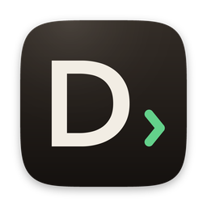
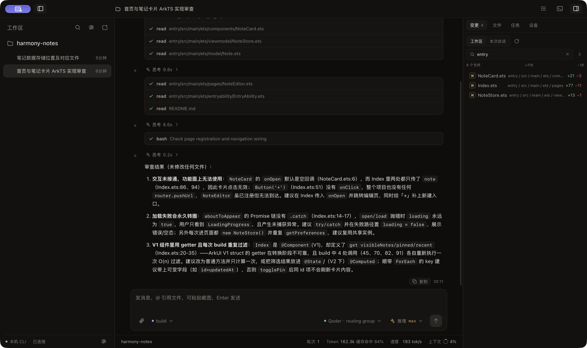
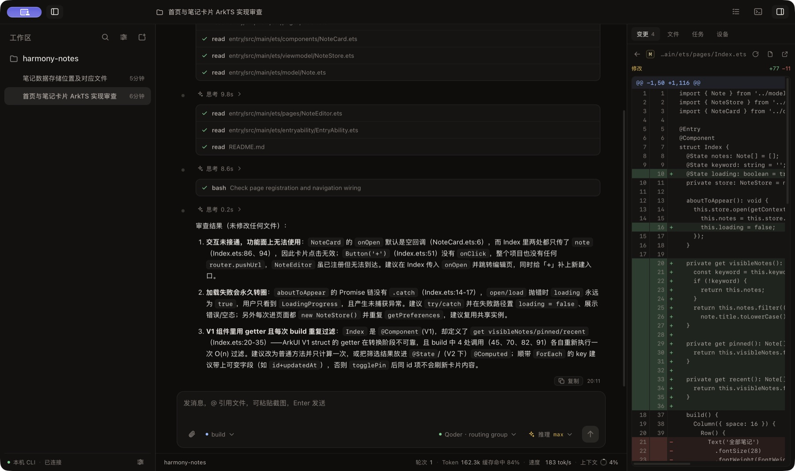
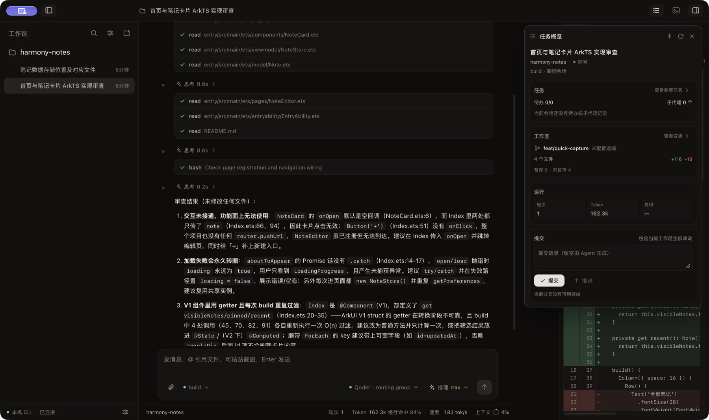
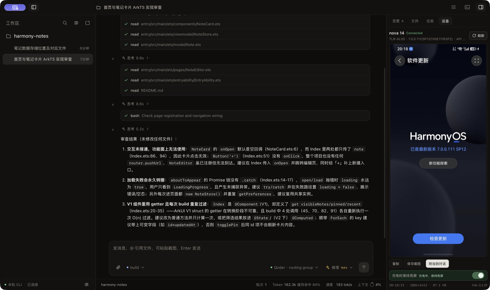
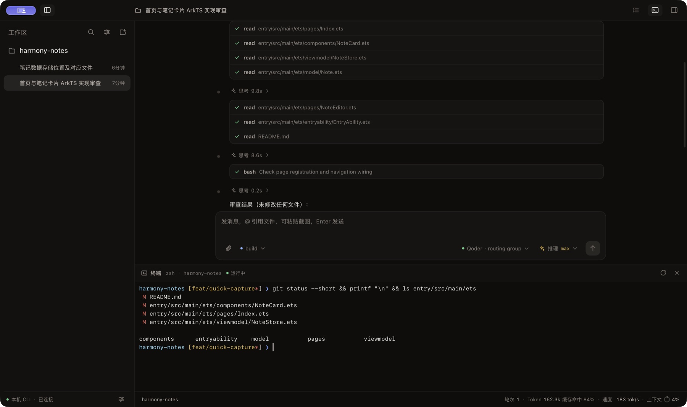
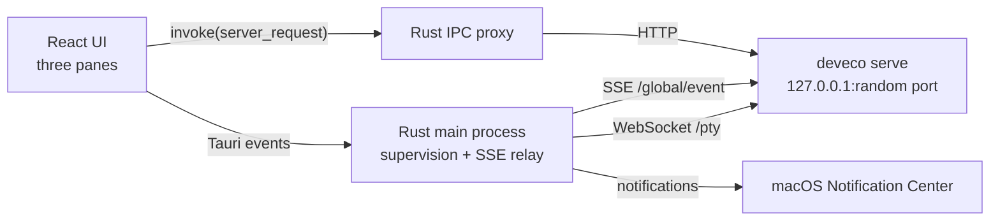

# DevEco Code Desktop



<p>
  <a href="https://github.com/SherlockGougou/devecocode-desktop/actions/workflows/ci.yml"></a>
  <a href="https://github.com/SherlockGougou/devecocode-desktop/actions/workflows/codeql.yml"></a>
  <a href="https://github.com/SherlockGougou/devecocode-desktop/actions/workflows/release.yml"></a>
  <a href="https://github.com/SherlockGougou/devecocode-desktop/releases"></a>
  <a href="LICENSE"></a>
</p>

<p>
  <strong>English</strong> · <a href="README.md">简体中文</a>
</p>

A macOS desktop client for the local
[DevEco Code CLI](https://www.npmjs.com/package/@deveco/deveco-code), a HarmonyOS-focused
downstream of opencode. It drives the CLI's HTTP + SSE contract and provides a custom
three-pane interface, notifications, workspace/session management, and file and device
panels.

> Early development. macOS is the only tested platform. The Standard build requires a
> separately installed and signed-in CLI; the Offline build bundles a pinned CLI.

[GitHub repository](https://github.com/SherlockGougou/devecocode-desktop) ·
[Installation and usage](docs/installation.md) (Chinese) ·
[Features](docs/features.md) (Chinese) · [Architecture](docs/architecture.md) (Chinese) ·
[Development](docs/development.md) (Chinese) ·
[Known limitations](docs/limitations.md) (Chinese) ·
[Release checklist](docs/release.md) (Chinese) ·
[Changelog](CHANGELOG.md) (Chinese) ·
[GitHub workflows](docs/github.md) (Chinese) ·
[Implementation log](docs/archive/implementation-log.md) (Chinese)



Screenshots come from a real build and the local CLI. The demo workspace is a local
`harmony-notes` project and does not contain private repositories, real sessions, or user
paths.

## What this is

- **A desktop layer, not another agent.** Models, tool execution, permissions, MCP,
  skills, and session data are owned by the CLI.
- **A custom interface, not the official web UI.** The React frontend talks to the CLI
  through a Rust IPC proxy. The official web UI is no longer exposed.
- **Follows the CLI contract.** The Standard build drives the local CLI; the Offline build
  bundles a pinned CLI. Neither build parses the CLI database, so an Offline build needs a
  new desktop release to upgrade its CLI.
- **macOS first.** The current implementation covers windows, the menu bar, notifications,
  Quick Look, HDC screenshots, and a custom titlebar drag region.

## Features

- **Workspaces and sessions:** a multi-workspace sidebar with independent expansion,
  lazy loading, search, sorting, archiving, renaming, and deletion. Running sessions show
  a spinner; finished sessions that have not been opened show an unread dot.
- **Conversation experience:** streaming Markdown, collapsible reasoning, grouped tool
  calls, subagent/todo progress, permission cards, in-session search, and stop
  generation. Local images in Markdown and image attachments returned by tools render
  inline, with image reads shown as a "已查看 N 张图像" row and a clickable thumbnail;
  failures fall back to readable placeholders. Clicking an image opens a large viewer
  with zoom, pan, multi-image navigation, and a shared-element transition; the context
  menu can copy or save the image. Enter queues a message while a turn is
  running; `⌘Enter` steers it. Stopping pauses the queue. Stale tools/reasoning after an abnormal stop are shown as interrupted
  instead of spinning forever; leftover in-progress todos in an idle session are also
  shown as interrupted. The left side of the transcript shows one marker per user turn;
  hover to expand the turn list and jump between turns, and use the latest-message button
  when scrolled up. Consecutive assistant steps in the same `HH:mm` minute are grouped,
  with one shared copy action at the end of the group.
- **Session permissions:** a Composer selector switches the current session between
  "follow agent", "ask every time", and "full access" for commands, files outside the
  workspace, and network requests. New sessions follow the agent unless you choose a mode;
  explicit choices are stored on the session only. CLI config files are untouched and hard
  Agent deny rules still apply. Custom session rules are shown as such and require
  confirmation before a mode switch; switching agents is disabled while a turn is running.
- **Message editing:** user messages can be edited and resent in place. The app first uses
  the CLI `revert` to restore the workspace state before that message, then permanently
  removes the old message and everything after it on the next prompt. The original
  agent/model is reused. The app asks for confirmation and exposes recovery when an
  external revert is detected.
- **Status bar:** turns, total tokens, cache hits, context usage, and output speed (TPS).
  Hover for uncached input, output, reasoning, and cache details.
- **Composer:** model, agent, reasoning effort, slash commands, `@` file references, file
  attachments, pasted screenshots, and a queue/steer tray while a turn is running.
- **Right panel:** workspace/session diff sources, directory grouping, a unified diff
  viewer, a lazy file tree, file search, system preview, task details, and HarmonyOS
  device screenshots.
- **Bottom terminal:** open it from the titlebar button or `⌘J`. It starts a local shell in
  the current workspace and supports input, scrolling, resizing, clearing, restarting, and
  cleanup. Rust owns the PTY and WebSocket connection.
- **Agent device capability:** a bundled `deveco-desktop-device` skill lets the agent
  discover devices through HDC, take screenshots, inspect layouts, tap/swipe/type, install
  and launch apps, and collect device logs.
- **CLI configuration center:** global or current-workspace scope for models, providers,
  MCP, agents, commands, permissions, skills, plugins, runtime options, and advanced
  JSONC. Saving reloads the CLI and rolls back on failure.
- **Task overview:** branch, ahead/behind, file stats, tokens/cost, and explicit commit
  and push actions.
- **In-app updates:** checks GitHub Releases after launch and lets the user confirm the
  download and install. The Standard and Offline builds use separate manifests; updating
  the Offline build also replaces its bundled CLI.
- **macOS integration:** menu bar residency, native menus, notifications, window state
  restoration, and a global context menu.
- **Reliability:** live backend supervision, crash recovery, process-group cleanup, proxy
  health checks, and `/global/event` subscriptions.

See [Features](docs/features.md) (Chinese) for details.

## Screens

| Changes and diff | Task overview |
| --- | --- |
|  |  |
| Workspace/session diff sources, file filtering, and a unified diff viewer | Branch, change stats, tokens/cost, and explicit commit/push |

| Device panel | Bottom terminal |
| --- | --- |
|  |  |
| HDC discovery, refresh, copy, save, or attach a screenshot to the conversation | A local shell in the current workspace; Rust owns the PTY and WebSocket |

## Getting started

### Requirements

- macOS 12+
- Node.js 20+
- Rust 1.77+
- An installed and signed-in DevEco Code CLI:

```bash
npm i -g @deveco/deveco-code
deveco providers   # or: deveco auth
deveco --version
```

### Install and run

```bash
npm install
npm --prefix ui install
npm run dev
```

Development mode starts a local `deveco serve` automatically. On first launch, macOS may
ask for Documents-folder and notification permissions.

### Homebrew

If Homebrew is installed, use the dedicated tap:

```bash
brew trust sherlockgougou/tap
brew install --cask sherlockgougou/tap/devecocode-desktop
# Or the Offline build with a bundled CLI
brew install --cask sherlockgougou/tap/devecocode-desktop-offline
```

The tap verifies the DMG separately for Apple Silicon and Intel. The current build is
ad-hoc signed and not notarized. On first launch, right-click the app and choose Open, or
allow it under System Settings → Privacy & Security.
[Tap source and notes](https://github.com/SherlockGougou/homebrew-tap)

### Build

```bash
npm run build:debug   # debug .app for local verification
npm run build         # release .app / .dmg
npm run build:offline # Offline build with a pinned CLI
```

Artifacts are written under `src-tauri/target/<profile>/bundle/`. Quit the old process
before opening a new bundle. See [Offline packaging](docs/offline-packaging.md) (Chinese)
for CLI resource preparation and acceptance.

## Quality checks

```bash
npm run check
npm run check:selftest
```

`check` runs TypeScript type checking, a Vite build, and all Rust unit tests.
`check:selftest` starts a real `deveco serve` and verifies CLI discovery, proxy reads and
writes, `/global/event`, notification policy, crash recovery, and process-group cleanup.
It does not call a model and does not consume tokens.

Read [Development](docs/development.md) (Chinese) before publishing or opening a PR.

## CI and releases

- `.github/workflows/ci.yml` runs the frontend build, version consistency, Rust formatting,
  Clippy, unit tests, and Offline resource generation for both architectures on push and
  pull request.
- `.github/workflows/codeql.yml` scans Rust, JavaScript/TypeScript, and GitHub Actions on
  push, pull request, and a weekly schedule.
- `.github/workflows/dependency-review.yml` reviews dependency changes in pull requests
  and blocks high-severity vulnerabilities.
- `.github/workflows/security.yml` runs RustSec `cargo audit` on Cargo changes, weekly, and
  on demand. The Linux-only `glib` exception is documented in the workflow.
- `.github/dependabot.yml` checks root npm, UI npm, Cargo, and GitHub Actions every week.
  Dependabot security updates are enabled.
- `.github/workflows/dependabot-automerge.yml` enables squash auto-merge for patch/minor
  updates after the 7 required checks pass. Major and unknown update types stay manual.
- `.github/workflows/release-check.yml` manually validates version consistency, bilingual
  release notes, and placeholders. `npm run release:prepare -- 0.2.6` updates all four
  version files.
- `.github/workflows/release.yml` builds Apple Silicon and Intel DMGs plus the Offline
  build on a `v*` tag or manual run. Publishing is draft-first: the Standard build, Offline
  build, bilingual notes, `SHA256SUMS.txt`, and both updater manifests must all exist
  before the release becomes public.
- Update bundles use a self-managed Ed25519 key supplied by
  `TAURI_SIGNING_PRIVATE_KEY` in CI, with the public key pinned in the app. Releases also
  include `latest.json`, `latest-offline.json`, `.app.tar.gz`, and `.sig` assets.
- Release assets include `SHA256SUMS.txt` and GitHub artifact attestations. Release
  immutability keeps published tags and assets unchanged.
- The `main` and `v*` rulesets require PRs, CI, CodeQL, and Dependency Review for `main`;
  release tags reject updates, deletion, and force pushes.
- `.github/workflows/labeler.yml` adds `frontend`, `rust`, `docs`, and `ci` labels based on
  changed paths.
- `.github/workflows/pages.yml` deploys the website to GitHub Pages.
- `.github/workflows/update-homebrew.yml` updates the
  [Homebrew tap](https://github.com/SherlockGougou/homebrew-tap) after a successful
  release. It can be re-run manually with a `v*` tag.
- Releases are not Developer ID signed or notarized. See
  [Installation and usage](docs/installation.md) (Chinese) for checksum and first-launch
  instructions.

See [GitHub workflows](docs/github.md) (Chinese) for the full workflow, ruleset, and
security-scan list.

## Architecture



The frontend never connects to `127.0.0.1` directly. All requests go through the Rust
proxy, which avoids CORS/ATS issues and keeps the port, optional password, and backend
recovery state on the Rust side.

Main directories:

```text
ui/          React + TypeScript + Vite
src-tauri/   Tauri 2 / Rust desktop shell and CLI integration
docs/        Current docs, development guide, and history
.github/     CI, issue, and pull request templates
scripts/     Release and maintenance scripts
website/     Static website and GitHub Pages content
```

See [Architecture](docs/architecture.md) (Chinese) for startup, process-group cleanup,
event contracts, and directory ownership.

Install from [GitHub Releases](https://github.com/SherlockGougou/devecocode-desktop/releases)
or follow [Installation and usage](docs/installation.md) (Chinese).

## Data and privacy

The app has no built-in telemetry or remote service. Business requests go to the local CLI
by default:

- App configuration: `~/Library/Application Support/DevEco Code Desktop/config.json`
- Device screenshots: `~/Library/Application Support/DevEco Code Desktop/device-shots/`
- Logs: `~/Library/Logs/DevEco Code Desktop/app.log`
- Agent device skill: `~/.config/deveco/skills/deveco-desktop-device/` (managed by the
  desktop app; the Offline build writes to its isolated CLI config directory)

The CLI owns its configuration and session data under `~/.config/deveco/` and
`~/.local/share/deveco/`. The desktop app can read and write the global `deveco.jsonc` and
project `.deveco/deveco.jsonc` after explicit user action: it checks the file hash, keeps
the latest 10 backups, replaces atomically, and reloads through the CLI dispose endpoint.
Secrets are masked by default. The desktop app does not parse the CLI SQLite database, and
the device skill only installs content with its management marker.

Commit, push, and device screenshots are explicit user actions. See
[Architecture](docs/architecture.md) (Chinese) and
[Known limitations](docs/limitations.md) (Chinese) for the security model and current CSP.

## Known limitations

- macOS only for now; there is no Universal binary, Developer ID signature, or
  notarization. In-app updates use a self-managed Ed25519 key, not an Apple identity.
- The CLI may block while the screen is locked; notification clicks only focus the window.
- Permission cards require `permission: ask` on the CLI side, or the current session can be
  switched to "ask every time". New sessions follow the Agent unless a mode is explicitly
  chosen. The device panel and agent device skill require developer mode, debugging
  authorization, and `hdc`.
- Saving CLI configuration reloads the instance and may interrupt running tasks. Project
  scope requires selecting a workspace first.
- Message editing only covers user messages with text/attachments. It cannot be undone,
  restoring files may overwrite later uncommitted changes, and consumed tokens/cost are
  not guaranteed to be refunded.
- Plugins are configuration entries only; the app does not run npm installs. File-based
  agents/commands remain read-only.
- The app does not expose the official web UI or multi-tab sessions. The Standard build
  does not bundle the CLI; the Offline build bundles a pinned CLI.

See [Known limitations](docs/limitations.md) (Chinese) for the complete list.

## Contributing

- Read [CONTRIBUTING](CONTRIBUTING.md) (Chinese) and
  [Development](docs/development.md) (Chinese) before submitting.
- Report vulnerabilities privately according to [SECURITY](SECURITY.md); do not publish
  exploitable details in a public issue.
- Keep `README.md`, `README.en.md`, and `docs/` in sync with behavior changes, and state
  what was actually verified and what remains untested in the PR.

## License and notices

This project is released under the [MIT License](LICENSE).

DevEco Code Desktop is a community project and is not affiliated with Huawei or the
DevEco team. DevEco, HarmonyOS, and related names and marks belong to their respective
owners. `@deveco/deveco-code` and third-party dependencies keep their own licenses and are
not relicensed by this repository.
