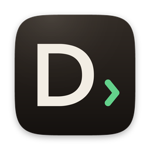
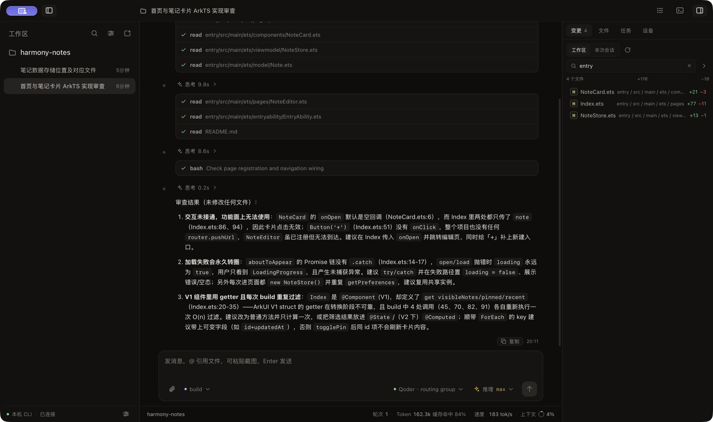
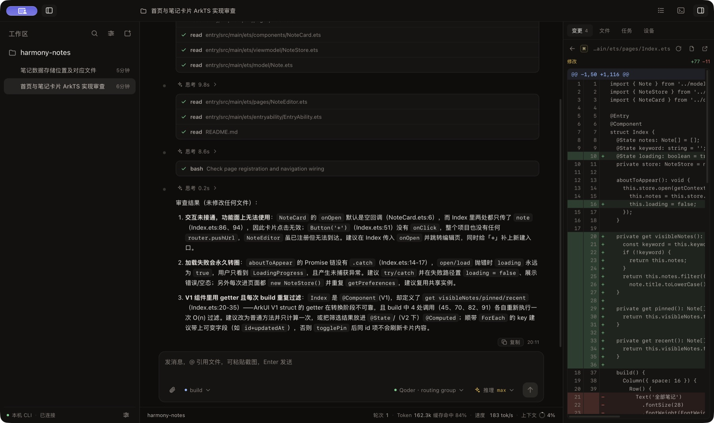
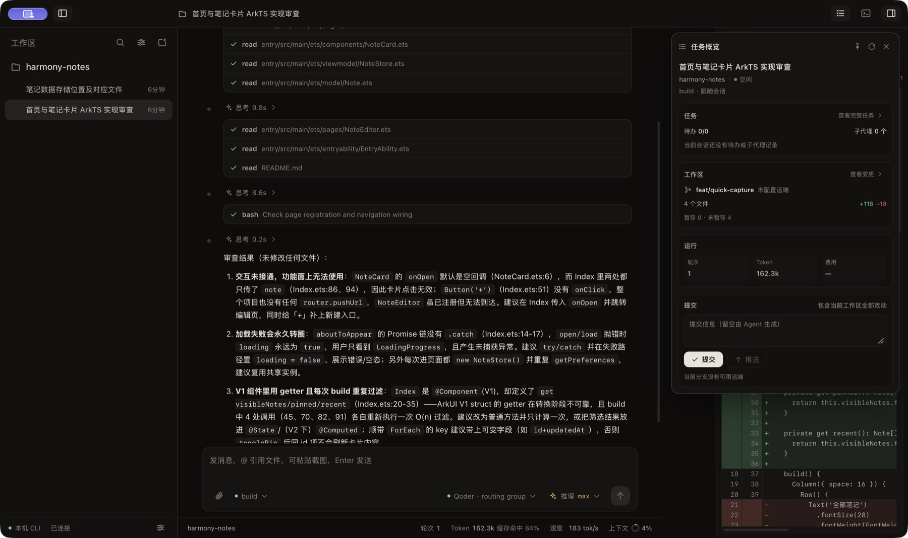
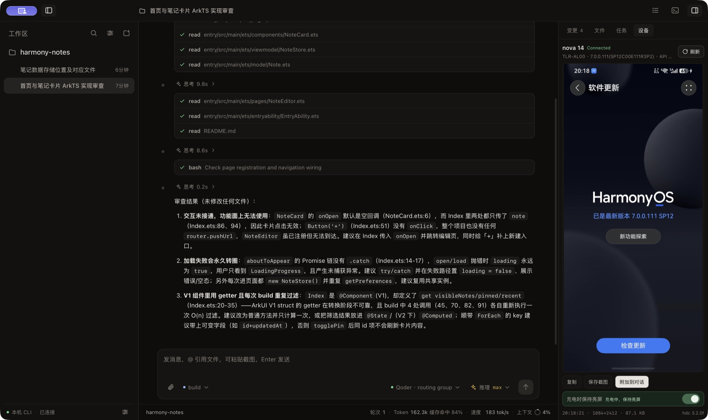
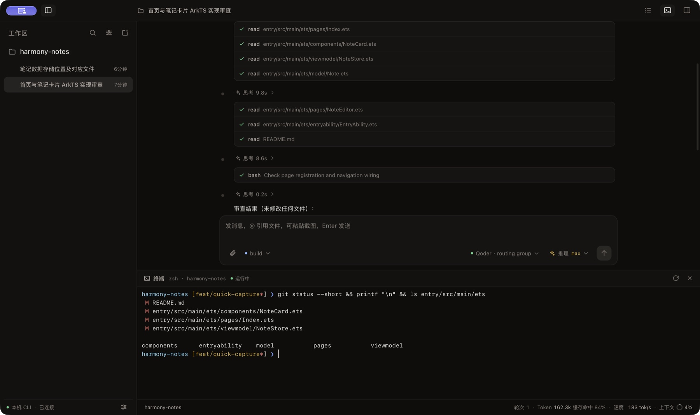
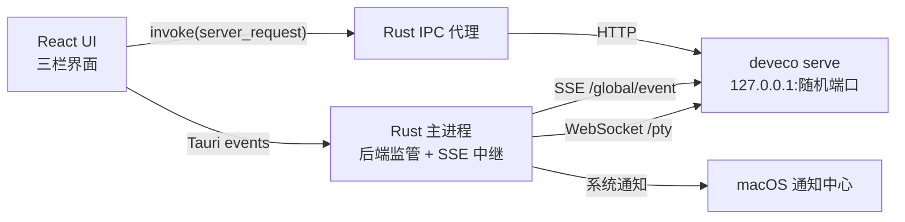

# DevEco Code Desktop



<p>
  <a href="https://github.com/SherlockGougou/devecocode-desktop/actions/workflows/ci.yml"></a>
  <a href="https://github.com/SherlockGougou/devecocode-desktop/actions/workflows/codeql.yml"></a>
  <a href="https://github.com/SherlockGougou/devecocode-desktop/actions/workflows/release.yml"></a>
  <a href="https://github.com/SherlockGougou/devecocode-desktop/releases"></a>
  <a href="LICENSE"></a>
</p>

<p>
  <a href="README.en.md">English</a> · <strong>简体中文</strong>
</p>

面向 macOS 的 DevEco Code 桌面客户端。它驱动本机
[DevEco Code CLI](https://www.npmjs.com/package/@deveco/deveco-code)（opencode 的
HarmonyOS 定制分支）的 HTTP + SSE 契约，提供自研三栏界面、系统通知、工作区/会话管理、
文件与设备面板。

> 早期开发中，当前只验证 macOS。普通版需要自行安装并登录 CLI；Offline 版内置固定版本 CLI。

[GitHub 仓库](https://github.com/SherlockGougou/devecocode-desktop) ·
[安装与使用](docs/installation.md) · [功能说明](docs/features.md) · [架构说明](docs/architecture.md) ·
[开发指南](docs/development.md) · [已知限制](docs/limitations.md) ·
[开源发布检查](docs/release.md) · [更新记录](CHANGELOG.md) ·
[GitHub 能力](docs/github.md) ·
[实现记录](docs/archive/implementation-log.md)



截图来自真实构建与本机 CLI。演示工作区为本地 `harmony-notes` 项目，不包含私有仓库、
真实会话数据或用户路径。

## 项目定位

- **桌面增强层，不是新的 Agent。** 模型、工具执行、权限、MCP、Skills 和会话数据都由
  CLI 负责。
- **自研界面，不复用官方 Web UI。** React 前端通过 Rust IPC 代理访问 CLI，官方 Web UI
  不再提供入口。
- **跟随 CLI 契约。** 普通版驱动本机 CLI；Offline 版内置固定版本 CLI。两者都不解析 CLI
  数据库，Offline 版升级 CLI 需要更新桌面端。
- **macOS 优先。** 当前覆盖窗口、菜单栏、通知、Quick Look、HDC 截图和自绘标题栏拖动。

## 主要能力

- 工作区与会话：多工作区侧栏（独立展开/收起）、懒加载、搜索、排序、归档、重命名和删除；
  执行中的会话显示加载指示，执行结束未查看的会话显示未读圆点。
- 对话体验：流式 Markdown、思考折叠、工具调用聚合、子代理/待办进度、权限审批卡片、
  会话内查找和停止生成；执行中 Enter 排队、`⌘Enter` 引导，停止时队列暂停保留；
  异常终止后残留的工具/思考状态显示为“已中断”，不会持续转圈。
- 历史消息编辑：用户消息可原地编辑并重新发送；先由 CLI `revert` 还原该消息之前的工作区，
  下一次 prompt 会永久删除该消息及其后内容，再沿用原 Agent/模型重新请求。发送前会二次
  确认影响范围，外部 revert 状态会在会话底部提供恢复入口。
- 状态栏：轮次、Token 总量与缓存命中、上下文占用和输出速度（TPS）；悬浮查看未缓存
  输入、输出、推理与缓存明细。
- Composer：模型、Agent、推理档位、斜杠命令、`@` 文件引用、文件附件、剪贴板截图，
  以及执行中的排队/引导消息托盘。
- 右栏：工作区/会话双来源 diff、目录分组与统一 diff 查看器、懒加载文件树、搜索与系统预览、
  任务详情、HarmonyOS 设备截图。
- 底部终端：标题栏终端按钮或 `⌘J` 展开，当前工作区启动本地 Shell；支持输入、滚动、
  拖高、清屏/重开和关闭回收，PTY 与 WebSocket 连接都由 Rust 管理。
- Agent 设备能力：应用内嵌 `deveco-desktop-device` skill，让 Agent 能通过 HDC 发现设备、
  截图、检查布局、点击/滑动/输入、安装启动和采集设备日志。
- CLI 配置中心：全局或当前工作区作用域，覆盖模型、Provider、MCP、Agent、Command、
  权限、Skills、Plugins、运行参数和高级 JSONC；保存后重载 CLI，失败自动回滚。
- 任务概览：分支、ahead/behind、文件统计、Token/费用，以及显式提交和推送。
- macOS 集成：菜单栏常驻、原生菜单、系统通知、窗口状态恢复和全局右键菜单。
- 可靠性：实时后端监管、崩溃自愈、进程组回收、代理健康检查和 `/global/event` 订阅。

详细行为见[功能说明](docs/features.md)。

## 界面一览

| 变更与 diff | 任务概览 |
| --- | --- |
|  |  |
| 工作区/会话双来源 diff、文件筛选与统一 diff 查看器 | 分支、改动统计、Token/费用，以及显式提交和推送 |

| 设备面板 | 底部终端 |
| --- | --- |
|  |  |
| HDC 发现设备，刷新、复制、保存截图或附加到对话 | 当前工作区本地 Shell，PTY 与 WebSocket 都由 Rust 管理 |

## 快速开始

### 前置条件

- macOS 12+
- Node.js 20+
- Rust 1.77+
- 已安装并登录 DevEco Code CLI：

```bash
npm i -g @deveco/deveco-code
deveco providers   # 或 deveco auth
deveco --version
```

### 安装与运行

```bash
npm install
npm --prefix ui install
npm run dev
```

开发模式会自动拉起本机 `deveco serve`。第一次启动时，macOS 可能请求文稿目录和通知权限。

### Homebrew

已安装 Homebrew 可以直接使用独立 tap：

```bash
brew trust sherlockgougou/tap
brew install --cask sherlockgougou/tap/devecocode-desktop
# 或带内置 CLI 的 Offline 版
brew install --cask sherlockgougou/tap/devecocode-desktop-offline
```

tap 按 Apple Silicon / Intel 分别校验 DMG。当前发布包仍是 ad-hoc 签名、未公证；
首次打开请右键应用选择“打开”，或到“系统设置 → 隐私与安全性”放行。
[tap 源码与说明](https://github.com/SherlockGougou/homebrew-tap)

### 构建

```bash
npm run build:debug   # debug .app，适合本地验证
npm run build         # release .app / .dmg
npm run build:offline # 含固定版本 CLI 的离线版
```

产物位于 `src-tauri/target/<profile>/bundle/`。打包后需要退出旧进程再重新打开。
离线版的 CLI 资源准备和验收见[离线版打包](docs/offline-packaging.md)。

## 质量检查

```bash
npm run check
npm run check:selftest
```

`check` 包含 TypeScript 类型检查、Vite 构建和全部 Rust 单测。
`check:selftest` 会真实拉起 `deveco serve`，验证 CLI 定位、代理读写、`/global/event`、
通知策略、崩溃自愈和进程组回收；它不调用模型，不消耗 token。

发布和 PR 前还请阅读[开发指南](docs/development.md)。

## 持续集成与发布

- `.github/workflows/ci.yml` 在 push 和 pull request 上运行前端构建、版本一致性、Rust
  格式、Clippy 和单测。
- `.github/workflows/codeql.yml` 在 push、pull request 和每周计划任务中扫描 Rust、
  JavaScript/TypeScript 与 GitHub Actions。
- `.github/workflows/dependency-review.yml` 在 pull request 中检查依赖变更，阻断高危漏洞。
- `.github/workflows/security.yml` 在依赖变更、每周计划任务和手动触发时运行 RustSec
  `cargo audit`；Linux-only 的 `glib` 例外在 workflow 中注明。
- `.github/dependabot.yml` 每周检查组依赖更新，覆盖根 npm、UI npm、Cargo 和 GitHub Actions；
  Dependabot security updates 已启用。
- `.github/workflows/dependabot-automerge.yml` 对 patch/minor 更新在 7 项必需检查通过后
  自动 squash 合并；major 和未知类型继续人工处理。
- `.github/workflows/release-check.yml` 手动检查版本一致性、双语 Release notes 和占位符；
  `npm run release:prepare -- 0.2.2` 同步四个版本文件。
- `.github/workflows/release.yml` 在推送 `v*` 标签或手动触发时构建 Apple Silicon 与 Intel
  两种 DMG，并额外构建包含固定 CLI 的 Offline 版本。发布使用 draft-first：普通版、
  Offline 版、双语 notes 和 `SHA256SUMS.txt` 全部完成后才公开。
- 发布资产生成 `SHA256SUMS.txt` 和 GitHub artifact attestation；仓库设置应启用
  Release immutability，使已发布的 tag 和资产不可再修改。
- `main` 与 `v*` 的 ruleset 已配置：主分支要求 PR、CI、CodeQL 和 Dependency Review；
  发布标签限制更新、删除和 force push。
- `.github/workflows/labeler.yml` 按改动路径给 pull request 添加 `frontend`、`rust`、
  `docs` 和 `ci` 标签。
- `.github/workflows/pages.yml` 在官网源码更新时部署到 GitHub Pages。
- `.github/workflows/update-homebrew.yml` 在 Release 成功后更新
  [Homebrew tap](https://github.com/SherlockGougou/homebrew-tap)；失败可用 `v*` 标签手动重跑。
- 发布包不做 Developer ID 签名，不做公证；下载校验和首次放行步骤见
  [macOS 安装与使用](docs/installation.md)。

工作流、ruleset、安全扫描和发布操作的完整清单见
[GitHub 能力与工作流](docs/github.md)。

## 架构概览



前端不直连 `127.0.0.1`：所有请求经 Rust 代理，避免 CORS/ATS，并让端口、可选口令和后端
自愈状态只停留在 Rust 侧。

主要目录：

```text
ui/          React + TypeScript + Vite
src-tauri/   Tauri 2 / Rust 桌面壳与 CLI 集成
docs/        当前文档、开发指南和历史记录
.github/     CI、issue 与 pull request 模板
scripts/     发布辅助脚本
website/     静态官网与 GitHub Pages 部署内容
```

后端启动链路、进程组回收、事件契约和目录职责见[架构说明](docs/architecture.md)。

从 [GitHub Releases](https://github.com/SherlockGougou/devecocode-desktop/releases)
下载安装的步骤见[macOS 安装与使用](docs/installation.md)。

## 数据与隐私

应用不内置遥测或远程服务。业务请求默认只到本机 CLI：

- 应用配置：`~/Library/Application Support/DevEco Code Desktop/config.json`
- 设备截图：`~/Library/Application Support/DevEco Code Desktop/device-shots/`
- 日志：`~/Library/Logs/DevEco Code Desktop/app.log`
- Agent 设备 skill：`~/.config/deveco/skills/deveco-desktop-device/`（桌面端管理；
  Offline 版写入其隔离的 CLI 配置目录）

CLI 自己的配置与会话数据位于 `~/.config/deveco/` 与 `~/.local/share/deveco/`，由 CLI 管理。
桌面端可以按用户操作读写全局 `deveco.jsonc` 和项目 `.deveco/deveco.jsonc`：写入前校验
文件 hash、保存最近 10 份备份并原子替换，写入后通过 CLI 的 dispose 接口重载；密钥默认
脱敏显示。桌面端不解析 CLI 的 SQLite 数据库，设备 skill 只安装带管理标记的内容。

提交、推送和设备截图均为用户显式操作。安全模型与当前 CSP 状态见
[架构说明](docs/architecture.md)和[已知限制](docs/limitations.md)。

## 已知限制

- 仅验证 macOS，尚无 Universal 二进制、正式签名、公证和自动更新。
- 锁屏时 CLI 可能阻塞；通知点击只能聚焦窗口。
- 权限卡片需要 CLI 侧 `permission: ask`；设备面板和 Agent 设备 skill 需要开发者模式、
  调试授权和 `hdc`。
- 保存 CLI 配置会重载实例，正在运行的任务可能被中断；Project 作用域必须先选择工作区。
- 历史消息编辑只支持用户消息和文本/附件内容；发送后不可撤销，文件还原可能覆盖之后的
  未提交修改，且不保证退还已消耗的 token/费用。
- Plugin 只编辑配置入口，不执行 npm 安装；文件型 Agent/Command 保持只读。
- 本应用不提供官方 Web UI 入口或多 Tab；普通版不内置 CLI，Offline 版内置固定版本 CLI。

完整列表见[已知限制](docs/limitations.md)。

## 参与贡献

- 提交前阅读[贡献指南](CONTRIBUTING.md)和[开发指南](docs/development.md)。
- 漏洞请按[安全策略](SECURITY.md)私密报告，不要公开提交可利用细节。
- 行为变化同步更新 `README.md` 与 `docs/`，并在 PR 中写明实际验证和未验证项。

## 许可证与声明

本项目以 [MIT License](LICENSE) 发布。

DevEco Code Desktop 是社区项目，与华为、DevEco 官方无隶属关系。DevEco、HarmonyOS 及相关
名称和标识归各自权利人所有。`@deveco/deveco-code` 及第三方依赖遵循各自许可证，不随本仓库
重新授权。
