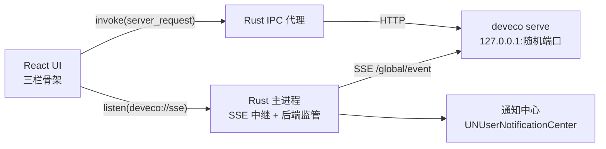

# DevEco Code Desktop

把本机的 [DevEco Code CLI](https://www.npmjs.com/package/@deveco/deveco-code)（opencode 的 HarmonyOS 定制分支）
包成 macOS 桌面应用。**自研 DSH 式界面**，直接驱动 CLI 的 HTTP + SSE 契约（官方 Web UI 不再提供入口）。

## 结构

```
ui/                       React + TypeScript 前端（Vite）
  src/App.tsx             标题栏 + 三栏骨架 + 顶栏拖动 + 原生菜单事件
  src/contextMenu.tsx     全局右键菜单宿主、场景菜单项与编辑/键盘操作
  src/components/         Sidebar / ChatView / Composer / StatusBar / RightPanel / Settings / Shortcuts / Markdown / Icon
  src/components/Icon.tsx 统一图标集（线性 SVG，1.75 描边，currentColor 跟随主题）
  src/mentions.ts         @ 文件引用解析与上限常量（Composer / ChatView 共用）
  src/clipboard.ts        Tauri 剪贴板读写与统一失败提示
  src/store.ts            zustand：会话、消息、权限、SSE 合并、后端状态
  src/theme.ts            主题：跟随系统 / 亮色 / 暗色（localStorage）
  src/types.ts            CLI 契约与前端状态类型
  src/api.ts              invoke 包装（全部走 Rust 代理）
src-tauri/
  src/main.rs             Tauri 主进程：窗口、托盘、菜单、单实例、通知、信号处理、SSE 中继、后端监管
  src/ipc.rs              前端 ↔ CLI 的命令桥（server_request / 设置 / 导出 / 后端状态）
  src/backend.rs          启动编排：定位 CLI → 复用或拉起 serve → 健康检查 → 项目目录
  src/supervise.rs        后端自愈状态机（就绪 / 重连 / 重建 / 失败 + 退避）
  src/http.rs             访问 CLI 的 HTTP 客户端（lib，自检程序复用）
  src/cli.rs              定位 deveco：配置 → 环境变量 → 常见路径 → login shell → PATH
  src/server.rs           拉起 serve、解析 listening、健康检查、进程组回收
  src/sse.rs              text/event-stream 解析与订阅
  src/events.rs           事件分类（授权/空闲/错误/阶段）与通知文案
  src/notify.rs           通知策略与去抖
  src/config.rs           配置：CLI 路径、通知开关、端口、可选口令
  src/windrag.rs          macOS 自绘顶栏拖动（按帧设置窗口位置）
  src/lib.rs              模块导出（主进程与自检共用）
  src/bin/selftest.rs     无头端到端自检
```



前端不直连 `127.0.0.1`：一是绕开 CORS/ATS，二是连接信息（端口、可选口令）只留在 Rust 侧。

## 界面结构（对齐 DSH Desktop）

| 区域 | 内容 |
|---|---|
| 标题栏 | 无系统标题栏（`titleBarStyle: Overlay`），红黄绿灯内嵌，自绘品牌与连接状态（已连接 / 重连中 / 后端不可用）；按住空白处可拖动窗口（macOS 由前端按帧推窗口位置，见 `docs/deveco-desktop-plan.md` 22.13），双击缩放 |
| 左栏 | 「工作区」头部（搜索 / 归档 / 新建三个图标）→ 文件夹图标的工作区行 → 展开的会话行（标题 + 相对时间，比工作区名称再缩进一级）；一次只展开一个工作区，默认先列 5 条会话并给出「展开其余 N 个会话」→ 底部「本机 CLI」与设置入口 |
| 主区 | 会话标题 + 导出；消息流（markdown、思考折叠、按步骤聚合的工具列表、生成状态）；底部 composer（含 @ 文件引用与模型选择） |
| 状态栏 | 事件流状态 · 当前工作区 · Agent · MCP 数量 · 轮次 · 步数 · token 输入/输出 · 成本 |
| 右栏 | 可折叠：变更（按文件 diff）/ 文件（目录浏览 + 搜索 + 内容预览；消息里的 `@` 文件链接直接打开这里） |
| 主题 | 跟随系统，或在设置页显式选「亮色 / 暗色」（暗色为设计基准，亮色只覆盖 CSS 变量；选择存 localStorage） |
| 图标 | 界面图标统一线性 SVG（`components/Icon.tsx`）：同一视框与描边、`currentColor` 跟随主题；尺寸按层级 14（行内）/ 15–16（常规按钮）/ 18（主操作） |
| 应用图标 | 程序化绘制（暖炭色 squircle + 暖白 D + 绿色 `>` 提示符），由 `src-tauri/icons/source.png` 生成全部平台尺寸（`tauri icon`） |
| 设置页 | `⌘,` 打开：运行状态 / 外观 / CLI 路径 / 服务端口与口令 / 通知开关 / CLI 配置只读 / 诊断（日志、配置文件、重启） |
| 原生菜单 | `⌘N` 新建会话、`⌘E` 导出当前会话、`⌘,` 设置、`⌘⇧B` 切换右栏、`⌘/` 快捷键、`⌘R` 重载界面，含标准编辑菜单与窗口菜单 |
| 右键菜单 | 自绘统一菜单；按工作区 / 会话 / 消息 / 代码 / 工具 / 文件 / 输入框 / 空白区展示不同动作，替换 WebView 默认菜单 |
| 窗口 | 大小/位置自动记忆；标题跟随「会话 · 项目」 |

权限审批以卡片形式出现在对话流末尾：允许一次 / 总是允许 / 拒绝。

## 构建与运行

```bash
npm install                 # 仓库根：拿 tauri CLI
npm --prefix ui install     # 前端依赖
npm run dev                 # 开发模式（自动拉起本机 deveco serve）
npm run build:debug         # 出 .app（自用就直接拷进 /Applications）
npm run build               # 出 release .app / .dmg
npm run check               # 本地护栏：前端构建 + 全部单测
npm run check:selftest      # 端到端自检（需要解锁的桌面会话，见「已知限制」）
```

前置条件：Node.js 20+、Rust 1.77+；本机已安装 CLI（`npm i -g @deveco/deveco-code`），并已通过
`deveco providers`（别名 `deveco auth`）登录过。

## 自测

```bash
cargo test --manifest-path src-tauri/Cargo.toml        # 单元测试
cargo run --manifest-path src-tauri/Cargo.toml --bin deveco-selftest   # 端到端
```

自检不打开窗口、不消耗模型 token，退出码 0 表示全链路通过。
日常改完代码先跑 `npm run check`（前端构建 + 40 项单测，几秒出结果），
再按需跑 `npm run check:selftest`（会真实拉起 serve，约 10s）。

| 检查 | 说明 |
|---|---|
| 发现 CLI | 打印路径与版本 |
| 拉起 serve | 随机空闲端口，实测约 1.6–1.8s 就绪 |
| 健康检查 /api/health | — |
| 读取 /api/location | 通知文案用的项目目录 |
| 代理读写路径 | POST 建会话 → POST `prompt_async` → 轮询 GET 读消息 → DELETE 清理 |
| 订阅 /global/event | 收到 `server.connected` |
| 授权事件分类 / 文案 / 策略 / 去抖 | 用真实事件格式构造 |
| 崩溃自愈 | `SIGKILL` 掉 serve 进程组 → 重建后端 → 健康检查恢复 |
| 启动失败清理 | 用「serve 立即退出」的假 CLI，验证 15s 内失败、原因可读、进程组登记已清理 |
| 退出回收 | serve 子进程组停止响应 |

最近一次结果：**40 个单测 + 13 项自检全部通过**（2026-11-07，macOS 27.2 / CLI 0.2.5；
serve 1.6s 就绪、崩溃自愈 1.6s、退出回收 10ms）。

真实模型流式对话已实测（临时工作区，多次 `prompt_async`）：思考过程实时滚动、正文逐字到达、
状态栏计数同步、任务结束后自动刷新右侧变更。

## 踩过的坑（都已修，写下来避免重犯）

1. **`/event` 是实例级的**：它只推送 `deveco serve` 启动目录那一个工作区的事件。
   切换工作区后会话事件全部收不到——必须订阅 `/global/event`，它把所有工作区的事件
   多路复用，外层包成 `{ directory, project, payload }`。
2. **`--port 0` 无效**：CLI 会当成「未指定」落到默认 4096，必须应用侧先挑空闲端口。
3. **launcher 会留孤儿**：`deveco` 是 node 包装脚本，只杀它会留下 161MB 原生二进制继续占端口，
   必须按进程组发信号（含 `SIGTERM/SIGINT/SIGHUP` 兜底）。
4. **路径要规范化**：macOS 上 `/tmp` → `/private/tmp`，CLI 返回的 worktree 是规范化后的路径。
5. **`noReply` 可造消息**：`POST /session/{id}/prompt_async` 带 `noReply: true` 能写入真实格式的
   用户消息且不调用模型，自检和调试靠它；204 只代表已接收，消息随后由 SSE 推送/落库。
6. **退出流程会「复活」serve**：如果监管循环不知道应用正在退出，它会把关停当成崩溃，
   在进程退出前重新拉起一个 serve。必须在 `RunEvent::Exit` 第一件事就置退出闸门。
7. **启动失败也要按进程组清理**：`kill_on_drop` 只回收 launcher，161MB 原生二进制会留下
   并占住 CLI 数据库，导致下一次启动探测直接卡死。`serve` 超时、`--version` 超时都要整组 kill。
8. **vite 的 esbuild 配置加载可能挂死**：本机出现过 `vite build` 无任何输出地卡住
   （空配置也一样），改用 `--configLoader native` 后恢复正常，已固化到 `ui/package.json`。
9. **空查询参数不能过滤**：`/find/file?query=` 的空值合法（返回工作区文件列表），
   但代理曾把空字符串参数整个丢掉，导致 400；现在只过滤 `null`。
10. **多 bin 项目 `npm run dev` 无法选入口**：新增自检 bin 后 `cargo run` 不再有唯一入口，
    Tauri dev 会报 `could not determine which binary to run`；已用 `default-run = "deveco-desktop"` 固定。
11. **同步 `/message` 会等到 agent loop 结束**：长任务必然撞上代理 30s 超时；发送统一走
    `prompt_async`（204 空响应），用户/助手消息与阶段全部由 `/global/event` 渲染。

## 后端自愈

`deveco serve` 崩溃、被升级替换或被手动 kill 时，应用不再静默失效：

- **状态机**：`启动中 → 就绪 → 重连中 → 重建中 →（成功）就绪 /（失败）后端不可用`，状态栏与标题栏实时反映。
- **自动重建**：事件流断开后先做健康检查；确认进程不可用就回收旧进程组，按原配置重新拉起（固定端口优先复用，否则挑新的空闲端口），并把新的连接信息写回 IPC 代理——前端不需要知道端口变了。
- **启动失败也可见**：CLI 缺失或后端起不来时不再卡在启动页，直接进主界面并显示提示条。
- **失败可见**：重建失败时主区顶部出现红色提示条，带「立即重试」与「诊断」两个出口；退避 1s/2s/4s/8s/15s 期间也可以随时手动重试（会打断等待立刻再试）。
- **恢复后刷新**：重新连上时自动重拉当前会话的消息、会话列表与授权列表，弥补断线期间丢失的事件。
- **退出不漏进程**：退出流程带闸门，监管循环不会在退出过程中再把服务拉起来；启动失败（如 `serve` 超时）也会按进程组清理，不留 161MB 孤儿。

验收方式（无头）：`deveco-selftest` 用 `SIGKILL` 杀掉 serve 进程组，约 1.6–1.8s 内自动恢复到新端口并通过健康检查。

## 会话与文件

- **工作区懒加载**：展开某个工作区时才拉它的会话列表；侧栏一次只展开一个工作区（手风琴），切换工作区不会卡。
- **侧栏工作区列表**：文件夹图标 + 名称的工作区行，当前工作区文件夹用蓝色描边提示；会话行比工作区名称再缩进一级，
  当前会话用圆角底块标出，正在生成时左侧圆环带旋转指示；每个工作区默认显示最近 5 条会话，其余收进「展开其余 N 个会话」。
  头部三个图标分别对应搜索、显示/隐藏归档、新建会话（均带 tooltip 与 aria-label）。
- **会话管理**：悬停显示重命名 / 归档 / 删除三个图标按钮（重命名也可双击标题；删除为行内二次确认，删当前会话会清空视图）。
- **模型选择**：composer 左下角的模型胶囊，支持搜索与切换；选定后新消息带上该模型。
- **Agent 切换**：`build / plan / debug …` 胶囊（`/agent` 的 primary 列表），选中后新消息带 `agent`。
- **推理强度**：模型带 variants 时出现档位胶囊（如 `max`），点击循环切换，随消息带 `variant`。
- **斜杠命令**：输入 `/` 弹出技能/命令列表（来自 `/command`），↑↓ 选择、Enter 插入、Esc 取消。
- **MCP 状态**：状态栏显示当前连接的 MCP server 数量（`/mcp`）。
- **文件面板**：按目录浏览（进入/返回上级），输入关键字走 `find` 搜索，点文件在面板内预览文本内容，`←` 返回列表，非文本文件给出提示。
- **全局搜索**：点侧栏头部的搜索图标展开输入框，输入后（300ms 防抖）并行查询所有工作区，未展开过的工作区也能搜到，点击结果直接跳转；Esc 或 × 关闭并清空。
- **消息复制**：悬停气泡/助手消息，在消息下方出现「复制」与时间，写入系统剪贴板；附件 chip 与用户气泡右边缘对齐。
- **全局右键菜单**：工作区可新建会话、展开/收起、复制路径、打开 Finder；会话可打开、重命名、归档、导出、复制标题/ID、删除；
  消息可复制正文，代码块/行内代码可复制代码，链接可打开或复制地址，工具卡可复制输入/输出；
  右侧文件、diff、预览可复制路径/补丁、Finder 定位并把文件引用到输入框。输入框和设置等所有可编辑控件支持
  撤销/重做/剪切/复制/粘贴/全选；菜单支持方向键、Home/End、Enter、Esc、Shift+F10，自动翻转并限制在窗口内；
  空白区域与设置/快捷键弹层也有对应菜单。
- **消息流**：同一轮里的连续助手步骤不再重复画头像，共用左侧时间线；相邻工具调用合并成一张紧凑列表，
  完成态只留绿色对勾，执行中显示旋转指示，失败自动展开输入；思考折叠显示耗时，正文生成中在末尾显示脉冲状态。
- **会话归档**：悬停会话行出现归档按钮，归档后默认从侧栏隐藏；侧栏头部的调整图标即「显示/隐藏归档」开关，开启后可看到已归档会话并取消归档。
- **停止生成**：任务执行中 composer 显示「停止」，点击后中断（外部或 CLI 触发的任务同样会显示）。
- **变更面板**：优先展示会话快照 diff，为空时自动回退到 git 工作区 diff（非 git 项目会给出提示）。
- **@ 引用文件**：输入框里打 `@`（行首或空格后）弹出工作区文件搜索，`↑↓` 选择、`Enter` 插入、`Esc` 取消；
  选中后输入框上方出现可删除的「引用」chip，发送时随消息带 `file://` file part（由 CLI 自己读盘并合成 Read 调用），
  模型无需再自行摸索路径；CLI 合成的 Read 调用文本（`synthetic: true`）不会显示在气泡里。
  发送后的消息里，`@` 引用显示为正文内的蓝色文件链接，点击在右栏「文件」中打开预览，不再额外显示同名 chip。
  路径含空格时自动写成 `@"path with space"`，最多 8 个引用。
- **快捷键面板**：`⌘/` 或「视图 → 快捷键」查看全部快捷键。
- **消息时间**：悬停消息显示发送时间；发送失败会把原文放回输入框，不用重新输入。
- **会话导出**：`⌘E` 或「文件 → 导出当前会话」，调用 `deveco export` 生成 JSON 到
  `~/Library/Application Support/DevEco Code Desktop/exports/` 并在 Finder 中定位。
- **会话内查找**：`⌘F` 打开查找条，Enter/⇧Enter 上下跳转，Esc 关闭。
- **侧栏宽度**：拖动分隔条调整（双击复位），宽度记在 localStorage。
- **附件**：输入框左下 `+` 选择文件（最多 4 个、单个 ≤8MB），转 data URL 随消息发送；
  图片/文档以可点击的附件项展示，可单个移除；消息里的上传附件点击后可在应用内预览图片或文本，
  其他类型提供下载。文本类附件由 CLI 自动内联，二进制保留 file part。

## 设置页

`⌘,` 或左栏底部的设置图标打开，`Esc` 关闭，`⌘S` 保存，`Tab` 焦点锁在面板内。

| 区块 | 内容 | 是否即时生效 |
|---|---|---|
| 运行状态 | CLI 路径/版本、服务地址、应用版本 | 只读 |
| 外观 | 主题：跟随系统 / 亮色 / 暗色 | **即时生效**（存 localStorage） |
| CLI | 可执行文件路径 + 自动探测 | 需重启 |
| 服务 | 端口偏好（0=自动挑空闲端口）、本地服务口令 | 需重启 |
| 通知 | 总开关、授权/完成/失败/阶段四类、前台静音 | **即时生效**（每次事件实时读配置） |
| CLI 配置 | 模型、小模型、权限、插件数量 | 只读（归 deveco 自己的配置管） |
| 诊断 | 打开日志目录 / 配置文件 / 重启应用 | — |

设置中的 CLI、服务与通知写入 `~/Library/Application Support/DevEco Code Desktop/config.json`；
主题选择只存在前端的 localStorage，不进入该配置文件。

## 跟随官方 CLI 更新

- 不打包 CLI，永远驱动本机那一份；`deveco upgrade` 后重启应用即可。
- 只依赖 CLI 的 HTTP + SSE 契约：`/api/health`、`/api/location`、`/project`、`/session`、
  `/session/{id}/message`、`/session/{id}/prompt_async`、`/session/{id}/abort`、`/session/{id}/diff`、
  `/permission`、`/permission/{id}/reply`、`/global/event`，以及只读的 `/api/model`、`/agent`、
  `/command`、`/mcp`、`/file`、`/file/content`、`/find/file`、`/vcs/diff`、`/config`。
- 发送消息必须走 `prompt_async`：同步 `/message` 会等到整个 agent loop 结束，长任务必然撞上代理超时；
  进度统一由 `/global/event` 推送。
- **事件流订阅 `/global/event`，不要用 `/event`**：后者只覆盖 serve 启动目录那一个实例。
- 事件侧只对四类语义做处理，未知事件忽略——上游新增事件不会打断 UI；权限事件同时兼容
  `permission.v2.asked` / `permission.v2.replied` 的字段命名。
- 端口用应用侧挑选的空闲端口 + 解析 `listening on` 行，不假设 4096。

## 已知限制

- **锁屏 / 屏幕休眠时 CLI 会挂住**：此时 `deveco --version` 与 `/session` 都不返回（实测 25s 无响应，解锁后立即恢复）。
  普通代理请求限制在 30s、CLI 探测限制在 5s；发送消息走 `prompt_async`，不占长连接，因此正常 agent 任务不会被 30s 截断。
  界面会给出可读错误而不是无限转圈，但后端自愈无法在锁屏状态下完成。
- 通知点击只能聚焦窗口，不能跳到会话，也不能在通知里直接批准。
- 托盘菜单（显示主窗口 / 隐藏到托盘 / 退出）尚未做自动化验证；托盘图标复用应用图标，未做 macOS template 单色版。
  通知在勿扰、锁屏下的表现需人工确认；通知本身已验证：权限请求会真实投递系统通知（日志「已发送通知：DevEco Code 需要授权」）。
- 主题选择存在 localStorage，不随应用配置导出；重装应用会回到「跟随系统」。
- 权限审批卡片需要 CLI 侧 `permission: ask` 才会触发（本机默认 `allow`）；已用「临时改 ask + 一条小 prompt」验证过
  卡片渲染与「允许一次」的完整链路（命令实际执行、助手继续作答），「总是允许 / 拒绝」共用同一回复通道，未单独验证。
- 工作区列表来自 CLI 的 `/project` 注册表；不存在的目录会被前端过滤，但仍存在的历史探测目录（如 `/tmp/dvt`）会出现。
- **重建 debug 包会触发 macOS 重新询问文件夹权限**：adhoc 签名变化会使 TCC 记录失效；拒绝「文稿」后
  `deveco serve` 读不到工作区并持续占用高 CPU，可用
  `tccutil reset SystemPolicyDocumentsFolder com.deveco.desktop` 后重新允许恢复。
- 顶栏拖动由前端按帧设置窗口位置实现，没有系统级贴边分屏、跨 Space 拖动；多显示器与 Retina 混插未实测。
- 仅 macOS 验证；Windows 需替换通知与 CLI 发现逻辑。
