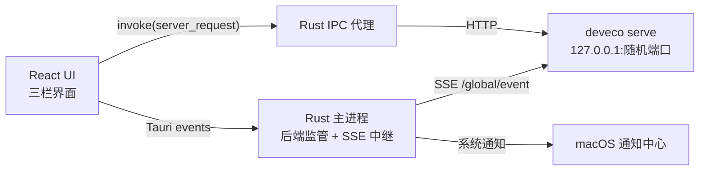

# DevEco Code Desktop


面向 macOS 的 DevEco Code 桌面客户端。它驱动本机
[DevEco Code CLI](https://www.npmjs.com/package/@deveco/deveco-code)（opencode 的
HarmonyOS 定制分支）的 HTTP + SSE 契约，提供自研三栏界面、系统通知、工作区/会话管理、
文件与设备面板。

> 早期开发中，当前只验证 macOS。CLI 不随应用打包，需自行安装并登录。

[安装与使用](docs/installation.md) · [功能说明](docs/features.md) · [架构说明](docs/architecture.md) ·
[开发指南](docs/development.md) · [已知限制](docs/limitations.md) ·
[开源发布检查](docs/release.md) · [实现记录](docs/archive/implementation-log.md)

## 项目定位

- **桌面增强层，不是新的 Agent。** 模型、工具执行、权限、MCP、Skills 和会话数据都由
  CLI 负责。
- **自研界面，不复用官方 Web UI。** React 前端通过 Rust IPC 代理访问 CLI，官方 Web UI
  不再提供入口。
- **跟随本机 CLI。** 不打包 CLI 二进制，不解析 CLI 的数据库；`deveco upgrade`
  后重启应用即可。
- **macOS 优先。** 当前覆盖窗口、菜单栏、通知、Quick Look、HDC 截图和自绘标题栏拖动。

## 主要能力

- 工作区与会话：多工作区侧栏（独立展开/收起）、懒加载、搜索、排序、归档、重命名、删除和导出。
- 对话体验：流式 Markdown、思考折叠、工具调用聚合、子代理/待办进度、权限审批卡片、
  会话内查找和停止生成。
- Composer：模型、Agent、推理档位、斜杠命令、`@` 文件引用、文件附件和剪贴板截图。
- 右栏：会话 diff / Git 变更、文件浏览与系统预览、任务详情、HarmonyOS 设备截图。
- 任务概览：分支、ahead/behind、文件统计、Token/费用，以及显式提交和推送。
- macOS 集成：菜单栏常驻、原生菜单、系统通知、窗口状态恢复和全局右键菜单。
- 可靠性：实时后端监管、崩溃自愈、进程组回收、代理健康检查和 `/global/event` 订阅。

详细行为见[功能说明](docs/features.md)。

## 快速开始

### 前置条件

- macOS 12+
- Node.js 20+
- Rust 1.77+
- 已安装并登录 DevEco Code CLI：

```bash
npm i -g @deveco/deveco-code
deveco providers   # 或 deveco auth
deveco --version
```

### 安装与运行

```bash
npm install
npm --prefix ui install
npm run dev
```

开发模式会自动拉起本机 `deveco serve`。第一次启动时，macOS 可能请求文稿目录和通知权限。

### 构建

```bash
npm run build:debug   # debug .app，适合本地验证
npm run build         # release .app / .dmg
```

产物位于 `src-tauri/target/<profile>/bundle/`。打包后需要退出旧进程再重新打开。

## 质量检查

```bash
npm run check
npm run check:selftest
```

`check` 包含 TypeScript 类型检查、Vite 构建和全部 Rust 单测。
`check:selftest` 会真实拉起 `deveco serve`，验证 CLI 定位、代理读写、`/global/event`、
通知策略、崩溃自愈和进程组回收；它不调用模型，不消耗 token。

发布和 PR 前还请阅读[开发指南](docs/development.md)。

## 持续集成与发布

- `.github/workflows/ci.yml` 在 push 和 pull request 上运行前端构建、版本一致性、Rust
  格式、Clippy 和单测。
- `.github/workflows/release.yml` 在推送 `v*` 标签或手动触发时构建 Apple Silicon 与 Intel
  两种 DMG，并自动创建 GitHub Release。
- `.github/workflows/pages.yml` 在官网源码更新时部署到 GitHub Pages。
- 发布包不做 Developer ID 签名，不做公证；安装和首次放行步骤见
  [macOS 安装与使用](docs/installation.md)。

## 架构概览



前端不直连 `127.0.0.1`：所有请求经 Rust 代理，避免 CORS/ATS，并让端口、可选口令和后端
自愈状态只停留在 Rust 侧。

主要目录：

```text
ui/          React + TypeScript + Vite
src-tauri/   Tauri 2 / Rust 桌面壳与 CLI 集成
docs/        当前文档、开发指南和历史记录
.github/     CI、issue 与 pull request 模板
scripts/     发布辅助脚本
website/     静态官网与 GitHub Pages 部署内容
```

后端启动链路、进程组回收、事件契约和目录职责见[架构说明](docs/architecture.md)。

从 GitHub Releases 下载安装的步骤见[macOS 安装与使用](docs/installation.md)。

## 数据与隐私

应用不内置遥测或远程服务。业务请求默认只到本机 CLI：

- 应用配置：`~/Library/Application Support/DevEco Code Desktop/config.json`
- 会话导出：`~/Library/Application Support/DevEco Code Desktop/exports/`
- 设备截图：`~/Library/Application Support/DevEco Code Desktop/device-shots/`
- 日志：`~/Library/Logs/DevEco Code Desktop/app.log`

CLI 自己的配置与会话数据位于 `~/.config/deveco/` 与 `~/.local/share/deveco/`，由 CLI 管理。
桌面端不直接改写 CLI 配置，也不解析其 SQLite 数据库。

提交、推送、导出和设备截图均为用户显式操作。安全模型与当前 CSP 状态见
[架构说明](docs/architecture.md)和[已知限制](docs/limitations.md)。

## 已知限制

- 仅验证 macOS，尚无 Universal 二进制、正式签名、公证和自动更新。
- 锁屏时 CLI 可能阻塞；通知点击只能聚焦窗口。
- 权限卡片需要 CLI 侧 `permission: ask`；设备面板需要开发者模式和 `hdc`。
- 本应用不提供官方 Web UI 入口、多 Tab 或内置 CLI。

完整列表见[已知限制](docs/limitations.md)。

## 参与贡献

- 提交前阅读[贡献指南](CONTRIBUTING.md)和[开发指南](docs/development.md)。
- 漏洞请按[安全策略](SECURITY.md)私密报告，不要公开提交可利用细节。
- 行为变化同步更新 `README.md` 与 `docs/`，并在 PR 中写明实际验证和未验证项。

## 许可证与声明

本项目以 [MIT License](LICENSE) 发布。

DevEco Code Desktop 是社区项目，与华为、DevEco 官方无隶属关系。DevEco、HarmonyOS 及相关
名称和标识归各自权利人所有。`@deveco/deveco-code` 及第三方依赖遵循各自许可证，不随本仓库
重新授权。
