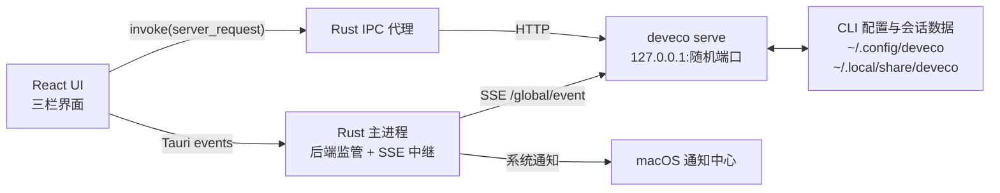
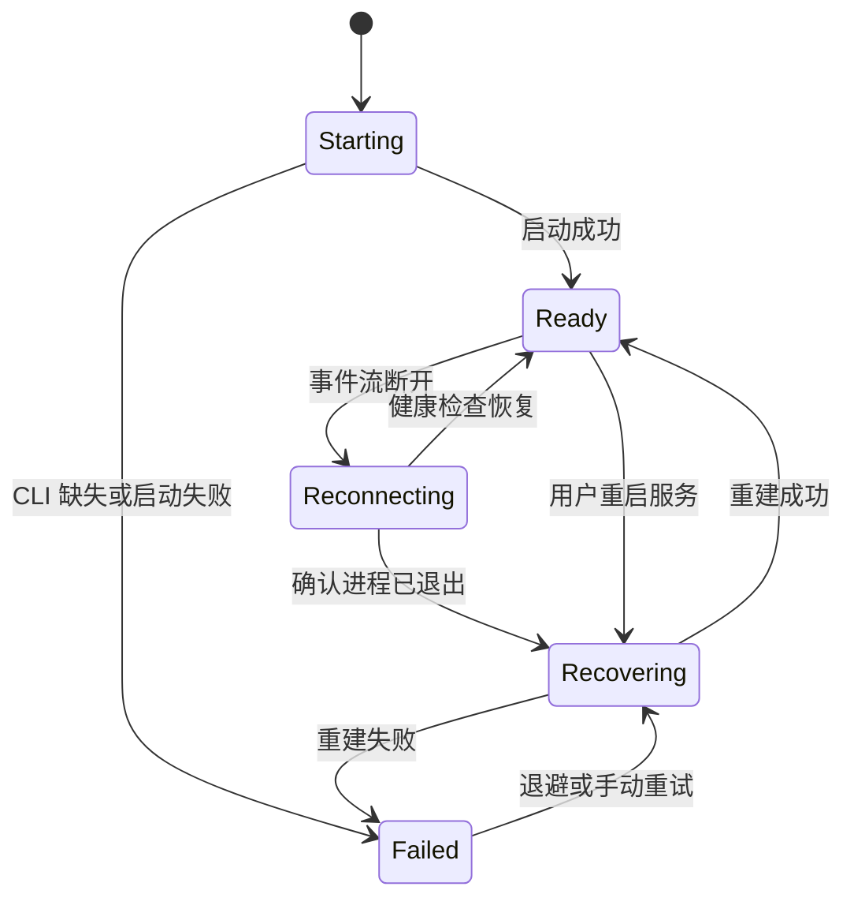

# 架构说明

## 产品边界

DevEco Code Desktop 是 macOS 上的桌面客户端，不是新的 Agent 实现：

- 本机 `deveco` CLI（opencode 的 HarmonyOS 定制分支）负责模型、会话、工具执行、
  权限、MCP、Skills 与数据持久化；
- 桌面端负责三栏 UI、工作区与会话管理、输入体验、文件/任务/设备面板、系统通知和
  macOS 集成；
- CLI 不随应用打包。应用始终驱动用户本机安装的那一份，并通过 HTTP + SSE 契约交互；
- 官方 Web UI 不再作为产品入口，也不再保留“经典界面”窗口。

这个边界决定了最重要的维护原则：**不复制 Agent 能力，只适配 CLI 契约。** 上游新增
事件或端点时，未知事件应被忽略，而不是让 UI 或通知链路中断。

## 系统结构



前端不直接连接 `127.0.0.1`。所有业务请求经 `server_request` 由 Rust 转发，原因包括：

- 绕开 WebView 的 CORS/ATS 限制；
- 端口、可选口令和连接状态只保留在 Rust 侧；
- 后端自愈后可以替换端口，前端无需感知；
- Git、设备、文件预览等需要 shell 或系统能力的操作可以在受限的 Rust 命令中实现。

## 目录与模块

### 顶层

```text
.
├── ui/                 React + TypeScript + Vite 前端
├── src-tauri/          Tauri 2 / Rust 桌面壳
├── docs/               当前文档与历史实现记录
├── website/            无构建依赖的静态官网
├── scripts/            发布辅助脚本
├── .github/            CI、issue 与 pull request 模板
├── package.json        根级 Tauri CLI 与检查命令
└── README.md           项目入口
```

### Rust 后端

| 模块 | 职责 |
|---|---|
| `src/main.rs` | Tauri 主进程：窗口、托盘、菜单、单实例、信号、SSE 中继、通知和后端监管 |
| `src/lib.rs` | 共享库导出，供主进程与无头自检复用 |
| `src/cli.rs` | 按“配置 → 环境变量 → 常见路径 → login shell → PATH”定位 CLI |
| `src/backend.rs` | 启动编排：定位 CLI、复用或拉起 serve、健康检查、读取项目目录 |
| `src/server.rs` | serve 子进程、端口选择、listening 行解析、健康检查与进程组回收 |
| `src/supervise.rs` | 后端自愈状态机与指数退避 |
| `src/http.rs` | 访问本机 CLI 的 HTTP 客户端，主进程与自检共用 |
| `src/sse.rs` | `text/event-stream` 解析与订阅 |
| `src/events.rs` | 授权、完成、失败、阶段事件分类，全局事件解包与通知文案 |
| `src/notify.rs` | 通知策略与按会话去抖 |
| `src/ipc.rs` | 前端与 CLI/系统之间的命令桥：代理、设置、导出、设备、字体与窗口标题 |
| `src/menubar.rs` | macOS 菜单栏状态项、动态图标与菜单动作 |
| `src/windrag.rs` | 自绘标题栏的窗口拖动 |
| `src/git.rs` | 当前工作区 Git 状态、显式提交与推送 |
| `src/device.rs` | HarmonyOS 设备发现、HDC 截图与充电亮屏锁 |
| `src/preview.rs` | macOS Quick Look 缩略图生成 |
| `src/fonts.rs` | 系统字体枚举 |
| `src/config.rs` | 应用配置：CLI 路径、通知、菜单栏、端口与可选本地口令 |
| `src/bin/selftest.rs` | 不打开窗口的端到端自检；由 `selftest` feature 启用，默认不进入应用包 |

`main.rs` 只声明 `ipc`、`menubar`、`windrag` 三个主进程模块；其余模块位于库层，
由主进程和 `deveco-selftest` 共用。

### React 前端

| 区域 | 主要文件 |
|---|---|
| 应用骨架 | `ui/src/App.tsx`、`ui/src/main.tsx`、`ui/src/styles.css` |
| 状态与数据 | `ui/src/store.ts`、`ui/src/api.ts`、`ui/src/types.ts`、`ui/src/appEvents.ts` |
| 对话体验 | `components/ChatView.tsx`、`components/Composer.tsx`、`components/Markdown.tsx` |
| 导航与工作区 | `components/Sidebar.tsx`、`components/StatusBar.tsx` |
| 右栏 | `components/RightPanel.tsx`、`components/FilePreview.tsx`、`components/TasksPanel.tsx`、`components/DevicePanel.tsx` |
| 概览与设置 | `components/TaskOverview.tsx`、`components/Settings.tsx`、`components/settings/*` |
| 交互基础 | `contextMenu.tsx`、`components/Shortcuts.tsx`、`components/Icon.tsx` |
| 纯逻辑工具 | `attachments.ts`、`clipboard.ts`、`filePreview.ts`、`mentions.ts`、`models.ts`、`paths.ts`、`tasks.ts`、`theme.ts`、`uiPrefs.ts` |

所有请求集中在 `ui/src/api.ts`，所有共享状态集中在 `ui/src/store.ts`。组件可以调用
`api.ts` 或读取 store，但不直接创建 HTTP 连接。

## 启动与请求链路

1. 应用读取 `~/Library/Application Support/DevEco Code Desktop/config.json`。
2. `cli.rs` 定位 `deveco` 并执行 `deveco --version`。
3. `backend.rs` 决定复用固定端口上的实例，或在应用侧先找空闲端口后拉起
   `deveco serve --hostname 127.0.0.1 --port <port>`。
4. `server.rs` 解析 stdout 的 `deveco server listening on http://...`，轮询
   `/api/health`，成功后把 `base_url` 和可选口令写入 IPC 状态。
5. 主进程订阅 `/global/event`，把事件通过 `deveco://sse` 转发给前端，同时做通知分类。
6. 前端通过 `server_request` 读取工作区、会话、消息、文件、diff、待办与设备状态。
7. 退出或崩溃时按进程组停止 serve；异常断开进入自愈状态机。

## 后端自愈



- 事件流断开后先做健康检查，不立刻杀进程。CLI 可能只是被 macOS 文件夹授权或锁屏阻塞。
- 确认子进程退出后，回收旧进程组，按原配置重建；固定端口优先复用，否则重新选空闲端口。
- 重建成功后重新拉取当前会话、会话列表和权限状态，弥补断线期间丢失的事件。
- `failed` 状态必须给出原因、重试和诊断入口，不能只显示“未连接”。

## 与 CLI 交互的关键不变量

1. **订阅 `/global/event`，不要用 `/event`。** 后者只覆盖 serve 启动目录所属实例；
   全局事件外层为 `{ directory, project, payload }`，使用前必须解包。
2. **不要传 `--port 0`。** CLI 会把它当作未指定并落到默认 4096；应用侧先用
   `free_port()` 选端口，再显式传入。
3. **按进程组回收。** `deveco` launcher 会派生原生二进制；只杀 launcher 会留下孤儿。
   统一先 `SIGTERM`，超时后 `SIGKILL` 整组，并保留信号退出兜底。
4. **规范化工作区路径。** macOS 上 `/tmp` 与 `/private/tmp` 指向不同字符串；
   会话匹配必须使用规范化后的路径。
5. **会话列表带 `?directory=` 查询。** `/project` 可能对同一路径返回多条记录，前端按
   `worktree` 去重。
6. **`/find/file` 必须带 `query`。** 空字符串合法并返回工作区文件列表；代理只过滤
   `null`，不能丢掉空串。目录浏览用 `/file?path=`，内容读取用 `/file/content?path=`。
7. **变更面板先查 `/session/{id}/diff`，为空再回退 `/vcs/diff?mode=git`。**
8. **归档是元数据操作。** 使用 `PATCH time.archived`，会话列表不会自动过滤，由前端处理。
9. **消息统一走 `prompt_async`。** 同步 `/message` 会等待整个 Agent loop，长任务容易撞上
   代理超时；进度依赖 `/global/event`。
10. **工作区文件引用使用 `file://` file part。** 由 CLI 自己读盘并合成 Read 调用，
    客户端不内联文件内容；附件仍使用 data URL。
11. **权限事件兼容 v1/v2 字段。** 至少兼容 `permission.asked/replied` 与
    `permission.v2.asked/replied`，未知事件忽略。

## 数据与配置

| 路径 | 所有权 | 用途 |
|---|---|---|
| `~/.config/deveco/` | CLI | CLI 配置、AGENTS.md、Skills；桌面端通过 CLI API 读取，不直接改写 |
| `~/.local/share/deveco/` | CLI | 会话数据库与认证信息；桌面端不解析 SQLite |
| `~/Library/Application Support/DevEco Code Desktop/config.json` | 桌面端 | CLI 路径、通知、菜单栏、端口与可选本地口令 |
| `~/Library/Application Support/DevEco Code Desktop/exports/` | 桌面端 | `deveco export` 生成的会话 JSON |
| `~/Library/Application Support/DevEco Code Desktop/device-shots/` | 桌面端 | HDC 设备截图 |
| `~/Library/Logs/DevEco Code Desktop/app.log` | 桌面端 | 运行日志 |
| WebView `localStorage` | 桌面端 | 主题、字体、侧栏宽度、模型可见性、隐藏工作区等纯 UI 偏好 |

## 安全边界

- 默认只连接本机回环地址，不打包或代理远程服务。
- `secure = true` 时会生成本地 Basic Auth 口令，注入 serve 并只由 Rust 代理携带；
  口令保存在应用配置文件中，不是系统钥匙串。
- 提交、推送、设备截图、文件导出等操作由用户显式触发；Git 命令限制在当前工作区，
  不经过 shell 拼接。
- 前端不加载远程页面。Markdown 使用 `react-markdown` 默认渲染，不执行原始 HTML。
- `tauri.conf.json` 当前未设置 CSP。发布前如需加载任何远程内容或引入新的 HTML 注入点，
  必须先收紧 CSP，并重新审查 Tauri capabilities。
- 桌面代理降低连接信息暴露，但不能替代输入校验；任何来自 CLI、文件名或 diff 的内容
  都按不可信数据处理。
