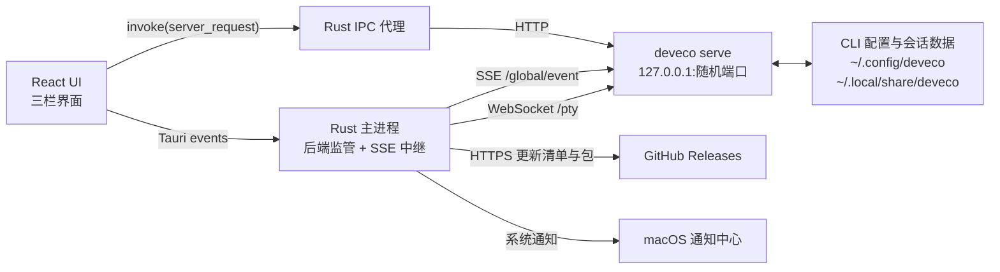
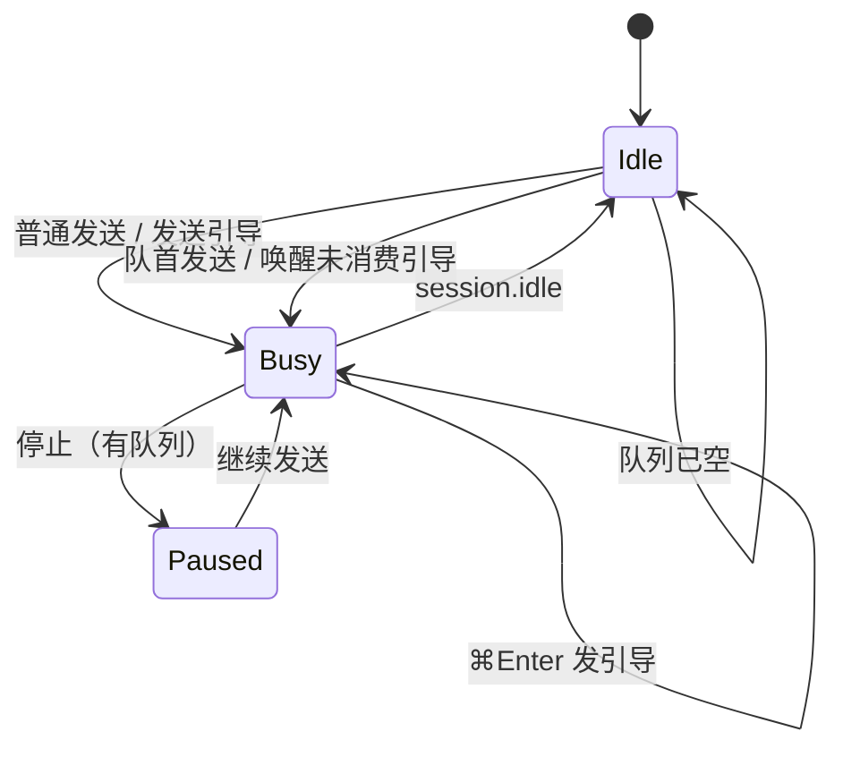
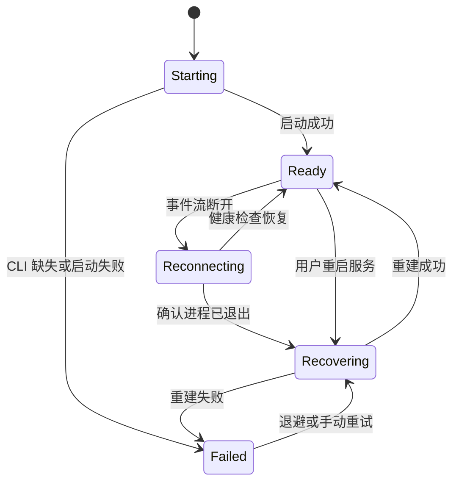
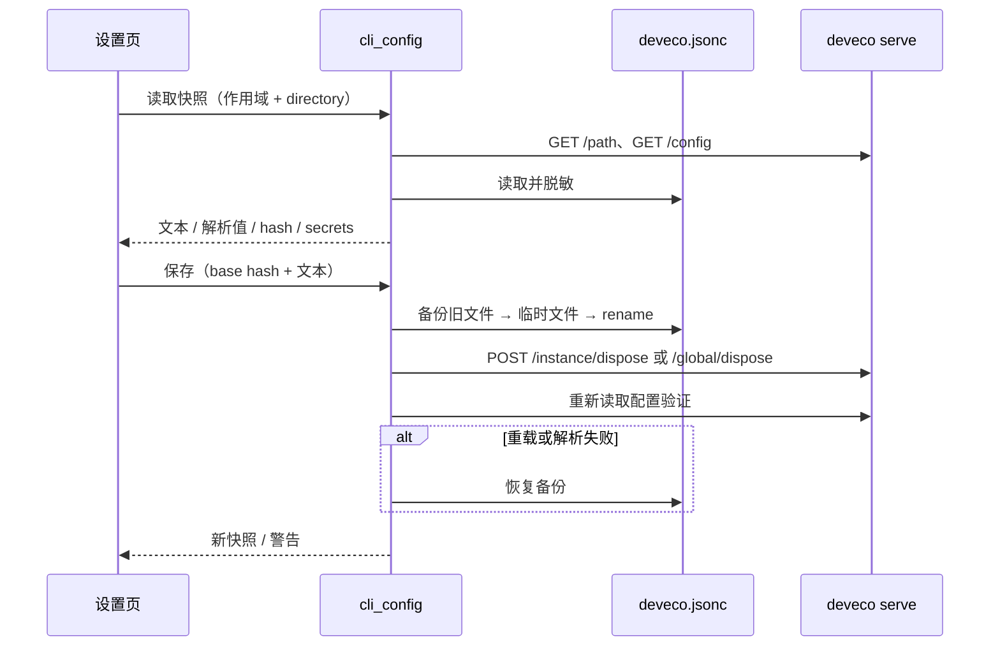

# 架构说明

## 产品边界

DevEco Code Desktop 是 macOS 上的桌面客户端，不是新的 Agent 实现：

- 本机 `deveco` CLI（opencode 的 HarmonyOS 定制分支）负责模型、会话、工具执行、
  权限、MCP、Skills 与数据持久化；
- 桌面端负责三栏 UI、工作区与会话管理、输入体验、文件/任务/设备面板、系统通知和
  macOS 集成；
- 普通版不打包 CLI；Offline 版内置固定版本 CLI，并从应用数据目录启动。两者都通过
  HTTP + SSE 契约交互；
- 官方 Web UI 不再作为产品入口，也不再保留“经典界面”窗口。

这个边界决定了最重要的维护原则：**不复制 Agent 能力，只适配 CLI 契约。** 上游新增
事件或端点时，未知事件应被忽略，而不是让 UI 或通知链路中断。

## 系统结构



前端不直接连接 `127.0.0.1`。所有业务请求经 `server_request` 由 Rust 转发，原因包括：

- 绕开 WebView 的 CORS/ATS 限制；
- 端口、可选口令和连接状态只保留在 Rust 侧；
- 后端自愈后可以替换端口，前端无需感知；
- Git、设备、文件预览等需要 shell 或系统能力的操作可以在受限的 Rust 命令中实现。
- Markdown 和消息附件里的本地图片经 `read_local_image` 读取后转 Blob URL；
  `tauri://localhost` 不能直接加载 `/Users/...` 路径，也不依赖 `file://` 访问权限。
  图片复制和另存统一走 `copy_image` / `save_image`，由 Rust 处理本地路径、data URL
  和远程地址，避免 WebView 直接读盘或跨域取图。

## 目录与模块

### 顶层

```text
.
├── ui/                 React + TypeScript + Vite 前端
├── src-tauri/          Tauri 2 / Rust 桌面壳
│   ├── resources/cli/  离线版构建时生成的 CLI 资源（不入库）
│   └── skills/         随二进制内嵌的 Agent skill
├── docs/               当前文档与历史实现记录
├── website/            无构建依赖的静态官网
├── scripts/            发布辅助脚本
├── .github/            CI、issue 与 pull request 模板
├── package.json        根级 Tauri CLI 与检查命令
└── README.md           项目入口
```

### Rust 后端

| 模块 | 职责 |
|---|---|
| `src/main.rs` | Tauri 主进程：窗口、托盘、菜单、单实例、信号、SSE 中继、通知、更新插件和后端监管 |
| `src/lib.rs` | 共享库导出，供主进程与无头自检复用 |
| `src/cli.rs` | 按“配置 → 环境变量 → 常见路径 → login shell → PATH”定位 CLI |
| `src/backend.rs` | 启动编排：定位 CLI、复用或拉起 serve、健康检查、读取项目目录 |
| `src/bundled_cli.rs` | Offline 版资源提取、CLI 数据目录隔离与 `devecocli` 入口 |
| `src/server.rs` | serve 子进程、端口选择、listening 行解析、健康检查与进程组回收 |
| `src/supervise.rs` | 后端自愈状态机与指数退避 |
| `src/http.rs` | 访问本机 CLI 的 HTTP 客户端，主进程与自检共用 |
| `src/sse.rs` | `text/event-stream` 解析与订阅 |
| `src/events.rs` | 授权、提问、完成、失败、阶段事件分类，全局事件解包与通知文案 |
| `src/notify.rs` | 通知策略、前台静音与按会话/请求去抖 |
| `src/ipc.rs` | 前端与 CLI/系统之间的命令桥：代理、设置、设备、字体与窗口标题 |
| `src/terminal.rs` | 底部终端：调用 `/pty` 创建/调整/关闭会话，维持 WebSocket，把输出转成 Tauri 事件 |
| `src/cli_config.rs` | CLI 全局/项目配置路径解析、JSONC 校验、密钥脱敏、备份、原子写入与重载 |
| `src/menubar.rs` | macOS 菜单栏状态项、动态图标与菜单动作 |
| `src/windrag.rs` | 自绘标题栏的窗口拖动 |
| `src/git.rs` | 当前工作区 Git 状态、显式提交与推送 |
| `src/device.rs` | HarmonyOS 设备发现、HDC 截图与充电亮屏锁 |
| `src/device_skill.rs` | 内嵌 `deveco-desktop-device` skill 的安装、管理标记与 CLI 配置目录解析 |
| `src/preview.rs` | macOS Quick Look 缩略图生成；读取并校验消息内嵌的本地图片与图片 data URL |
| `src/fonts.rs` | 系统字体枚举 |
| `src/config.rs` | 应用配置：CLI 路径、通知、菜单栏、端口与可选本地口令 |
| `src/bin/selftest.rs` | 不打开窗口的端到端自检；由 `selftest` feature 启用，默认不进入应用包 |

`main.rs` 只声明 `ipc`、`menubar`、`terminal`、`windrag` 四个主进程模块；其余模块位于库层，
由主进程和 `deveco-selftest` 共用。

### React 前端

| 区域 | 主要文件 |
|---|---|
| 应用骨架 | `ui/src/App.tsx`、`ui/src/main.tsx`、`ui/src/styles.css` |
| 状态与数据 | `ui/src/store.ts`、`ui/src/api.ts`、`ui/src/types.ts`、`ui/src/appEvents.ts` |
| 配置编辑 | `ui/src/cliConfig.ts`、`components/settings/CliConfigPage.tsx`、`components/settings/useCliConfigEditor.ts` |
| 对话体验 | `components/ChatView.tsx`、`components/Composer.tsx`、`components/Markdown.tsx` |
| 图片查看 | `components/InlineImage.tsx`、`imageViewer.tsx`、`imageActions.ts` |
| 导航与工作区 | `components/Sidebar.tsx`、`components/StatusBar.tsx` |
| 底部终端 | `components/TerminalPanel.tsx` |
| 右栏 | `components/RightPanel.tsx`、`components/ChangesPanel.tsx`、`components/FilesPanel.tsx`、`components/DiffView.tsx`、`components/FilePreview.tsx`、`components/TasksPanel.tsx`、`components/DevicePanel.tsx` |
| 概览与设置 | `components/TaskOverview.tsx`、`components/Settings.tsx`、`components/settings/*` |
| 应用内更新 | `update.ts`、`components/UpdateBanner.tsx`、`components/settings/AboutPage.tsx` |
| 交互基础 | `contextMenu.tsx`、`components/Shortcuts.tsx`、`components/Icon.tsx` |
| 纯逻辑工具 | `attachments.ts`、`changes.ts`、`diff.ts`、`fileTree.ts`、`clipboard.ts`、`filePreview.ts`、`mentions.ts`、`messageStats.ts`、`models.ts`、`paths.ts`、`questions.ts`、`tasks.ts`、`theme.ts`、`uiPrefs.ts` |

所有请求集中在 `ui/src/api.ts`，所有共享状态集中在 `ui/src/store.ts`。组件可以调用
`api.ts` 或读取 store，但不直接创建 HTTP 连接。

## 启动与请求链路

1. 应用读取 `~/Library/Application Support/DevEco Code Desktop/config.json`。
2. `cli.rs` 定位 `deveco` 并执行 `deveco --version`。npm / Homebrew 安装的 `deveco`
   是 `#!/usr/bin/env node` 启动器，因此调用 CLI 前会把 CLI 目录、常见安装目录和
   nvm / fnm 版本目录并入子进程 `PATH`；Finder 启动的应用本身只有系统 PATH。
3. `backend.rs` 定位 `hdc` 并注入 `HDC`，再把内嵌设备 skill 写入 CLI 的全局 skills 目录；
   随后决定复用固定端口上的实例，或在应用侧先找空闲端口后拉起
   `deveco serve --hostname 127.0.0.1 --port <port>`。serve 固定以
   `~/Library/Application Support/DevEco Code Desktop/server-cwd` 为工作目录；不能继承
   Finder 启动时的 `/`，否则 CLI 会把整个根目录当作默认工作区并建立文件监听。
4. `server.rs` 解析 stdout 的 `deveco server listening on http://...`，轮询
   `/api/health`，成功后把 `base_url` 和可选口令写入 IPC 状态。
5. 主进程订阅 `/global/event`，把事件通过 `deveco://sse` 转发给前端，同时做通知分类。
6. 前端通过 `server_request` 读取工作区、会话、消息、文件、diff、待办与设备状态。
7. 底部终端由 `terminal.rs` 调用 `/pty` 创建会话，用一次性 ticket 建立 WebSocket；
   输出经 `deveco://terminal` 事件交给 xterm，前端按键再由 Rust 写回同一条连接。
8. 退出或崩溃时按进程组停止 serve；异常断开进入自愈状态机。
9. 应用内更新由 Tauri updater 读取 GitHub 的 `latest.json` 或 `latest-offline.json`，
   校验 Ed25519 签名和签名中的版本号；用户确认后替换 `.app`，重启由用户触发。

前端在打开会话、后端恢复或收到 `session.idle`/`session.error` 后，会用
`/session/status` 与消息快照校准执行态。空闲会话里残留的 `running`/`pending` 工具和未结束的
`reasoning` 只在展示层标记为 `interrupted`，不回写 CLI 存储；外部 CLI 客户端仍可能看到原始
`running` 记录。

### 排队与引导

排队和引导是桌面端的投递层，不改变 CLI 的会话存储：

- 每个会话维护 FIFO 队列；执行中按 Enter 入队，`session.idle` 后只发送队首，发送成功才出队。
- 引导消息发送时携带客户端生成的 `msg_` ULID，agent 回应后可通过 assistant `parentID`
  判断是否被当前轮消费；若当前轮已结束，则发送一条可被界面隐藏的 synthetic 继续消息，
  开启新一轮而不是重复写入用户消息。
- 点“停止”只中止当前轮；有待发送内容时置 `queuePaused`，不自动再起一轮，用户恢复后继续。
- CLI 0.2.5 虽然暴露 `/api/session/:id/prompt` 的 `delivery: steer|queue`，但 serve 的
  v2 执行层未接通（`wait`/`compact` 返回 503，prompt 只产生 admitted 事件），本版不依赖它。



## 后端自愈



- 事件流断开后先做健康检查，不立刻杀进程。CLI 可能只是被 macOS 文件夹授权或锁屏阻塞。
- 确认子进程退出后，回收旧进程组，按原配置重建；固定端口优先复用，否则重新选空闲端口。
- 重建成功后重新拉取当前会话、会话列表和权限状态，弥补断线期间丢失的事件。
- `failed` 状态必须给出原因、重试和诊断入口，不能只显示“未连接”。

## 与 CLI 交互的关键不变量

1. **订阅 `/global/event`，不要用 `/event`。** 后者只覆盖 serve 启动目录所属实例；
   全局事件外层为 `{ directory, project, payload }`，使用前必须解包。
2. **不要传 `--port 0`。** CLI 会把它当作未指定并落到默认 4096；应用侧先用
   `free_port()` 选端口，再显式传入。
3. **按进程组回收。** `deveco` launcher 会派生原生二进制；只杀 launcher 会留下孤儿。
   统一先 `SIGTERM`，超时后 `SIGKILL` 整组，并保留信号退出兜底。
4. **规范化工作区路径。** macOS 上 `/tmp` 与 `/private/tmp` 指向不同字符串；
   会话匹配必须使用规范化后的路径。
5. **会话列表带 `?directory=` 查询。** `/project` 可能对同一路径返回多条记录，前端按
   `worktree` 去重。
6. **`/find/file` 必须带 `query`。** 空字符串合法并返回工作区文件列表；代理只过滤
   `null`，不能丢掉空串。目录浏览用 `/file?path=`，内容读取用 `/file/content?path=`。
7. **变更面板按来源分别读取，不做自动回退。** 工作区用 `/vcs/diff?mode=git`，
   本次会话用 `/session/{id}/diff`；`/vcs` 的 `branch=null` 用于区分非 Git 工作区。
   文件状态徽标读取 `/vcs/status`，与 diff 来源相互独立。
8. **归档是元数据操作。** 使用 `PATCH time.archived`，会话列表不会自动过滤，由前端处理。
9. **历史消息编辑必须走 `revert → prompt_async`。** `POST /session/{id}/revert` 先保存
   回滚边界、还原工作区快照并返回 `session.revert`；下一次 prompt 的 cleanup 才会永久删除
   该消息及其后内容。不要只逐条删除消息或只 PATCH text part，否则模型上下文和文件状态会
   不一致。`prompt` 失败时要读取 `/session/{id}` 判断 revert 是否已清除，再决定 `unrevert`
   或保留回滚态重试。
10. **`Session.revert` 是可选权威字段。** CLI 在 unrevert/cleanup 后会直接省略该字段；
    前端 upsert 会话时必须显式写回 `revert`（缺失即清空），否则旧边界会把新消息误判为
    已回滚。`message.removed` / `message.part.removed` 事件用于同步 CLI 的 cleanup 或其他
    客户端删除；编辑提交期间要保留目标消息的本地快照，忽略自身 cleanup 的 removed 事件。
11. **消息统一走 `prompt_async`。** 同步 `/message` 会等待整个 Agent loop，长任务容易撞上
   代理超时；进度依赖 `/global/event`。
12. **工作区文件引用使用 `file://` file part。** 由 CLI 自己读盘并合成 Read 调用，
    客户端不内联文件内容；附件仍使用 data URL。
13. **权限事件兼容 v1/v2 字段。** 至少兼容 `permission.asked/replied` 与
    `permission.v2.asked/replied`，未知事件忽略。
14. **内嵌 skill 不能改写 CLI 配置。** 设备 skill 只写入 CLI 的 `skills/<name>/SKILL.md`，
    用 `.deveco-desktop-managed` 标记所有权；不修改 `deveco.jsonc`，不覆盖无标记同名目录。
    CLI 只在启动时扫描 skill，复用已有 serve 实例时不会热加载。
15. **PTY 连接不能交给 WebView。** `/pty/{id}/connect-token` 要求内部请求头，返回的一次性
    ticket 只用于 Rust 侧建立 WebSocket；输出是字符串帧，首帧可能是 `0x00 + {"cursor":...}`
    的二进制控制帧，xterm 只接收普通输出。关闭面板时先断开连接，再调用 `DELETE /pty/{id}`
    回收 shell。
16. **排队/引导走 v1 客户端投递。** 忙时由前端按会话 FIFO 排队，`session.idle` 后逐条
    `prompt_async`；引导消息带客户端 `messageID`，用 assistant `parentID` 对账，错过当轮时
    发送 synthetic 继续消息。不要改用 `/api/session/:id/prompt` 的 `delivery`，
    CLI 0.2.5 的 serve 尚未接通 v2 执行层。客户端 `messageID` 必须是 ULID 形状的
    `msg_` + 26 位 Crockford 字符；非 ULID 值仍返回 204，但消息会静默不落库。
17. **会话权限选择走会话级规则，不写配置文件。** 未显式选择时新会话不发送 `permission`，
    继承 Agent/全局配置；用户选择“每次询问 / 完全访问”后才用 `POST /session` 带入，已有
    会话用 `PATCH /session/{id}` 更新。**PATCH 的 `permission` 是追加合并，不是替换**；
    CLI 按 `findLast` 匹配，所以切换模式时只追加 `bash`、`external_directory`、`webfetch`、
    `websearch` 的新动作，并把 Agent 的有效 deny 规则追加到最后；整体拒绝的工具还会重建
    其通配 deny 和局部 allow，避免 `plan` 等限制被旧会话规则或新模式覆盖。不要试图用空
    数组清除已有会话规则。
    `每次询问` 写 `ask`，`完全访问` 写 `allow`；权限写入在途时，下一条 prompt 必须等待其
    完成；写入失败时取消本次 prompt 并恢复输入，不能用旧权限继续发送。模式所有权判断要求
    可调整工具最后一个非 deny 规则是 `pattern:"*"` 的桌面预设动作；整体拒绝（工具通配
    deny 或全局兜底 deny）的工具保留 Agent 规则且不写模式动作。出现自定义路径/命令规则
    时显示为“自定义”，切换模式前确认。切换 Agent 时，桌面预设按模式追加规则，自定义
    会话只追加新 Agent 的硬限制；执行期间禁止切换 Agent，同步失败时恢复原 Agent。不要用
    修改 `deveco.jsonc` 实现会话内切换。
18. **`question` 是等待用户输入的交互工具，不是普通工具输出。** 待答请求以
    `question.asked` 广播，按 `sessionID` 归属会话，并可用 `tool.messageID/callID`
    对回消息里的 `question` tool part；打开工作区、打开会话和断线重连时要从
    `GET /question?directory=` 补齐。回答用
    `POST /question/{requestID}/reply` 提交 `answers: string[][]`，每题按题目顺序给一组
    标签或自定义文本；跳过用 `POST /question/{requestID}/reject`。不能只渲染
    `part.state.input`，否则用户无法完成请求。待答状态下前端用问答面板替换 Composer，
    Composer 只隐藏、不卸载，避免丢失未发送草稿；面板的“无偏好”把空答案填为
    `["无偏好"]` 后提交，“停止生成”先调用 `session.abort`，再静默关闭仍存在的
    question 请求。

## 数据与配置

| 路径 | 所有权 | 用途 |
|---|---|---|
| `~/.config/deveco/` | CLI | CLI 配置、AGENTS.md、Skills；桌面端可经确认写入 `deveco.jsonc`，并安装带管理标记的 `deveco-desktop-device` |
| `~/.local/share/deveco/` | CLI | 会话数据库与认证信息；桌面端不解析 SQLite |
| `<workspace>/.deveco/deveco.jsonc` | 项目 | 项目级 CLI 配置；首次保存时由桌面端创建，项目规则覆盖全局 |
| `~/Library/Application Support/DevEco Code Desktop/config.json` | 桌面端 | CLI 路径、通知、菜单栏、端口与可选本地口令 |
| `~/Library/Application Support/DevEco Code Desktop/cli-config-backups/` | 桌面端 | CLI 配置写入前备份，按配置文件路径隔离并保留最近 10 份，权限 `0600` |
| `~/Library/Application Support/DevEco Code Desktop/server-cwd/` | 桌面端 | serve 的中性工作目录，避免 CLI 扫描根目录或用户主目录 |
| `~/Library/Application Support/DevEco Code Desktop/device-shots/` | 桌面端 | HDC 设备截图 |
| `~/Library/Logs/DevEco Code Desktop/app.log` | 桌面端 | 运行日志 |
| WebView `localStorage` | 桌面端 | 主题、字体、侧栏宽度、模型可见性、隐藏工作区等纯 UI 偏好 |

### CLI 配置写入链路



## 安全边界

- 默认只连接本机回环地址，不打包或代理远程服务。
- `secure = true` 时会生成本地 Basic Auth 口令，注入 serve 并只由 Rust 代理携带；
  口令保存在应用配置文件中，不是系统钥匙串。
- CLI 配置写入只接受 `global` 或带 `directory` 的 `project` 作用域；项目路径限定为
  `.deveco/deveco.jsonc` 或已有根 `deveco.jsonc`，不会写项目根 `config.json`，也不会把
  `server-cwd` 当成用户工作区。
- 配置保存前校验 base hash，旧文件备份到应用数据目录（`0600`，每个配置目标最近 10 份），
  临时文件原子替换；重载失败或 CLI 无法解析时恢复备份。
- Provider `options.apiKey`、MCP `headers`、MCP `environment` 中的敏感键和 MCP
  `oauth.clientSecret` 默认脱敏为稳定哨兵；保存未修改的字段时由 Rust 还原，日志与前端
  共享状态不保存明文。
- 提交、推送、设备截图等操作由用户显式触发；Git 命令限制在当前工作区，
  不经过 shell 拼接。
- 终端 PTY 由本机 CLI 创建，命令拥有当前用户权限；桌面端只转发键盘输入与尺寸，不执行
  额外 shell 拼接。连接票据、端口和可选口令不会进入 WebView。
- 设备 skill 只提供 HDC 命令说明和临时文件清理规则；安装、卸载、重启等修改设备的操作
  必须由用户明确请求，skill 不提高 CLI 的权限。
- 前端不加载远程页面。Markdown 使用 `react-markdown` 默认渲染，不执行原始 HTML。
- `tauri.conf.json` 当前未设置 CSP。发布前如需加载任何远程内容或引入新的 HTML 注入点，
  必须先收紧 CSP，并重新审查 Tauri capabilities。
- 桌面代理降低连接信息暴露，但不能替代输入校验；任何来自 CLI、文件名或 diff 的内容
  都按不可信数据处理。
