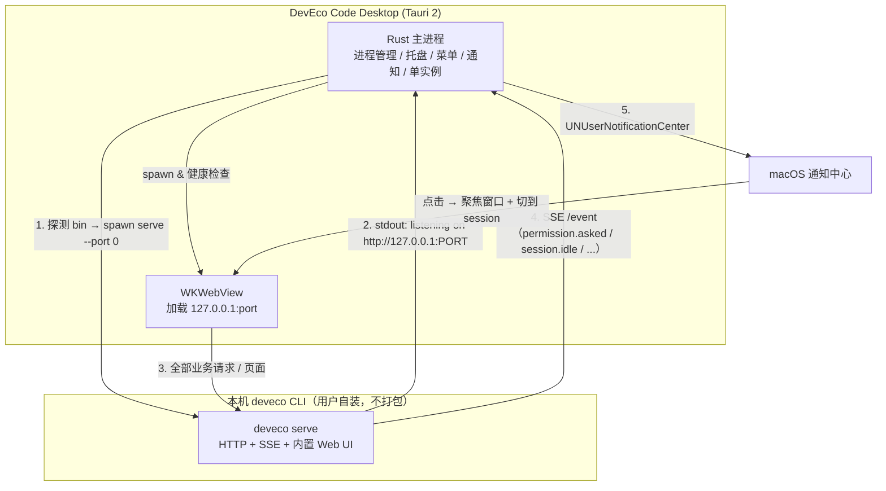

# DevEco Code Desktop 实现方案（macOS 优先）

> 日期：2026-11-06 ｜ 状态：决策稿 ｜ 本机实测环境：`@deveco/deveco-code@0.2.5`（npm），macOS arm64

## 1. 结论

**做 Tauri 2「薄壳 + 事件旁路」，不自研聊天 UI。**

关键事实：`deveco serve` 启动的 HTTP 服务在 `/` 直接返回**完整的 DevEco Code Web 应用**（SolidJS，标题 `DevEco Code`，主题变量沿用上游 opencode 的 `oc-*`）。也就是说官方 CLI 已经自带一套可用 UI 和一套稳定的 HTTP + SSE 契约。

因此桌面端只需要做「OS 集成层」：窗口/托盘/菜单/快捷键/单实例 + 生命周期管理 + **通知**。聊天、会话、权限弹窗、diff 全部复用官方 Web UI。这样：

- 开发量从 25–40 人日降到 **8–12 人日**；
- **跟随官方更新是免费获得的**——UI 随 CLI 升级自动变，不需要适配；
- 唯一需要长期维护的是「SSE 事件 → 通知」这一段薄胶水，只依赖 4 个已存在的稳定事件；
- 选 Tauri 而不是 Electron 的硬理由：macOS 上 Electron 的通知与自动更新**都要求代码签名**，Tauri 两者都不要求（见 §8），可以零成本起步、有账号后再补。

## 2. 已核实的事实（本地实测，非推断）

| # | 事实 | 证据 |
|---|---|---|
| 1 | CLI 是 opencode 的定制分支，MIT 许可 | `README.md`：「基于开源项目 OpenCode 扩展开发」；`package.json` `"license": "MIT"`；源码仓库 `gitcode.com/openharmony-sig/deveco-code` |
| 2 | 存在 headless server 与 ACP server | `deveco serve` / `deveco acp` / `deveco attach <url>` / `deveco web` |
| 3 | server 暴露 164 个 API path，含 SSE | `GET /doc` 返回 OpenAPI 3.1（`title: opencode`，`description: DevEco Code API`） |
| 4 | SSE 实测可用 | `curl /event` 立即收到 `data: {"type":"server.connected"}` |
| 5 | 事件契约粒度足够做 UI/通知 | schema 中有 `session.idle`、`session.error`、`permission.asked`、`permission.replied`、`session.next.step.ended`、`session.next.tool.failed`、`message.part.delta` 等 |
| 6 | 根路径就是完整 Web UI | `GET /` 返回 SolidJS 应用 HTML（含 CSP、manifest、theme 预加载脚本）；`/favicon.png`、`/social-share.png` 均 200 |
| 7 | 健康检查端点 | `GET /api/health` → `{"healthy":true}` |
| 8 | 端口可发现 | `--port 0` 随机端口；stdout 打印 `deveco server listening on http://127.0.0.1:<port>` |
| 9 | 原生二进制 161 MB，平台包分发 | `@deveco/deveco-code-darwin-arm64/bin/deveco`；launcher 支持 `DEVECO_BIN_PATH` 覆盖 |
| 10 | 发布节奏为周级 | npm 上 0.2.0(9/10) → 0.2.5(10/28)，且已有 `0.3.0-stable` 预发布；`CHANGELOG.md` 逐版本记录 |
| 11 | 默认无鉴权 | 日志：`Warning: DEVECO_SERVER_PASSWORD is not set; server is unsecured.` |
| 12 | 配置/数据目录 | `~/.config/deveco/`（配置、AGENTS.md、skills）、`~/.local/share/deveco/`（`deveco.db` 会话库、auth.json） |
| 13 | ACP 形态未确认为 stdio | 向 `deveco acp` stdin 发 `initialize` 无任何响应；带 `--port` 启动也未监听端口 → **不把 ACP 作为方案依赖** |

## 3. 方案对比

| 维度 | **A. 薄壳 + 事件旁路（推荐）** | B. 薄壳 + 自研增强面板 | C. 全自研 UI（对接 API） | D. Fork opencode 官方 desktop | E. 套现成 ACP 桌面壳 |
|---|---|---|---|---|---|
| 做法 | Tauri 2 加载 `127.0.0.1:<port>/`，Rust 侧订阅 SSE 做通知 | A + 侧边栏/多项目看板用 React 自研 | React/Solid 全量重写聊天/权限/diff | 抄 opencode `packages/desktop`（**Electron** + electron-vite，MIT）换后端 | 用 AionUi / acp-ui 直接连 `deveco acp` |
| 开发量 | **8–12 人日** | 20–25 人日 | 25–40 人日 + 长期跟进 | 12–18 人日（Electron 架构可抄，但要接通知/签名的坑） | **1–3 人日**（若 ACP 可用） |
| 跟随官方更新 | **自动**（UI 与 API 都由 CLI 提供） | UI 自动，自研部分需适配 | 全靠自己适配，节奏周级 → 长期负债 | 需定期 rebase 上游，且与官方 UI 重复 | 自动 |
| UI 掌控度 | 低（只能注入 CSS/JS） | 中 | 高 | 中 | 低（是别人的产品形态，HarmonyOS 相关面板全丢） |
| 必须 Apple 签名 | **否** | 否 | 否 | Electron 通知/自更新需要 | 取决于壳 |
| 主要风险 | 官方改 UI 结构导致注入失效（非阻塞） | 两套 UI 风格割裂 | API 漂移 + 工作量失控 | 双份维护 + 签名阻塞 | ACP 实测不通，且不是你要的 DevEco 体验 |

**选 A。** B/C 不是被否决，而是排在 A 的 M4 之后按需追加——A 的架构不改一行就能长出 B。E 保留为 M0 的一个 30 分钟旁路验证（若 `deveco acp` 真能用，可用 `acp-ui` 快速验证协议层，但不作为产品形态）。

### 3.1 参考实现：抄什么、不抄什么

| 项目 | 许可证 | 可抄的部分 |
|---|---|---|
| [opencode `packages/desktop`](https://github.com/anomalyco/opencode/tree/dev/packages/desktop)（Electron，MIT，活跃） | MIT | **架构与工程手法**：CLI 二进制放 asar 之外、按 version-arch 分 stage、启动前 `Service.discover({version})` 复用已运行实例、解析 stdout 的 `listening on` 行 |
| [AionUi](https://github.com/iOfficeAI/AionUi)（34k★，Apache-2.0，ACP，20+ CLI 解耦） | Apache-2.0 | **产品形态**：多后端切换、会话侧边栏、权限确认交互的组织方式 |
| [jockey](https://github.com/recailai/jockey)（MIT，Tauri+Rust+SolidJS+ACP）、[acp-ui](https://github.com/formulahendry/acp-ui)（MIT） | MIT | **Tauri 最小实现骨架**：Rust 拉起子进程 + ACP/流式事件 → 前端 |
| [opcode/winfunc](https://github.com/winfunc/opcode)（22.4k★）、crystal、claudecodeui | **AGPL-3.0** | **一个字节都不要抄**（AGPL 传染性，会污染整个仓库）；只看交互设计 |

> opencode 本身是 MIT，DevEco Code 也是 MIT，参考其代码安全。注意：网上不少二手资料把 opencode desktop 说成「Tauri + SolidJS」，**以仓库 README 为准——它是 Electron**。

## 4. 架构



**职责切分**

- **Rust 侧**（唯一需要长期维护的代码）：CLI 定位 → 启动 → 端口发现 → 健康探测 → 崩溃重启 → 退出清理；单实例锁；托盘/菜单/全局快捷键；SSE 订阅与通知映射；随机生成 `DEVECO_SERVER_PASSWORD` 注入子进程与 WebView。
- **WebView 侧**：零改造加载官方 UI。可选注入 20–80 行 CSS/JS 做品牌化与「通知点击后切 session」的桥接。
- **不做的**：不解析 CLI 的本地数据库（`deveco.db`），不内嵌 161 MB 二进制，不实现聊天/权限/diff。

## 5. 通知设计

Rust 侧常驻一个 SSE 订阅（`GET /event`，`text/event-stream`），按下表映射。原则：**只订阅 4 个事件，未知事件静默忽略**，这样上游加事件不会打断我们。

| 事件 | 触发场景 | 通知 |
|---|---|---|
| `permission.asked` | Agent 要执行命令/改文件，等用户批准 | 高优先级：「DevEco Code 需要授权：<permission>」，点击 → 聚焦并定位到该 session（UI 里完成批准） |
| `session.idle` | 一轮任务结束 | 普通：「任务完成 · <项目名>」，点击 → 聚焦该 session |
| `session.error` / `session.next.tool.failed` | 出错 | 普通：「执行失败」，点击 → 聚焦 |
| `session.next.step.ended` | 长任务阶段推进（可选） | 默认关闭，设置项开关 |

工程要点：

- 实现用 `tauri-plugin-notification`。首次运行需请求权限；**Tauri 在 macOS 上不强制签名**（Electron 则必须签名，未签名会触发 `failed` 事件），这是选 Tauri 的直接收益。
- 通知里带「批准/拒绝」按钮需要 `UNNotificationCategory` + action，Tauri 桌面端插件对此**没有明确文档**——M0 先只做「点击跳转」，按钮作为 M2 的待验证项（必要时 Rust 侧写 30 行 objc2 桥接）。
- 去抖与聚合：同一 session 10 秒内的同类事件只发一条；应用前台激活时默认不发（符合 macOS 习惯，可在设置里关闭）。
- 兜底通道：若 SSE 断开，用 `/permission` 与 `/session/status` 轮询（5–10s）补状态——只在窗口最小化/后台时启用。

## 6. 怎么「跟随官方 CLI 更新」

这是本方案的核心优势，靠三层保障：

1. **零版本耦合**：不打包 CLI、不锁定版本。用户用 `npm i -g @deveco/deveco-code` 或 `deveco upgrade` 自行升级，桌面端永远驱动「本机那一个」。opencode 官方 desktop 也是同一思路（CLI 二进制放 asar 外、按版本分 stage、启动前探测版本并复用已运行实例），已被验证可行。
2. **只依赖最小契约 + 能力探测**：启动时 `deveco --version`，建立 `(major,minor) → 能力` 表；只依赖 v1 的 `/session`、`/event`、`/permission` 与 `/doc` 探活，**不用** `/api/*`（v2 预览面，operationId 带 `v2.` 前缀，明显在演进）。未知新版本一律降级到最小契约，功能照常可用。
3. **CI 契约回归**（最关键、成本最低）：每日/每发版跑一次——
   `npm i -g @deveco/deveco-code@latest` → `deveco serve` → 抓 `/doc` → 与我们用到的 path/schema 做快照 diff → 变了就自动开 issue 并标红。
   同时监听 npm 上 `@deveco/deveco-code` 新版本（发布节奏约每周），提前在 branch 上跑同样检查。

配套细节：

- **CLI 定位顺序**：`DEVECO_BIN_PATH` 环境变量 → app 设置里手选（持久化）→ 常见路径探测（`/opt/homebrew/bin`、`/usr/local/bin`、`~/.nvm/versions/node/*/bin`、`npm prefix -g`）→ **用 login shell 执行 `which deveco`**。注意 GUI 应用拿到的 PATH 只有 `/usr/bin:/bin:/usr/sbin:/sbin`，直接 `which` 必然失败，这是本方案最容易踩的坑。
- **端口策略**：优先固定端口（如 4096，与 opencode SDK 默认一致）并先 `/api/health` 探活——若已有同项目 server 直接复用；否则 `--port 0` 随机端口并解析 stdout 的 `listening on` 行。
- **进程生命周期**：`serve` 作为子进程，退出时 `SIGTERM` + 5s 后 `SIGKILL`；异常退出按指数退避重启（上限 3 次）并提示。

## 7. 里程碑与验收

| 里程碑 | 内容 | 人日 | 验收标准 |
|---|---|---|---|
| **M0 骨架** | Tauri 2 空壳 + CLI 探测 + spawn serve + 端口发现 + 加载 `/` | 2 | 双击 .app 能出现官方 UI，能发消息、能看回复 |
| **M1 通知** | SSE 订阅 + 4 类事件映射 + 权限申请引导 + 点击聚焦 | 2 | 后台运行时，Agent 请求权限 / 任务结束能各自弹出一条通知，点击回到对应位置 |
| **M2 桌面化** | 托盘 + 原生菜单 + 全局快捷键（唤起）+ 单实例 + 崩溃重启 + 设置页（CLI 路径/通知开关）+ `DEVECO_SERVER_PASSWORD` | 3 | 关窗不退进程，托盘可唤回；杀掉 serve 后 5s 内自愈 |
| **M3 分发** | 打包 .app/.dmg、ad-hoc 签名、Tauri updater（自建 Ed25519 密钥，不需要 Apple 账号）、README | 2 | 另一台 M 系列 Mac 免配置可用（CLI 已装前提下），旧版能收到更新提示 |
| **M4（可选）** | 增强面板（多项目看板/diff/历史）或通知内直接批准 | 10+ | 按需 |

M0 的验证命令（先于写代码）：

```bash
deveco serve --port 0 --print-logs     # 观察 listening 行格式与退出行为
curl -s localhost:<port>/api/health     # 探活契约
curl -N localhost:<port>/event          # 观察 server.connected 与真实事件流
```

## 8. 风险与未验证项

| 项 | 状态 | 处置 |
|---|---|---|
| Tauri 桌面端通知 action 按钮（批准/拒绝） | **未验证** | M2 验证；不行则退化为「点击跳转」，或 Rust 侧 objc2 桥接 |
| `deveco acp` 是否提供 stdio ACP | **未验证**（实测无响应） | 不作依赖；M0 花 30 分钟旁路验证，通了可白得 ACP 生态（AionUi/Zed 等） |
| 内置 Web UI 的注入可行性（CSP `script-src 'self'`） | **未验证** | Tauri 的 `initialization_script` 在页面脚本前执行，通常可绕过 CSP；仅用于品牌化与桥接，失败不影响主流程 |
| `/api/*` v2 面稳定性 | 高风险 | 明确不使用，只用 v1 |
| 上游 UI 改版导致注入失效 | 中 | 注入层做特性检测，失败静默降级 |
| Electron 路线被签名卡死 | 确定（官方文档） | 已在选型阶段规避：不用 Electron |
| 未签名分发 Gatekeeper 拦截 | 确定 | 内部分发用 ad-hoc 签名 + 右键打开说明；对外需 Apple Developer（¥688/年） |
| 161 MB 二进制冷启动 | 需实测 | serve 常驻 + 托盘不退，避免反复启动 |
| 本地其他进程可访问无鉴权 server | 确定（日志已警告） | M0 即生成随机 `DEVECO_SERVER_PASSWORD` 注入 |

## 9. 后续事项

- M0 结束后用真实事件流回填通知去抖参数。
- 若后续要脱离「官方 UI 长什么样」的限制，再启动 M4，届时新面板走 `/api/session`、`/api/session/{id}/prompt`、`/api/session/{id}/wait`（v2），与壳内的 Web UI 并存于同一窗口的独立 Tab。
- Windows 端复用同一 Rust 层，差异在通知（Toast + AppUserModelID）与 CLI 发现逻辑，预估 +3 人日。
- ACP v1/v2 存在方法名差异（v2 仍是 draft），若走 ACP 路线必须锁版本。

---

## 10. 实施记录（2026-11-06）

M0（骨架）与 M1（通知）已完成并自测通过，代码在本仓库。

| 项 | 状态 | 证据 |
|---|---|---|
| Tauri 壳 + CLI 发现 + 拉起 serve + 导航到官方 UI | ✅ | .app 启动 1.7s 就绪，窗口渲染官方 Web UI |
| SSE 订阅 + 4 类事件映射 + 通知投递 | ✅ | `/event` 收到 `server.connected`（45ms）；测试通知成功投递 |
| 通知策略/去抖/文案 | ✅ | 单测 31 项全过 |
| 进程生命周期（启动/退出/异常） | ✅ | 退出后进程组回收、端口释放、无孤儿 |
| 托盘 + 单实例 + 关窗退到托盘 | ✅ | 已实现，托盘的交互未做自动化验证 |
| 通知点击定位会话 / 通知内批准 | ❌ 未做 | Tauri 桌面端 notification 无 action 回调，M2 验证 |

实施中修正了方案里的两处假设：

- **`--port 0` 不可靠**：CLI 会把它当成默认 4096，必须应用侧显式挑空闲端口。
- **launcher 会留孤儿**：`/opt/homebrew/bin/deveco` 是 node 包装脚本，只杀它会留下
  161MB 的原生子进程继续占端口。必须按进程组发信号。

仍待真人验证（自动化无法覆盖）：通知横幅在锁屏/勿扰模式下的表现、通知点击后的
窗口聚焦体验、托盘菜单交互。

---

## 11. 结构重构（v2，2026-11-06 晚）

第一版是「Tauri 窗口 = 官方 Web UI」，实测可用但结构上就是个网页：没有自定义标题栏、
没有工作区树、没有状态栏、没有右面板。按「对齐 DSH Desktop 结构」的要求改为自研前端。

**保留的**：Rust 侧的 CLI 发现、进程生命周期、SSE 订阅、通知策略、进程组回收（这些与 UI 无关）。
**替换的**：窗口内容从「官方 UI」改为 React 应用；新增 `server_request` 通用代理，
前端所有请求经 Rust 转发（绕开 CORS/ATS，连接信息不外泄）。
**兜底的**：官方 Web UI 保留为「经典界面」独立窗口（`open_classic_view`）。

实现范围（Phase 1）：标题栏 + 工作区树 + 会话列表 + 对话流（markdown/思考/工具卡片）+
权限审批卡片 + composer + 状态栏 + 右面板（变更/文件）。未做：多 Tab（轨迹/版本/上下文）、
设置页、通知点击定位。

新增修复的两个进程问题：

1. **信号退出不回收**：`kill -TERM` 走的是进程终止路径，不触发 Rust `Drop` 与 `RunEvent::Exit`，
   serve 会变孤儿。加了 `SIGTERM/SIGINT/SIGHUP` 处理器，直接把 serve 进程组杀掉。
2. **事件缺口**：外部创建的会话不会出现在侧栏（只处理了 `session.updated`），补上 `session.created`。

验证：`cargo test`（含编码/拼接等单测）+ `deveco-selftest` 11 项全过（新增「代理读写路径」
覆盖 UI 实际使用的 POST/GET/DELETE）+ GUI 截图确认三栏结构与实时会话更新。

---

## 12. 自测与优化（2026-11-06 深夜，自主测试轮）

按「自主测试，继续优化」做了一轮真机验证，结论与修复：

| 发现 | 影响 | 修复 |
|---|---|---|
| `/event` 只推 serve 启动目录所属实例的事件 | **跨工作区的流式对话完全不工作**（UI 只有打开会话时的全量快照） | 改订阅 `/global/event`，解包 `{directory, project, payload}` 后转发；解包逻辑下沉到 lib 并加单测 |
| `/tmp` 与 `/private/tmp` 路径不一致 | 启动目录参数匹配不到工作区 | `startup_directory` 做 `canonicalize` |
| 应用永远恢复上次工作区 | 无法从外部「在指定目录打开」 | 新增 `DEVECO_DESKTOP_DIR` 启动参数（也是深链落点） |
| `SIGTERM` 退出不触发 Drop/RunEvent | serve 变孤儿占端口 | 注册 `SIGTERM/SIGINT/SIGHUP` 处理器，直接杀进程组 |
| 外部创建的会话不进侧栏 | 多入口协作时列表滞后 | 处理 `session.created` |
| 工作区注册表残留已删除目录 | 侧栏噪音 | 新增 `path_exists` 命令，启动时过滤 |
| 自动滚动会打断用户翻阅 | 体验 | 仅在距底部 90px 内自动滚动 |
| 思考块无耗时、与正文粘连 | 可读性 | 显示 `思考过程 · 1.6s`，完成态默认折叠 |

验证方式（两个临时工作区、共 8 轮真实 prompt）：

- `/tmp/deveco-ui-e2e`：6 轮问答，逐帧截图确认「思考中…」实时滚动、正文逐字到达、
  状态栏 11 轮/11 步/token 同步；并用 `curl` 旁路抓 SSE 原始流核对事件类型。
- `/tmp/deveco-ui-tool`：要求「读 README.md + 执行 ls」，验证工具卡片——
  `read 完成 README.md`、`bash 完成 List files in current directory` 两张卡片正常渲染，
  最终回答正确。

测试会话与临时目录已清理。仍未真机验证：权限审批卡片（本机 deveco 配置是
`permission: allow`，不会触发 `permission.asked`；要验证需临时改成 `ask`）。

自动化护栏：`cargo test` 34 项；`deveco-selftest` 11 项（新增全局事件订阅与代理读写路径）。

---

## 13. 设置页（2026-11-06）

实现方式：`⌘,` 打开的模态面板，四块内容 + 底部保存栏。

- **可写**：CLI 路径、端口偏好、本地口令开关、通知总开关与四类事件开关、前台静音。
  写入 `~/Library/Application Support/DevEco Code Desktop/config.json`；
  通知类改动**即时生效**——SSE 事件处理每次实时读取配置，不需要重启。
- **只读**：运行状态（CLI 路径/版本、服务地址、应用版本）与 CLI 自身配置
  （`GET /config` 的 model / small_model / permission / plugin）。
- **诊断**：打开日志目录、打开配置文件、打开经典界面、重启应用（`app.restart()`）。

交互细节：面板内焦点陷阱（Tab 不跑到主界面）、`Esc` 关闭、`⌘S` 保存、保存按钮 dirty 才可用。

验证：用 AppleScript 驱动键盘（`⌘,` → Tab×8 → Space → `⌘S`）把「任务完成时提醒」关掉，
再直接读 `config.json` 确认 `on_idle: false`，随后改回 true；设置页各区块截图核对，
包括滚动后的通知开关、CLI 只读配置与诊断按钮。

已知未做：CLI 配置（模型/权限模式）目前只读，尚未提供在桌面端直接修改的能力。

---

## 14. 基础功能补齐（2026-11-06 夜）

本轮做的功能与修掉的缺陷：

| 功能 | 实现要点 |
|---|---|
| 工作区懒加载 | 展开时按 `directory` 拉 `/session`，避免启动时把每个工作区都拉一遍 |
| 会话重命名 | `PATCH /session/{id}` 改 title；`✎` 或双击标题进入内联编辑，回车提交 |
| 会话删除 | `DELETE /session/{id}`；行内二次确认（不用原生 dialog，避免和 WebView 打架） |
| 模型选择 | `/api/model` 拉 49 个模型，composer 胶囊 + 搜索；选中后 `POST .../message` 带 `model` |
| 文件面板 | 目录浏览 `GET /file?path=`、搜索 `GET /find/file?query=`、预览 `GET /file/content?path=` |

同时修掉三个真 bug：

1. **会话重复**：`POST /session` 的响应与 `session.created` 事件竞争，两边都插入列表 → 侧栏出现两条。改为统一 `upsertSession` 按 id 去重。
2. **文件面板永远为空**：`/find/file` 必须带 `query`，不带直接 400。改为「目录浏览 + 关键字搜索」两条路径。
3. **非当前工作区展开看不到会话**：只加载了当前工作区的列表。改为按需加载。

验证方式：用 `agent-desktop` 走 macOS 辅助功能树**无焦点驱动**（不抢鼠标键盘），
依次验证：选择项目 → 新建会话 → 删除会话（✕→确认）→ 模型切换（胶囊变成 MiniMax）
→ 文件面板目录进入/预览 README → 展开未选中的工作区看到懒加载会话。
会话重命名因为 AX 点击无法让输入框真正聚焦，改用「API 改名 + 观察 SSE 实时更新」验证。
`cargo test` 34 项、`deveco-selftest` 11 项仍全绿。

---

## 15. 第二轮补齐（2026-11-06 深夜）

| 功能 | 实现 |
|---|---|
| 原生菜单 | Tauri MenuBuilder：应用菜单（关于/设置 ⌘,/隐藏/退出）、文件（新建会话 ⌘N/关闭窗口）、编辑（标准项）、视图（右栏 ⌘⇧B/经典界面 ⌘⇧C/日志/重载 ⌘R）、窗口。菜单事件经 `deveco://menu` 交给前端执行 |
| 窗口状态记忆 | `tauri-plugin-window-state` |
| 窗口标题 | 命令 `ipc::set_window_title`，前端按「会话 · 项目」同步 |
| 消息复制 | `navigator.clipboard`，悬停显示「复制」，实测剪贴板内容正确 |
| 全局会话搜索 | 输入 300ms 防抖后并行请求各工作区 `/session?search=`，按来源工作区分组展示，点击可跨工作区打开 |

又修掉两个真 bug：

1. **工作区重复**：CLI 的 `/project` 会对同一路径返回多条不同 id 的记录，侧栏出现两个同名工作区。改为按 `worktree` 去重。
2. **会话插错工作区**：全局事件流里 `session.created/updated` 带自己的 `directory`，之前一律塞进「当前工作区」，导致别处的会话出现在当前项目下。改为按事件自带的 directory 归位。

验证：`agent-desktop` 驱动菜单（文件→新建会话，窗口标题随即变成
「New session - … · DevEcoCodeDesktop」）、复制按钮（`pbpaste` 内容与消息一致）、
搜索框输入 `omega` 后在未展开的 `sampleworkspace-harmony` 下搜到目标会话；
`cargo test` 34 项 + `deveco-selftest` 11 项全绿。测试会话已清理。

---

## 16. 第三轮：停止、变更、归档（2026-11-06 深夜）

| 功能 | 实现 | 验证 |
|---|---|---|
| 停止生成 | `streaming` 改为事件驱动（`message.updated` 的 assistant 角色 / `session.next.step.started` 置真，`session.idle` 置假），外部触发的任务也能停止 | 发 3000 字长文，中途点「停止」，实际只产出 138 字后中断 |
| 变更面板 | 会话快照 diff 为空时回退到 `GET /vcs/diff?mode=git` | 临时 git 仓库里让 Agent 改 README，面板显示 `README.md +2` |
| 会话归档 | `PATCH /session/{id}` 写 `time.archived`；侧栏过滤 + 「显示归档」开关 + `⇩/↩` 往返 | 默认隐藏，开关后出现「归档测试」 |

排查中的发现（CLI 侧，非本应用 bug）：`/project` 会为同一路径返回多条不同 id 的记录。
当项目在注册后又 `git init`，会话会挂在旧 projectID 上，导致 `GET /session?directory=`
查不到该会话（记录本身还在，`GET /session/{id}` 可读取）。桌面端按 worktree 去重后行为一致，
但这类历史数据需要 CLI 侧修复；已在文档中记录。

`cargo test` 34 项全绿；测试会话与临时目录均已清理。

---

## 17. 第四轮：输入体验（2026-11-06 深夜）

屏幕中途休眠，本轮先做不依赖 GUI 的功能，恢复后逐项补验：

| 功能 | 实现 | 验证 |
|---|---|---|
| @ 文件引用 | composer 检测光标前 `@关键字`，200ms 防抖走 `/find/file`，`↑↓`/`Enter`/`Esc` 键盘操作，插入 `@path` | 输入 `@readme` 弹出 5 个候选，Enter 后变成 `@README.md`，且不会误触发送 |
| 快捷键面板 | `⌘/`（菜单「视图 → 快捷键」同效），分组展示 12 条快捷键 | 截图确认渲染与分组 |
| 消息时间戳 | 悬停消息显示 `HH:mm` | 打开会话后 AX 读到 `22:16` |
| 发送失败保留原文 | 失败时把文本写回 `failedText`，composer 自动回填 | 代码路径（难以稳定复现失败） |
| 归档视图持久化 | 「显示归档」状态存 localStorage | 重启后保持 |

`cargo test` 34 项全绿，`tsc --noEmit` 通过。

---

## 18. 第五轮：导出、查找、布局（2026-11-06 深夜）

| 功能 | 实现 | 验证 |
|---|---|---|
| 会话导出 | Rust 命令调用 `deveco export <sessionID>`，JSON 落盘到数据目录并在 Finder 定位；菜单「文件 → 导出当前会话」⌘E | 生成 `ses_…-<ts>.json`，内容含 info 与消息 |
| 会话内查找 | `⌘F` 查找条，按消息文本过滤并高亮当前命中，Enter/⇧Enter 跳转 | 查找条成功打开（截图） |
| 侧栏拖拽 | 网格列宽跟随鼠标，双击复位，宽度持久化，读取时夹紧到 220–460 | 代码路径（未做真人拖拽） |

过程中发现并修掉一个隐患：持久化的侧栏宽度没有夹紧，一条异常值会把三栏布局挤成竖排
（现场出现内容竖排显示）。改为在读取时就 clamp。

**本轮提前收尾**：测试期间检测到用户正在使用这台机器（另一个应用在前台并有输入），
为避免键鼠注入打断用户操作，立即停止了所有 GUI 自动化，剩余人工验证项留待屏幕空闲时补。

---

## 19. 第六轮：附件（2026-11-06 深夜）

选择用 WebView 原生 `<input type="file">` + `FileReader` 转 data URL，**不引入新依赖**
（不需要 Tauri dialog 插件），拼成 `FilePartInput { type, mime, url, filename }` 随 prompt 发送。

- 限制：最多 4 个附件、单个 ≤ 8MB，超出静默忽略并保留已有附件。
- 交互：`+` 选择 → chip 列表（可单个移除）→ 发送后清空；消息气泡上方渲染附件 chip。
- 验证：直接用 UI 相同的 payload 调 `POST /session/{id}/message`（`noReply`，不花 token），
  CLI 返回 `parts: [text, text(内联内容), file(note.txt)]`，说明 data URL 被正确解析。
- 视觉验证留给用户（屏幕被用户占用，未做键鼠注入）。

亮色主题与 ⌘K 命令面板评估后放到后续：现有 CSS 有较多硬编码颜色，换主题需要一次变量化整理，
不适合在无法视觉验证的时段做。

---

## 20. 收尾（2026-11-06 深夜）

修掉一个把布局彻底打乱的 bug：侧栏拖拽条被当成 grid 子元素插进网格，导致主区被挤到第三列、
右栏换行、内容竖排显示（前几轮那次「竖排文字」也是它）。改为绝对定位（`left = 侧栏宽度`），
布局恢复正常。

阶段交付状态：功能清单见 README，`cargo test` 34 项、`deveco-selftest` 11 项、`tsc --noEmit` 全绿。
用户开始自行体验测试。

---

## 21. 与 CLI TUI 对齐（2026-11-06 深夜）

用户提供了 CLI 启动页截图（`Build · Qoder · routing group · max · 2 mcp servers · tab agents · ctrl+p commands`），
据此补齐四个此前缺失的基础能力：

| 能力 | 接口 | 实现 |
|---|---|---|
| Agent 切换 | `GET /agent`（mode=primary） | composer 左侧 `build` 胶囊 + 下拉，随消息发 `agent` |
| 推理档位 | `/api/model` 的 `variants` | 选中带变体的模型时出现档位胶囊，随消息发 `variant` |
| 斜杠命令 | `GET /command`（62 条） | 输入 `/` 弹出面板，↑↓/Enter/Esc，插入 `/name ` |
| MCP 状态 | `GET /mcp` | 状态栏 `2 MCP`，同时显示当前 agent |

验证：截图确认 agent 胶囊、`agent: build · 2 MCP` 状态栏、`/` 弹出的命令列表（debug/init/review/analyze/…）。

另外确认了两件影响选型的事实：`deveco acp` 是标准 ACP agent（`initialize` 返回协议 1、
`agentInfo: DevEco Code 0.2.5`，但 `session/new` 仍未走通）；`deveco serve --cors` 正常返回
`access-control-allow-origin`，纯浏览器前端直连可行。
