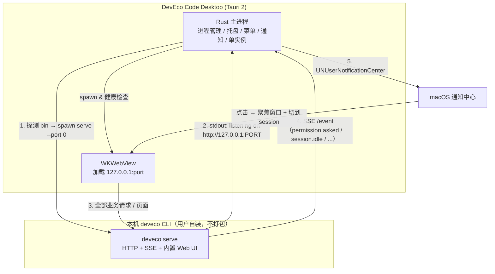

# DevEco Code Desktop 实现方案（macOS 优先）

> 日期：2026-11-06 ｜ 状态：决策稿 ｜ 本机实测环境：`@deveco/deveco-code@0.2.5`（npm），macOS arm64

## 1. 结论

**做 Tauri 2「薄壳 + 事件旁路」，不自研聊天 UI。**

关键事实：`deveco serve` 启动的 HTTP 服务在 `/` 直接返回**完整的 DevEco Code Web 应用**（SolidJS，标题 `DevEco Code`，主题变量沿用上游 opencode 的 `oc-*`）。也就是说官方 CLI 已经自带一套可用 UI 和一套稳定的 HTTP + SSE 契约。

因此桌面端只需要做「OS 集成层」：窗口/托盘/菜单/快捷键/单实例 + 生命周期管理 + **通知**。聊天、会话、权限弹窗、diff 全部复用官方 Web UI。这样：

- 开发量从 25–40 人日降到 **8–12 人日**；
- **跟随官方更新是免费获得的**——UI 随 CLI 升级自动变，不需要适配；
- 唯一需要长期维护的是「SSE 事件 → 通知」这一段薄胶水，只依赖 4 个已存在的稳定事件；
- 选 Tauri 而不是 Electron 的硬理由：macOS 上 Electron 的通知与自动更新**都要求代码签名**，Tauri 两者都不要求（见 §8），可以零成本起步、有账号后再补。

## 2. 已核实的事实（本地实测，非推断）

| # | 事实 | 证据 |
|---|---|---|
| 1 | CLI 是 opencode 的定制分支，MIT 许可 | `README.md`：「基于开源项目 OpenCode 扩展开发」；`package.json` `"license": "MIT"`；源码仓库 `gitcode.com/openharmony-sig/deveco-code` |
| 2 | 存在 headless server 与 ACP server | `deveco serve` / `deveco acp` / `deveco attach <url>` / `deveco web` |
| 3 | server 暴露 164 个 API path，含 SSE | `GET /doc` 返回 OpenAPI 3.1（`title: opencode`，`description: DevEco Code API`） |
| 4 | SSE 实测可用 | `curl /event` 立即收到 `data: {"type":"server.connected"}` |
| 5 | 事件契约粒度足够做 UI/通知 | schema 中有 `session.idle`、`session.error`、`permission.asked`、`permission.replied`、`session.next.step.ended`、`session.next.tool.failed`、`message.part.delta` 等 |
| 6 | 根路径就是完整 Web UI | `GET /` 返回 SolidJS 应用 HTML（含 CSP、manifest、theme 预加载脚本）；`/favicon.png`、`/social-share.png` 均 200 |
| 7 | 健康检查端点 | `GET /api/health` → `{"healthy":true}` |
| 8 | 端口可发现 | `--port 0` 随机端口；stdout 打印 `deveco server listening on http://127.0.0.1:<port>` |
| 9 | 原生二进制 161 MB，平台包分发 | `@deveco/deveco-code-darwin-arm64/bin/deveco`；launcher 支持 `DEVECO_BIN_PATH` 覆盖 |
| 10 | 发布节奏为周级 | npm 上 0.2.0(9/10) → 0.2.5(10/28)，且已有 `0.3.0-stable` 预发布；`CHANGELOG.md` 逐版本记录 |
| 11 | 默认无鉴权 | 日志：`Warning: DEVECO_SERVER_PASSWORD is not set; server is unsecured.` |
| 12 | 配置/数据目录 | `~/.config/deveco/`（配置、AGENTS.md、skills）、`~/.local/share/deveco/`（`deveco.db` 会话库、auth.json） |
| 13 | ACP 形态未确认为 stdio | 向 `deveco acp` stdin 发 `initialize` 无任何响应；带 `--port` 启动也未监听端口 → **不把 ACP 作为方案依赖** |

## 3. 方案对比

| 维度 | **A. 薄壳 + 事件旁路（推荐）** | B. 薄壳 + 自研增强面板 | C. 全自研 UI（对接 API） | D. Fork opencode 官方 desktop | E. 套现成 ACP 桌面壳 |
|---|---|---|---|---|---|
| 做法 | Tauri 2 加载 `127.0.0.1:<port>/`，Rust 侧订阅 SSE 做通知 | A + 侧边栏/多项目看板用 React 自研 | React/Solid 全量重写聊天/权限/diff | 抄 opencode `packages/desktop`（**Electron** + electron-vite，MIT）换后端 | 用 AionUi / acp-ui 直接连 `deveco acp` |
| 开发量 | **8–12 人日** | 20–25 人日 | 25–40 人日 + 长期跟进 | 12–18 人日（Electron 架构可抄，但要接通知/签名的坑） | **1–3 人日**（若 ACP 可用） |
| 跟随官方更新 | **自动**（UI 与 API 都由 CLI 提供） | UI 自动，自研部分需适配 | 全靠自己适配，节奏周级 → 长期负债 | 需定期 rebase 上游，且与官方 UI 重复 | 自动 |
| UI 掌控度 | 低（只能注入 CSS/JS） | 中 | 高 | 中 | 低（是别人的产品形态，HarmonyOS 相关面板全丢） |
| 必须 Apple 签名 | **否** | 否 | 否 | Electron 通知/自更新需要 | 取决于壳 |
| 主要风险 | 官方改 UI 结构导致注入失效（非阻塞） | 两套 UI 风格割裂 | API 漂移 + 工作量失控 | 双份维护 + 签名阻塞 | ACP 实测不通，且不是你要的 DevEco 体验 |

**选 A。** B/C 不是被否决，而是排在 A 的 M4 之后按需追加——A 的架构不改一行就能长出 B。E 保留为 M0 的一个 30 分钟旁路验证（若 `deveco acp` 真能用，可用 `acp-ui` 快速验证协议层，但不作为产品形态）。

### 3.1 参考实现：抄什么、不抄什么

| 项目 | 许可证 | 可抄的部分 |
|---|---|---|
| [opencode `packages/desktop`](https://github.com/anomalyco/opencode/tree/dev/packages/desktop)（Electron，MIT，活跃） | MIT | **架构与工程手法**：CLI 二进制放 asar 之外、按 version-arch 分 stage、启动前 `Service.discover({version})` 复用已运行实例、解析 stdout 的 `listening on` 行 |
| [AionUi](https://github.com/iOfficeAI/AionUi)（34k★，Apache-2.0，ACP，20+ CLI 解耦） | Apache-2.0 | **产品形态**：多后端切换、会话侧边栏、权限确认交互的组织方式 |
| [jockey](https://github.com/recailai/jockey)（MIT，Tauri+Rust+SolidJS+ACP）、[acp-ui](https://github.com/formulahendry/acp-ui)（MIT） | MIT | **Tauri 最小实现骨架**：Rust 拉起子进程 + ACP/流式事件 → 前端 |
| [opcode/winfunc](https://github.com/winfunc/opcode)（22.4k★）、crystal、claudecodeui | **AGPL-3.0** | **一个字节都不要抄**（AGPL 传染性，会污染整个仓库）；只看交互设计 |

> opencode 本身是 MIT，DevEco Code 也是 MIT，参考其代码安全。注意：网上不少二手资料把 opencode desktop 说成「Tauri + SolidJS」，**以仓库 README 为准——它是 Electron**。

## 4. 架构



**职责切分**

- **Rust 侧**（唯一需要长期维护的代码）：CLI 定位 → 启动 → 端口发现 → 健康探测 → 崩溃重启 → 退出清理；单实例锁；托盘/菜单/全局快捷键；SSE 订阅与通知映射；随机生成 `DEVECO_SERVER_PASSWORD` 注入子进程与 WebView。
- **WebView 侧**：零改造加载官方 UI。可选注入 20–80 行 CSS/JS 做品牌化与「通知点击后切 session」的桥接。
- **不做的**：不解析 CLI 的本地数据库（`deveco.db`），不内嵌 161 MB 二进制，不实现聊天/权限/diff。

## 5. 通知设计

Rust 侧常驻一个 SSE 订阅（`GET /event`，`text/event-stream`），按下表映射。原则：**只订阅 4 个事件，未知事件静默忽略**，这样上游加事件不会打断我们。

| 事件 | 触发场景 | 通知 |
|---|---|---|
| `permission.asked` | Agent 要执行命令/改文件，等用户批准 | 高优先级：「DevEco Code 需要授权：<permission>」，点击 → 聚焦并定位到该 session（UI 里完成批准） |
| `session.idle` | 一轮任务结束 | 普通：「任务完成 · <项目名>」，点击 → 聚焦该 session |
| `session.error` / `session.next.tool.failed` | 出错 | 普通：「执行失败」，点击 → 聚焦 |
| `session.next.step.ended` | 长任务阶段推进（可选） | 默认关闭，设置项开关 |

工程要点：

- 实现用 `tauri-plugin-notification`。首次运行需请求权限；**Tauri 在 macOS 上不强制签名**（Electron 则必须签名，未签名会触发 `failed` 事件），这是选 Tauri 的直接收益。
- 通知里带「批准/拒绝」按钮需要 `UNNotificationCategory` + action，Tauri 桌面端插件对此**没有明确文档**——M0 先只做「点击跳转」，按钮作为 M2 的待验证项（必要时 Rust 侧写 30 行 objc2 桥接）。
- 去抖与聚合：同一 session 10 秒内的同类事件只发一条；应用前台激活时默认不发（符合 macOS 习惯，可在设置里关闭）。
- 兜底通道：若 SSE 断开，用 `/permission` 与 `/session/status` 轮询（5–10s）补状态——只在窗口最小化/后台时启用。

## 6. 怎么「跟随官方 CLI 更新」

这是本方案的核心优势，靠三层保障：

1. **零版本耦合**：不打包 CLI、不锁定版本。用户用 `npm i -g @deveco/deveco-code` 或 `deveco upgrade` 自行升级，桌面端永远驱动「本机那一个」。opencode 官方 desktop 也是同一思路（CLI 二进制放 asar 外、按版本分 stage、启动前探测版本并复用已运行实例），已被验证可行。
2. **只依赖最小契约 + 能力探测**：启动时 `deveco --version`，建立 `(major,minor) → 能力` 表；只依赖 v1 的 `/session`、`/event`、`/permission` 与 `/doc` 探活，**不用** `/api/*`（v2 预览面，operationId 带 `v2.` 前缀，明显在演进）。未知新版本一律降级到最小契约，功能照常可用。
3. **CI 契约回归**（最关键、成本最低）：每日/每发版跑一次——
   `npm i -g @deveco/deveco-code@latest` → `deveco serve` → 抓 `/doc` → 与我们用到的 path/schema 做快照 diff → 变了就自动开 issue 并标红。
   同时监听 npm 上 `@deveco/deveco-code` 新版本（发布节奏约每周），提前在 branch 上跑同样检查。

配套细节：

- **CLI 定位顺序**：`DEVECO_BIN_PATH` 环境变量 → app 设置里手选（持久化）→ 常见路径探测（`/opt/homebrew/bin`、`/usr/local/bin`、`~/.nvm/versions/node/*/bin`、`npm prefix -g`）→ **用 login shell 执行 `which deveco`**。注意 GUI 应用拿到的 PATH 只有 `/usr/bin:/bin:/usr/sbin:/sbin`，直接 `which` 必然失败，这是本方案最容易踩的坑。
- **端口策略**：优先固定端口（如 4096，与 opencode SDK 默认一致）并先 `/api/health` 探活——若已有同项目 server 直接复用；否则 `--port 0` 随机端口并解析 stdout 的 `listening on` 行。
- **进程生命周期**：`serve` 作为子进程，退出时 `SIGTERM` + 5s 后 `SIGKILL`；异常退出按指数退避重启（上限 3 次）并提示。

## 7. 里程碑与验收

| 里程碑 | 内容 | 人日 | 验收标准 |
|---|---|---|---|
| **M0 骨架** | Tauri 2 空壳 + CLI 探测 + spawn serve + 端口发现 + 加载 `/` | 2 | 双击 .app 能出现官方 UI，能发消息、能看回复 |
| **M1 通知** | SSE 订阅 + 4 类事件映射 + 权限申请引导 + 点击聚焦 | 2 | 后台运行时，Agent 请求权限 / 任务结束能各自弹出一条通知，点击回到对应位置 |
| **M2 桌面化** | 托盘 + 原生菜单 + 全局快捷键（唤起）+ 单实例 + 崩溃重启 + 设置页（CLI 路径/通知开关）+ `DEVECO_SERVER_PASSWORD` | 3 | 关窗不退进程，托盘可唤回；杀掉 serve 后 5s 内自愈 |
| **M3 分发** | 打包 .app/.dmg、ad-hoc 签名、Tauri updater（自建 Ed25519 密钥，不需要 Apple 账号）、README | 2 | 另一台 M 系列 Mac 免配置可用（CLI 已装前提下），旧版能收到更新提示 |
| **M4（可选）** | 增强面板（多项目看板/diff/历史）或通知内直接批准 | 10+ | 按需 |

M0 的验证命令（先于写代码）：

```bash
deveco serve --port 0 --print-logs     # 观察 listening 行格式与退出行为
curl -s localhost:<port>/api/health     # 探活契约
curl -N localhost:<port>/event          # 观察 server.connected 与真实事件流
```

## 8. 风险与未验证项

| 项 | 状态 | 处置 |
|---|---|---|
| Tauri 桌面端通知 action 按钮（批准/拒绝） | **未验证** | M2 验证；不行则退化为「点击跳转」，或 Rust 侧 objc2 桥接 |
| `deveco acp` 是否提供 stdio ACP | **未验证**（实测无响应） | 不作依赖；M0 花 30 分钟旁路验证，通了可白得 ACP 生态（AionUi/Zed 等） |
| 内置 Web UI 的注入可行性（CSP `script-src 'self'`） | **未验证** | Tauri 的 `initialization_script` 在页面脚本前执行，通常可绕过 CSP；仅用于品牌化与桥接，失败不影响主流程 |
| `/api/*` v2 面稳定性 | 高风险 | 明确不使用，只用 v1 |
| 上游 UI 改版导致注入失效 | 中 | 注入层做特性检测，失败静默降级 |
| Electron 路线被签名卡死 | 确定（官方文档） | 已在选型阶段规避：不用 Electron |
| 未签名分发 Gatekeeper 拦截 | 确定 | 内部分发用 ad-hoc 签名 + 右键打开说明；对外需 Apple Developer（¥688/年） |
| 161 MB 二进制冷启动 | 需实测 | serve 常驻 + 托盘不退，避免反复启动 |
| 本地其他进程可访问无鉴权 server | 确定（日志已警告） | M0 即生成随机 `DEVECO_SERVER_PASSWORD` 注入 |

## 9. 后续事项

- M0 结束后用真实事件流回填通知去抖参数。
- 若后续要脱离「官方 UI 长什么样」的限制，再启动 M4，届时新面板走 `/api/session`、`/api/session/{id}/prompt`、`/api/session/{id}/wait`（v2），与壳内的 Web UI 并存于同一窗口的独立 Tab。
- Windows 端复用同一 Rust 层，差异在通知（Toast + AppUserModelID）与 CLI 发现逻辑，预估 +3 人日。
- ACP v1/v2 存在方法名差异（v2 仍是 draft），若走 ACP 路线必须锁版本。

---

## 10. 实施记录（2026-11-06）

M0（骨架）与 M1（通知）已完成并自测通过，代码在本仓库。

| 项 | 状态 | 证据 |
|---|---|---|
| Tauri 壳 + CLI 发现 + 拉起 serve + 导航到官方 UI | ✅ | .app 启动 1.7s 就绪，窗口渲染官方 Web UI |
| SSE 订阅 + 4 类事件映射 + 通知投递 | ✅ | `/event` 收到 `server.connected`（45ms）；测试通知成功投递 |
| 通知策略/去抖/文案 | ✅ | 单测 31 项全过 |
| 进程生命周期（启动/退出/异常） | ✅ | 退出后进程组回收、端口释放、无孤儿 |
| 托盘 + 单实例 + 关窗退到托盘 | ✅ | 已实现，托盘的交互未做自动化验证 |
| 通知点击定位会话 / 通知内批准 | ❌ 未做 | Tauri 桌面端 notification 无 action 回调，M2 验证 |

实施中修正了方案里的两处假设：

- **`--port 0` 不可靠**：CLI 会把它当成默认 4096，必须应用侧显式挑空闲端口。
- **launcher 会留孤儿**：`/opt/homebrew/bin/deveco` 是 node 包装脚本，只杀它会留下
  161MB 的原生子进程继续占端口。必须按进程组发信号。

仍待真人验证（自动化无法覆盖）：通知横幅在锁屏/勿扰模式下的表现、通知点击后的
窗口聚焦体验、托盘菜单交互。

---

## 11. 结构重构（v2，2026-11-06 晚）

第一版是「Tauri 窗口 = 官方 Web UI」，实测可用但结构上就是个网页：没有自定义标题栏、
没有工作区树、没有状态栏、没有右面板。按「对齐 DSH Desktop 结构」的要求改为自研前端。

**保留的**：Rust 侧的 CLI 发现、进程生命周期、SSE 订阅、通知策略、进程组回收（这些与 UI 无关）。
**替换的**：窗口内容从「官方 UI」改为 React 应用；新增 `server_request` 通用代理，
前端所有请求经 Rust 转发（绕开 CORS/ATS，连接信息不外泄）。
**兜底的**：官方 Web UI 保留为「经典界面」独立窗口（`open_classic_view`）。

> 2026-11-07 更新：产品决定去掉经典界面，所有入口与 `open_classic_view` 已删除，见 §22.12。

实现范围（Phase 1）：标题栏 + 工作区树 + 会话列表 + 对话流（markdown/思考/工具卡片）+
权限审批卡片 + composer + 状态栏 + 右面板（变更/文件）。未做：多 Tab（轨迹/版本/上下文）、
设置页、通知点击定位。

新增修复的两个进程问题：

1. **信号退出不回收**：`kill -TERM` 走的是进程终止路径，不触发 Rust `Drop` 与 `RunEvent::Exit`，
   serve 会变孤儿。加了 `SIGTERM/SIGINT/SIGHUP` 处理器，直接把 serve 进程组杀掉。
2. **事件缺口**：外部创建的会话不会出现在侧栏（只处理了 `session.updated`），补上 `session.created`。

验证：`cargo test`（含编码/拼接等单测）+ `deveco-selftest` 11 项全过（新增「代理读写路径」
覆盖 UI 实际使用的 POST/GET/DELETE）+ GUI 截图确认三栏结构与实时会话更新。

---

## 12. 自测与优化（2026-11-06 深夜，自主测试轮）

按「自主测试，继续优化」做了一轮真机验证，结论与修复：

| 发现 | 影响 | 修复 |
|---|---|---|
| `/event` 只推 serve 启动目录所属实例的事件 | **跨工作区的流式对话完全不工作**（UI 只有打开会话时的全量快照） | 改订阅 `/global/event`，解包 `{directory, project, payload}` 后转发；解包逻辑下沉到 lib 并加单测 |
| `/tmp` 与 `/private/tmp` 路径不一致 | 启动目录参数匹配不到工作区 | `startup_directory` 做 `canonicalize` |
| 应用永远恢复上次工作区 | 无法从外部「在指定目录打开」 | 新增 `DEVECO_DESKTOP_DIR` 启动参数（也是深链落点） |
| `SIGTERM` 退出不触发 Drop/RunEvent | serve 变孤儿占端口 | 注册 `SIGTERM/SIGINT/SIGHUP` 处理器，直接杀进程组 |
| 外部创建的会话不进侧栏 | 多入口协作时列表滞后 | 处理 `session.created` |
| 工作区注册表残留已删除目录 | 侧栏噪音 | 新增 `path_exists` 命令，启动时过滤 |
| 自动滚动会打断用户翻阅 | 体验 | 仅在距底部 90px 内自动滚动 |
| 思考块无耗时、与正文粘连 | 可读性 | 显示 `思考过程 · 1.6s`，完成态默认折叠 |

验证方式（两个临时工作区、共 8 轮真实 prompt）：

- `/tmp/deveco-ui-e2e`：6 轮问答，逐帧截图确认「思考中…」实时滚动、正文逐字到达、
  状态栏 11 轮/11 步/token 同步；并用 `curl` 旁路抓 SSE 原始流核对事件类型。
- `/tmp/deveco-ui-tool`：要求「读 README.md + 执行 ls」，验证工具卡片——
  `read 完成 README.md`、`bash 完成 List files in current directory` 两张卡片正常渲染，
  最终回答正确。

测试会话与临时目录已清理。仍未真机验证：权限审批卡片（本机 deveco 配置是
`permission: allow`，不会触发 `permission.asked`；要验证需临时改成 `ask`）。

自动化护栏：`cargo test` 34 项；`deveco-selftest` 11 项（新增全局事件订阅与代理读写路径）。

---

## 13. 设置页（2026-11-06）

实现方式：`⌘,` 打开的模态面板，四块内容 + 底部保存栏。

- **可写**：CLI 路径、端口偏好、本地口令开关、通知总开关与四类事件开关、前台静音。
  写入 `~/Library/Application Support/DevEco Code Desktop/config.json`；
  通知类改动**即时生效**——SSE 事件处理每次实时读取配置，不需要重启。
- **只读**：运行状态（CLI 路径/版本、服务地址、应用版本）与 CLI 自身配置
  （`GET /config` 的 model / small_model / permission / plugin）。
- **诊断**：打开日志目录、打开配置文件、重启应用（`app.restart()`）。

交互细节：面板内焦点陷阱（Tab 不跑到主界面）、`Esc` 关闭、`⌘S` 保存、保存按钮 dirty 才可用。

验证：用 AppleScript 驱动键盘（`⌘,` → Tab×8 → Space → `⌘S`）把「任务完成时提醒」关掉，
再直接读 `config.json` 确认 `on_idle: false`，随后改回 true；设置页各区块截图核对，
包括滚动后的通知开关、CLI 只读配置与诊断按钮。

已知未做：CLI 配置（模型/权限模式）目前只读，尚未提供在桌面端直接修改的能力。

---

## 14. 基础功能补齐（2026-11-06 夜）

本轮做的功能与修掉的缺陷：

| 功能 | 实现要点 |
|---|---|
| 工作区懒加载 | 展开时按 `directory` 拉 `/session`，避免启动时把每个工作区都拉一遍 |
| 会话重命名 | `PATCH /session/{id}` 改 title；`✎` 或双击标题进入内联编辑，回车提交 |
| 会话删除 | `DELETE /session/{id}`；行内二次确认（不用原生 dialog，避免和 WebView 打架） |
| 模型选择 | `/api/model` 拉 49 个模型，composer 胶囊 + 搜索；选中后 `POST .../message` 带 `model` |
| 文件面板 | 目录浏览 `GET /file?path=`、搜索 `GET /find/file?query=`、预览 `GET /file/content?path=` |

同时修掉三个真 bug：

1. **会话重复**：`POST /session` 的响应与 `session.created` 事件竞争，两边都插入列表 → 侧栏出现两条。改为统一 `upsertSession` 按 id 去重。
2. **文件面板永远为空**：`/find/file` 必须带 `query`，不带直接 400。改为「目录浏览 + 关键字搜索」两条路径。
3. **非当前工作区展开看不到会话**：只加载了当前工作区的列表。改为按需加载。

验证方式：用 `agent-desktop` 走 macOS 辅助功能树**无焦点驱动**（不抢鼠标键盘），
依次验证：选择项目 → 新建会话 → 删除会话（✕→确认）→ 模型切换（胶囊变成 MiniMax）
→ 文件面板目录进入/预览 README → 展开未选中的工作区看到懒加载会话。
会话重命名因为 AX 点击无法让输入框真正聚焦，改用「API 改名 + 观察 SSE 实时更新」验证。
`cargo test` 34 项、`deveco-selftest` 11 项仍全绿。

---

## 15. 第二轮补齐（2026-11-06 深夜）

| 功能 | 实现 |
|---|---|
| 原生菜单 | Tauri MenuBuilder：应用菜单（关于/设置 ⌘,/隐藏/退出）、文件（新建会话 ⌘N/关闭窗口）、编辑（标准项）、视图（右栏 ⌘⇧B/快捷键/日志/重载 ⌘R）、窗口。菜单事件经 `deveco://menu` 交给前端执行（经典界面菜单项已于 2026-11-07 移除） |
| 窗口状态记忆 | `tauri-plugin-window-state` |
| 窗口标题 | 命令 `ipc::set_window_title`，前端按「会话 · 项目」同步 |
| 消息复制 | `navigator.clipboard`，悬停显示「复制」，实测剪贴板内容正确 |
| 全局会话搜索 | 输入 300ms 防抖后并行请求各工作区 `/session?search=`，按来源工作区分组展示，点击可跨工作区打开 |

又修掉两个真 bug：

1. **工作区重复**：CLI 的 `/project` 会对同一路径返回多条不同 id 的记录，侧栏出现两个同名工作区。改为按 `worktree` 去重。
2. **会话插错工作区**：全局事件流里 `session.created/updated` 带自己的 `directory`，之前一律塞进「当前工作区」，导致别处的会话出现在当前项目下。改为按事件自带的 directory 归位。

验证：`agent-desktop` 驱动菜单（文件→新建会话，窗口标题随即变成
「New session - … · DevEcoCodeDesktop」）、复制按钮（`pbpaste` 内容与消息一致）、
搜索框输入 `omega` 后在未展开的 `sampleworkspace-harmony` 下搜到目标会话；
`cargo test` 34 项 + `deveco-selftest` 11 项全绿。测试会话已清理。

---

## 16. 第三轮：停止、变更、归档（2026-11-06 深夜）

| 功能 | 实现 | 验证 |
|---|---|---|
| 停止生成 | `streaming` 改为事件驱动（`message.updated` 的 assistant 角色 / `session.next.step.started` 置真，`session.idle` 置假），外部触发的任务也能停止 | 发 3000 字长文，中途点「停止」，实际只产出 138 字后中断 |
| 变更面板 | 会话快照 diff 为空时回退到 `GET /vcs/diff?mode=git` | 临时 git 仓库里让 Agent 改 README，面板显示 `README.md +2` |
| 会话归档 | `PATCH /session/{id}` 写 `time.archived`；侧栏过滤 + 「显示归档」开关 + `⇩/↩` 往返 | 默认隐藏，开关后出现「归档测试」 |

排查中的发现（CLI 侧，非本应用 bug）：`/project` 会为同一路径返回多条不同 id 的记录。
当项目在注册后又 `git init`，会话会挂在旧 projectID 上，导致 `GET /session?directory=`
查不到该会话（记录本身还在，`GET /session/{id}` 可读取）。桌面端按 worktree 去重后行为一致，
但这类历史数据需要 CLI 侧修复；已在文档中记录。

`cargo test` 34 项全绿；测试会话与临时目录均已清理。

---

## 17. 第四轮：输入体验（2026-11-06 深夜）

屏幕中途休眠，本轮先做不依赖 GUI 的功能，恢复后逐项补验：

| 功能 | 实现 | 验证 |
|---|---|---|
| @ 文件引用 | composer 检测光标前 `@关键字`，200ms 防抖走 `/find/file`，`↑↓`/`Enter`/`Esc` 键盘操作，插入 `@path` | 输入 `@readme` 弹出 5 个候选，Enter 后变成 `@README.md`，且不会误触发送 |
| 快捷键面板 | `⌘/`（菜单「视图 → 快捷键」同效），分组展示 12 条快捷键 | 截图确认渲染与分组 |
| 消息时间戳 | 悬停消息显示 `HH:mm` | 打开会话后 AX 读到 `22:16` |
| 发送失败保留原文 | 失败时把文本写回 `failedText`，composer 自动回填 | 代码路径（难以稳定复现失败） |
| 归档视图持久化 | 「显示归档」状态存 localStorage | 重启后保持 |

`cargo test` 34 项全绿，`tsc --noEmit` 通过。

---

## 18. 第五轮：导出、查找、布局（2026-11-06 深夜）

| 功能 | 实现 | 验证 |
|---|---|---|
| 会话导出 | Rust 命令调用 `deveco export <sessionID>`，JSON 落盘到数据目录并在 Finder 定位；菜单「文件 → 导出当前会话」⌘E | 生成 `ses_…-<ts>.json`，内容含 info 与消息 |
| 会话内查找 | `⌘F` 查找条，按消息文本过滤并高亮当前命中，Enter/⇧Enter 跳转 | 查找条成功打开（截图） |
| 侧栏拖拽 | 网格列宽跟随鼠标，双击复位，宽度持久化，读取时夹紧到 220–460 | 代码路径（未做真人拖拽） |

过程中发现并修掉一个隐患：持久化的侧栏宽度没有夹紧，一条异常值会把三栏布局挤成竖排
（现场出现内容竖排显示）。改为在读取时就 clamp。

**本轮提前收尾**：测试期间检测到用户正在使用这台机器（另一个应用在前台并有输入），
为避免键鼠注入打断用户操作，立即停止了所有 GUI 自动化，剩余人工验证项留待屏幕空闲时补。

---

## 19. 第六轮：附件（2026-11-06 深夜）

选择用 WebView 原生 `<input type="file">` + `FileReader` 转 data URL，**不引入新依赖**
（不需要 Tauri dialog 插件），拼成 `FilePartInput { type, mime, url, filename }` 随 prompt 发送。

- 限制：最多 4 个附件、单个 ≤ 8MB，超出静默忽略并保留已有附件。
- 交互：`+` 选择 → chip 列表（可单个移除）→ 发送后清空；消息气泡上方渲染附件 chip。
- 验证：直接用 UI 相同的 payload 调 `POST /session/{id}/message`（`noReply`，不花 token），
  CLI 返回 `parts: [text, text(内联内容), file(note.txt)]`，说明 data URL 被正确解析。
- 视觉验证留给用户（屏幕被用户占用，未做键鼠注入）。

亮色主题与 ⌘K 命令面板评估后放到后续：现有 CSS 有较多硬编码颜色，换主题需要一次变量化整理，
不适合在无法视觉验证的时段做。

---

## 20. 收尾（2026-11-06 深夜）

修掉一个把布局彻底打乱的 bug：侧栏拖拽条被当成 grid 子元素插进网格，导致主区被挤到第三列、
右栏换行、内容竖排显示（前几轮那次「竖排文字」也是它）。改为绝对定位（`left = 侧栏宽度`），
布局恢复正常。

阶段交付状态：功能清单见 README，`cargo test` 34 项、`deveco-selftest` 11 项、`tsc --noEmit` 全绿。
用户开始自行体验测试。

---

## 21. 与 CLI TUI 对齐（2026-11-06 深夜）

用户提供了 CLI 启动页截图（`Build · Qoder · routing group · max · 2 mcp servers · tab agents · ctrl+p commands`），
据此补齐四个此前缺失的基础能力：

| 能力 | 接口 | 实现 |
|---|---|---|
| Agent 切换 | `GET /agent`（mode=primary） | composer 左侧 `build` 胶囊 + 下拉，随消息发 `agent` |
| 推理档位 | `/api/model` 的 `variants` | 选中带变体的模型时，发送按钮左侧出现档位菜单，随消息发 `variant` |
| 斜杠命令 | `GET /command`（62 条） | 输入 `/` 弹出面板，↑↓/Enter/Esc，插入 `/name ` |
| MCP 状态 | `GET /mcp` | 状态栏 `2 MCP`，同时显示当前 agent |

验证：截图确认 agent 胶囊、`agent: build · 2 MCP` 状态栏、`/` 弹出的命令列表（debug/init/review/analyze/…）。

另外确认了两件影响选型的事实：`deveco acp` 是标准 ACP agent（`initialize` 返回协议 1、
`agentInfo: DevEco Code 0.2.5`，但 `session/new` 仍未走通）；`deveco serve --cors` 正常返回
`access-control-allow-origin`，纯浏览器前端直连可行。

---

## 22. 可靠性收口（2026-11-06 深夜，第二轮自主推进）

目标：把「功能齐全」推到「挂了能自己起来、且看得见」。按上一轮计划的阶段 0 / 阶段 1 执行；
分发（签名 + 公证 + updater）因确认「只有自己用」而取消，验证债与体验顺延。

### 22.1 做了什么

| 项 | 实现 |
|---|---|
| 后端监管者 | 新增 `src/supervise.rs`：`Supervisor` 持有 `Backend`，`ensure()` 先健康检查、不健康就回收旧进程组再按原配置重建；`Phase`（starting/ready/reconnecting/recovering/failed）+ `backoff()`（1/2/4/8/15s 封顶）为纯逻辑，带单测 |
| 主循环 | `boot()` 改为 `run_backend()`：ensure → 发布 ready → 消费事件流 → 断流后健康检查 → 不健康则重建；失败进入退避，用户可打断 |
| 状态广播 | 新事件 `deveco://backend`（含 `state/attempt/detail`）+ 命令 `backend_state`、`retry_backend`；`BackendCtl` 保存最近状态避免启动竞态 |
| 前端三态 | 标题栏/状态栏由 `sseOk` 改为后端状态驱动；新增主区提示条（重连中为黄色，失败为红色并带「立即重试 / 诊断」）；恢复后自动重拉会话、消息、授权与 diff |
| 退出闸门 | `RunEvent::Exit` 先置 `SHUTTING_DOWN` 再回收进程组，监管循环看到闸门立刻停手 |
| 启动窗口兜底 | `server.rs` 在 `spawn()` 后立即登记进程组（`ACTIVE_PGID`），信号处理与退出流程都能带走在「健康检查期间」的 serve |
| 启动失败清理 | `DevEcoServer::spawn` 的三条失败路径改为按进程组 SIGKILL；`cli::read_version` 超时同样按进程组清理 |
| 请求超时 | 代理 HTTP 超时 300s → 30s；`deveco --version` 探测上限 5s（超时后仍可继续启动，只是版本未知） |
| 配置回写修复 | `apply_backend` 之前只把默认配置写回磁盘，会把用户的 CLI 路径/通知开关冲掉；改为先同步「磁盘加载的配置」再保存 |
| 构建脚本 | `ui/package.json` 的 dev/build 加 `--configLoader native`，绕开本机 esbuild 配置加载挂死 |

### 22.2 验证与证据

- `cargo test`：**40 项通过**（新增 `Phase::key`、`backoff` 边界、`one_line` 压缩、状态判定 4 组）。
- `deveco-selftest`（解锁状态下跑通）：**12 项通过**，新增「崩溃自愈（SIGKILL → 自动重建）」——
  实测 `http://127.0.0.1:65112` → `65128`，**1.8s** 恢复并通过健康检查。
- 真机 GUI（debug 包）：
  - 就绪态截图：标题栏「已连接」、状态栏「事件流已连接」。
  - `kill -9` serve 进程组：日志 `事件流中断（第 1 次）→ 健康检查未通过 → 重建后端 → 后端已就绪`，约 2s；端口 65518 → 49205。
  - 连续杀进程制造失败态：横幅「本地服务已停止 / deveco serve 启动后立即退出，输出：（无输出）」+ 立即重试/诊断；标题栏「后端不可用」、状态栏「本地服务不可用」。
  - 点「立即重试」（AX 语义点击）：日志 `用户要求立即重试后端` → 立即重建 → 2s 恢复，绕过 15s 退避。
  - 退出应用：日志 `退出：回收 serve 进程组`，退出后无 serve 残留。
  - 启动窗口期 SIGTERM：无 serve 残留（补 `ACTIVE_PGID` 之前这里会漏）。

### 22.3 过程中发现的真实缺陷（都已修）

1. **退出时监管循环复活 serve**：首次实现没有退出闸门，`Cmd+Q` 后事件流中断被当成崩溃，进程退出前又拉起一个 serve，
   留下孤儿并占住 CLI 数据库。证据：日志出现「退出：回收进程组 54365」紧接着「正在重建后端…」。
2. **启动失败只杀 launcher**：`kill_on_drop` 不管孙进程，serve 启动超时后 161MB 原生二进制继续存活；
   它占住 `deveco.db`，导致下一次启动 `--version` 直接卡死（实测 20s 无返回）。
3. **配置被默认值覆盖**：`apply_backend` 写盘的是 `SettingsState` 的初始默认配置而非磁盘配置。
4. **vite 构建挂死**：`vite build` 无输出卡住、空配置同样卡住，`--configLoader native` 正常。

### 22.3.1 构建链路（本轮补齐）

- 之前 `npm run build:debug` 在 dmg 步骤失败，根因是上一次失败构建留下的挂载卷
  `/Volumes/dmg.vmeBmR` 占着 `/dev/disk20`；`hdiutil detach` 后恢复正常。
- 本轮首次跑通 `npm run build`（release）：`.app` 21.4MB / `.dmg` 7.2MB；
  debug 产物 `.app` 66.8MB / `.dmg` 16.5MB。dmg 挂载验证过内容与 ad-hoc 签名。
- 新增 `npm run check`（前端构建 + 单测）与 `npm run check:selftest`（端到端，
  需解锁会话），已实测可用。

### 22.4 未完成 / 待验证

- **GUI 复验被锁屏阻塞**：23:46 起屏幕锁定，锁屏状态下 CLI 自身会挂（`deveco --version` 25s 不返回），
  自检与真机验证都无法继续；需解锁后复跑 `cargo test` + `deveco-selftest` + 一次断线恢复截图。
- 上一轮遗留的验证债未动：权限审批卡片（需要 `permission: ask`）、通知点击、托盘菜单。
- 阶段 3（亮色主题的 CSS 变量化、大会话手感）未开始。

### 22.5 解锁后的复验清单（按顺序执行）

1. `npm run check` —— 前端构建 + 40 项单测必须全绿（无需 GUI）。
2. `npm run check:selftest` —— 12 项端到端自检，重点看「崩溃自愈（SIGKILL → 自动重建）」。
3. 打开 `src-tauri/target/debug/bundle/macos/DevEco Code.app`，确认首屏能正常加载会话（不再是「加载中…」）。
4. 找到 serve 子进程，`kill -9` 整个进程组，3 秒内截图应看到主区出现黄色提示条
   （「与本地服务的连接中断」），随后自动恢复、提示条消失、当前会话仍在。
5. 连续杀进程直到出现红色「本地服务已停止」提示条，点「立即重试」确认立刻恢复。
6. 通过托盘「退出 DevEco Code」退出，`pgrep -f "deveco serve"` 应无残留。

排障入口：日志在 `~/Library/Logs/DevEco Code Desktop/app.log`；设置页诊断区块可直接打开。

### 22.6 亮色主题（阶段 3 第一部分，2026-11-07 凌晨）

做法：把写死的颜色收敛成语义变量，再用一份亮色变量表覆盖，**不改布局、不改结构**。

- 暗色仍是设计基准：`:root` 里的值保持原样，新增约 33 个组件级语义变量
  （`--btn-bg`、`--danger-border`、`--warn-bg`、`--shadow-rgb`、`--scrim` 等）。
- 亮色只覆盖变量：`:root[data-theme="light"]`。`ui/src/theme.ts` 在渲染前按
  `prefers-color-scheme` 写入 `data-theme`，已显式指定时不覆盖（为将来的
  「强制亮/暗」设置和截图工具预留入口）。
- 阴影改用 `rgba(var(--shadow-rgb), α)`，亮色下换成暖灰阴影，不会出现黑色发脏。

验证（无桌面会话也能做）：

| 检查 | 方法 | 结果 |
|---|---|---|
| 暗色无观感变化 | 同一份 mock 数据，改造前/后各截一张 1512×930，逐像素比对 | 差异 32 像素（0.002%），最大通道差 3，可忽略 |
| 亮色可读性 | WCAG 对比度计算（正文/次级/弱化/链接/状态/按钮/授权卡/提示条） | 暗色 12 项、亮色 12 项全部达标（最低 4.74，正文 15–16） |
| 布局未动 | 亮色截图与暗色截图同尺寸、同结构，只见颜色差异 | 通过 |
| 失败态提示条 | mock 广播 `deveco://backend{state:"failed"}` 后截图 | 两套主题下横幅、标题栏、状态栏文案与配色均正确 |

截图（本机 `.agent-temp/screens/`，未入库）：`21-dark.png`、`22-light.png`、
`23-light-failed.png`、`24-dark-failed.png`。

顺手补的可复用能力：`.agent-temp/mock/` 里有一套 Tauri IPC 假实现（假数据驱动真实前端），
不依赖 CLI 与桌面会话，可用 headless Chrome 直接出图；权限卡片、工具卡片、提示条
这类需要特定状态的界面都能用它复核。该目录在 `.gitignore` 内，属于临时工具。

### 22.7 启动失败退场与长会话实测（2026-11-07 凌晨）

**启动失败退场**：此前后端在启动阶段失败（CLI 缺失、锁屏导致 CLI 挂住等）时，前端要等
`api.health()` 轮询 60s 才退出启动页。现在 `App.tsx` 监听后端状态，一旦进入 `failed`
就直接进主界面并显示红色提示条（原因 + 立即重试 + 诊断），不再空等。

验证（mock 通道 + headless Chrome，`?bootfail=1`）：
- DOM 中 `boot-mark` 元素数 0（启动页已退场），`backend-banner` 存在；
- 红条文案「本地服务已停止 / deveco serve 启动后立即退出，输出：（无输出）」；
- 去掉了重复的错误 toast（原因由提示条承载）。

**长会话渲染实测**（mock 生成 N 条消息，headless Chrome 全量渲染后截图，取 3 次均值）：

| 消息数 | 整轮耗时（含 Chrome 启动 ~1.1s） | 实际渲染消息节点 |
|---|---|---|
| 50 | 1.14s | 全部 |
| 300 | 1.24s | 全部 |
| 800 | 1.35s | 1203 个节点 |
| 2000 | 1.35s | 3003 个节点 |
| 8000 | 2.22s | — |

结论：渲染成本约 0.13ms/条，2000 条以内额外耗时 ≈0.25s，8000 条约 1.1s。没有出现
病态膨胀，暂不做虚拟滚动（真机 WKWebView 的滚动手感仍需解锁后人工确认）。

### 22.8 主题选择项（2026-11-07 凌晨）

设置页新增「外观 → 主题」三选一：跟随系统 / 亮色 / 暗色。

- 选择存 `localStorage`（`deveco.desktop.theme`），纯前端偏好，不改 Rust 配置契约；
  只有「跟随系统」时才响应 macOS 外观切换。
- 分段控件用新的 `--seg-on-bg` 变量：暗色取 `#2a2724`，亮色取 `#ffffff` 加浅阴影；
  直接复用 `--control-bg` 在亮色下与轨道几乎同色，选中态看不出来（本轮踩到并修掉）。
- 验证（mock + headless Chrome）：`light.html` 中 DOM 为 `data-theme="light"` 且
  「亮色」为选中态；暗色页面「跟随系统」选中；两个主题的设置页截图配色正常。

### 22.9 失败路径回归测试（2026-11-07 凌晨）

`deveco-selftest` 新增「启动失败清理（假 CLI 立即退出）」：临时写一个只会打印版本、
`serve` 立即退出的假 CLI，走一遍 `Supervisor::ensure()` 的失败路径。

检查三件事：失败在 15s 内返回、错误原因包含「立即退出」、`server::active_pgid()` 为空
（进程组登记已清掉，不会留 161MB 孤儿）。

实测：**0.3s 失败，原因可读，进程组已清理**。这条用例在锁屏（CLI 真实挂住）时也能跑，
因为它不依赖真实 CLI，因此服务不可用的日子也能验证失败路径没有退化。

### 22.10 真机验收（2026-11-07 早，解锁后）

按 22.5 清单逐条执行，环境：macOS 本机、系统外观浅色、CLI 0.2.5。

| 项 | 结果 | 证据 |
|---|---|---|
| `npm run check` | ✅ | 前端构建 + 40 单测 |
| `npm run check:selftest` | ✅ 13/13 | 含崩溃自愈（1.8s）、启动失败清理（0.4s） |
| 首屏加载 | ✅ | 会话与消息正常渲染，无「加载中…」卡死 |
| 断线自动恢复 | ✅ | `kill -9` 进程组 → 标题栏「重连中」+ 黄色提示条「正在重启本地服务（第 1 次）」→ 约 2s 恢复（61565 → 61643），会话内容保留 |
| 失败态与手动重试 | ✅ | 连续杀进程 → 红色横幅「本地服务已停止…」+ 立即重试/诊断；AX 点击「立即重试」→ 日志「用户要求立即重试后端」→ 2s 恢复（61800） |
| 退出回收 | ✅ | 菜单「退出 DevEco Code」→ 日志「退出：回收 serve 进程组」「应用正在退出，跳过重建」，无 serve 残留 |
| 主题切换 | ✅ | 设置页选「暗色」全界面即时变暗；切回「跟随系统」后随系统恢复浅色 |
| 权限审批卡片 | ✅ | 临时把全局配置改成 `permission: ask` 后发一条「用 bash 执行 ls」：卡片渲染（需要授权 bash / ls / 三个按钮）→ 点「允许一次」→ 授权列表清空、`ls` 实际执行（输出 note.txt）、助手继续作答；同时验证权限通知真实投递 |
| 菜单栏 | ✅（读取） | AX 树含自定义菜单：文件（新建会话/导出）、视图（右侧面板/经典界面/快捷键/日志/重载）、设置 |

收尾：测试会话已删除，全局配置按备份还原（hash 一致 `99c5816b…`，`permission` 回到 `allow`），临时目录清理；
应用已用正常配置重启（后端 63283）。

未验证项：托盘菜单点击（AX 的 menu-bar-extras 面在扫描时反复报 inventory 不稳定）、通知点击行为、勿扰/锁屏下的通知表现、
「总是允许 / 拒绝」两条审批分支（与「允许一次」共用回复通道）。

### 22.11 图标体系与控件尺寸（2026-11-07 上午）

起因：界面上的图标一直用 Unicode 字形凑（`⌕ ✎ ⇩ ↩ ⚙ ◫ ↑ ✕`），实测偏小、粗细不齐：
字形墨迹只占 em 的 50–65%，12px 字号实际只有约 8px 的可见面积；`⇩/↩` 这类字符在系统字体里
还会被替换成不相关的箭头形状，跟设计意图对不上。

做法：

- 新增 `ui/src/components/Icon.tsx`：26 个线性图标，统一 24 视框、1.75 描边、圆角端点、
  `currentColor`，尺寸由调用方按层级给（14 行内 / 15–16 常规 / 18 主操作）。
  SVG 不参与文字基线，按钮统一 `display:grid; place-items:center`，不再出现上下抖动。
- 全量替换：标题栏面板开关、侧栏新建/搜索/展开箭头/重命名/归档/删除/设置、
  对话头导出与经典界面、查找栏上一个下一个关闭、工具卡与思考块与变更条目的展开指示、
  复制按钮、附件图标（原先是 🖼/📄 emoji）、右栏返回与上级目录、文件列表的目录/文件图标、
  设置页与快捷键面板的关闭。
- 点击热区同步放大（图标变大后原来的按钮显得挤）：`icon-btn` 26×24 → 32×26，
  行内小按钮 20 → 22，发送 26 → 32，附件 26 → 30，设置关闭 24 → 28。
- 顺手修的两处布局问题：变更条目的路径被 `space-between` 居中（补 `flex:1; min-width:0`）；
  设置面板 `tabindex=-1` 接焦点做键盘循环时会被画出焦点框（`.settings-panel:focus { outline: none }`）。
- 清掉死样式：`.chevron`（旧展开箭头，早就换成 `.chevron-btn`）、`.plus`（字形加号）。

验证：

| 检查 | 方法 | 结果 |
|---|---|---|
| 类型与构建 | `npm --prefix ui run build` | 通过 |
| 两套主题渲染 | mock（`.agent-temp/mock/{dark,light}.html`）+ headless Chrome 1440×900 @2x | 图标与文字基线一致，暗/亮两套配色下均正常 |
| 需要交互的状态 | mock 页面 `?s=find / settings / shortcuts / right / files / tool-open / confirm` 自动触发 | 查找栏、设置页、快捷键、右栏变更与文件列表、工具卡展开态、删除二次确认截图均正常 |
| 真机 | `npm run build:debug` + 重启 `.app`，`agent-desktop screenshot` 抓窗口 | 首屏、侧栏、composer、状态栏图标全部为新 SVG，WKWebView 下描边清晰 |
| 对比 | 与改造前的 `36-real-back-light.png` 同区域对照 | 图标可见面积约放大 1.6–2 倍，字形替换导致的不一致消失 |

证据（本机 `.agent-temp/screens/`，未入库）：`66-dark.png`、`67-light.png`、
`70-real-light.png` 及 `41/42/46/53/54/63/64/68/69/71/72` 等局部放大图。

未做：暗色真机截图（当前系统外观为浅色，未改动系统外观与主题偏好）；托盘菜单图标未定制。

### 22.12 @ 文件引用、移除经典界面、新应用图标（2026-11-07 上午）

三项产品需求一起做：输入框用 `@` 关联工作区文件、去掉右上角经典页面及所有入口、给 App 画一个匹配的图标。
下文记录实测事实、实现要点与验证边界。

#### 1. `@` 引用工作区文件

先对真实 `deveco serve` 做契约实测（临时工作区、`noReply`，不消耗模型 token）：

| 事实 | 证据 |
|---|---|
| `/find/file?query=` 的空值是合法的 | 返回工作区文件列表，目录项以 `/` 结尾；**缺少 `query` 键**才 400 `Missing key at ["query"]` |
| `file` part 用 `url: "file://<绝对路径>"` 时由 serve 读盘 | 响应里合成 `Called the Read tool with the following input: {"filePath":…}` 与 `<path>…<content>…` 的 synthetic text，模型直接看到内容 |
| 路径含空格/中文可直接编码进 URL | `%20` 与原样空格都能解析；中文按 UTF-8 百分号编码正常 |
| `mime` 客户端给近似值即可 | 传 `text/plain` 的 png 仍被按 `image/png` 处理 |
| 引用不存在的文件不会让消息失败 | 合成 `Read tool failed … File not found`，消息照常落库 |

实现：

- `Composer.tsx`：`@` 必须出现在行首或空白之后（`a@b` 邮件不触发），180ms 防抖查 `/find/file`；
  `↑↓` 循环、`Enter/Tab` 插入、`Esc` 关闭、点击插入；候选过滤目录项与已引用文件，最多 8 条；
  选中后写入 `@相对路径`，含空格时写 `@"path with space"`；输入框上方出现可删除的「引用」chip。
- 文本是唯一事实来源：chip、发送时的 file part 都从文本 `parseMentions` 派生，手删 token 时 chip 自动消失，
  删 chip 时同步切掉 token；发送失败恢复原文时按 token 是否仍在原文里恢复引用。
- `store.send(text, attachments?, refs?)`：parts 顺序为 text → 每个引用的 file part → 原附件；
  file part 带 `source: { type:"file", path, text:{ value: token, start, end } }`，位置按 trim 后真正发送的文本重算。
- 修复 Rust 代理缺陷：`http::build_url` 原来 `filter(|(_, v)| !v.is_empty())`，会把 `query=` 整个丢掉，
  导致空关键字搜索经代理变成 400。改为只过滤 null（在 `ipc.rs` 已做），并改写单测为「拼接查询串时保留空值」。

验证：

- `npm --prefix ui run build`（含 `tsc --noEmit`）通过；`cargo test` 40 项通过。
- headless Chromium + mock IPC（生产构建产物，1440×900，暗/亮两套主题）验证弹层、键盘选择、chip、引用上限文案。
- 捕获真实 prompt body：`@src/lib.rs` → text part + `file:///…/src/lib.rs` file part + source 0–12；
  `@"docs/设计 文档.md"` → `file:///…/docs/%E8%AE%BE%E8%AE%A1%20%E6%96%87%E6%A1%A3.md`，source 0–16，mime `text/markdown`。

未验证：WKWebView 真机截图与中文输入法实际输入（截图时机器处于锁屏登录界面，WebView 不绘制）；
手动敲错路径时 serve 只回 Read 失败，不影响消息（实测）。

#### 2. 移除「经典界面」

产品决定不再保留官方 Web UI 兜底窗口，所有入口与死代码一并删除：

- 前端：ChatView 头部按钮、设置页诊断按钮、快捷键面板 `⌘⇧C` 条目、`App.tsx` 的 `deveco://menu` `case "classic"`、
  `api.openClassicView`，以及因此不再使用的 `ChatView` 的 `api` import。
- Rust：`ipc::open_classic_view` 命令、`generate_handler!` 注册、视图菜单「经典界面」（含 `⌘⇧C` accelerator）。
- 影响：`⌘⇧C` 不再可用；「后端重建后旧经典窗口仍指向旧端口」这条已知限制随之消失。
- 自查：`grep -rn "经典界面\|open_classic_view\|openClassicView\|\"classic\"" ui/src src-tauri/src` 无输出；
  README、AGENTS.md 同步。

#### 3. 新应用图标

- 设计：暖炭色 squircle（超椭圆 n=5，Apple 824/1024 网格，带顶部柔光与内侧玻璃边）+ 暖白 `D`
  （Avenir Next Demi Bold）+ 界面 `--ok` 绿的终端提示符 `>`；`D` 与 `>` 的墨迹整体水平居中、`>` 底边与 `D` 基线齐平，
  不做辉光，保证 32px 下仍是「D + 绿色折角」而不是一团绿斑。
- 生成：`.agent-temp/icon/gen5.py` 程序化绘制（3× 超采样 + LANCZOS），
  `npx tauri icon src-tauri/icons/source.png -o src-tauri/icons` 一次产出 `icon.icns`、`icon.ico`、
  Windows Square*、Android、iOS 全尺寸；`source.png` 是唯一设计源。
- 验证：`iconutil` 解包 icns 得到 16/32/128/256/512/1024 全套；`sips` 从 icns 渲染 1024 正常；
  `.app/Contents/Resources/icon.icns` 已随 `build:debug` 更新，`CFBundleIconFile` 指向它。
- 未验证：Dock/Finder 真机观感（锁屏未能截图）；托盘图标仍复用 app 图标，未做 macOS template 单色版（后续事项）。

证据（本机 `.agent-temp/screens/`，未入库）：`85/86`（@ 弹层与引用 chip，暗色）、`87`（亮色）、
`90/91`（真机窗口截图，锁屏下 WKWebView 空白）。

### 22.13 顶栏拖不动窗口（2026-11-07 上午）

现象：自绘顶栏（`titleBarStyle: Overlay` + `hiddenTitle`）按住拖不动窗口，正文能正常点击。

排查与证据（本机 macOS 27.2 / 26B123，Tauri 2.12.5、tao 0.37.2 均为当时最新）：

| 步骤 | 结果 |
|---|---|
| 查 ACL：`core:window:default` 只有窗口读取/`internal_toggle_maximize`，**不含** `start-dragging` | 官方 Window Customization 文档也要求自定义标题栏显式声明该权限 → 这是一处真缺陷，已补 |
| 补权限后前端 `invoke('plugin:window|start_dragging')` | 返回成功（不报错），但窗口不动 |
| tao `drag_window()` 用 `NSApp.currentEvent` 传给 `performWindowDragWithEvent:`，无当前事件时只 warn | 日志里没有该 warn，说明拿到了事件但不是那次 mousedown；同一路径双击却能让窗口 zoom（`internal_toggle_maximize` 不依赖事件） |
| 改走 `NSWindow.movableByWindowBackground` + tao 在 `sendEvent:` 的同步钩子 | 开关读回确认已置位（`isMovableByWindowBackground` = true），合成拖动仍无位移 |
| `agent-desktop` 合成拖动打原生 TextEdit 窗口标题栏 | 窗口按位移精确移动，说明测试手段本身有效，问题在应用侧 |

结论：macOS 上这条「IPC → 原生起拖」的路子在本机拿不到有效的按下事件，两种写法都不产生拖动。
最终实现改成应用内拖动：前端按住顶栏时按帧算目标位置，Rust 侧 `set_position` 设置窗口位置
（`src-tauri/src/windrag.rs`）。

实现要点：

- `useTitleBarDrag`：`mousedown`（左键、且不在按钮上）记下屏幕坐标并取 `outer_position()` 作基准；
  `mousemove` 用 `requestAnimationFrame` 合并成每帧一次 IPC，`mouseup` 收尾。
- 坐标：`screenX/screenY` 是 CSS 像素，窗口位置是物理像素，Rust 侧乘 `scale_factor` 对齐。
- 只在 macOS 启用；Windows/Linux 继续用 `data-tauri-drag-region`（那条路径在本机无从验证，保持原样），
  因此 capabilities 里的 `core:window:allow-start-dragging` 仍然需要。
- 按帧推位置换来的是可控实现，代价：没有系统级贴边分屏、跨 Space 拖动这类原生拖窗行为。

验证（真机，`agent-desktop` 合成拖动 + `list-windows` 读窗口位置）：

| 操作 | 证据 |
|---|---|
| 顶栏空白处拖动 (700,55) → (830,185) | 窗口 (1,33) → (131,163)，位移与拖动量一致 |
| 品牌文字处拖动 (120,56) → (220,116) | 窗口 → (101,93)，位移 +100/+60 一致 |
| 顶栏右侧面板按钮点击 | 右栏「变更/文件」打开，窗口位置不变 |
| 正文（侧栏）点击 | 窗口位置不变 |

`npm --prefix ui run build`（含 `tsc --noEmit`）通过；`cargo test` 40 项通过。

未验证 / 已知差异：双击顶栏缩放（原 `data-tauri-drag-region` 自带）现在不再触发，需要的话另行补；
未做多显示器与 Retina 混插的拖动实测；拖动时窗口位置由 IPC 逐帧设置，理论上比原生略慢一帧。

### 22.14 侧栏工作区列表改版（2026-11-07 上午）

需求：参考用户截图（DSH 自身侧栏「工作区」区块），把左栏改成工作区头部图标 + 文件夹行 + 会话行，
并要求「展开的会话比工作区文件夹再缩进一级」。

做法：

- `Sidebar.tsx` 重写：头部「工作区」+ 搜索 / 归档 / 新建三个图标动作；工作区行用新增的 `workspace` 图标
  （带翻盖横线的开口文件夹）；会话行拆成独立的 `ChatRow` 组件，内部管理重命名与删除确认状态。
- 交互：单击工作区＝切换并展开，再点当前工作区＝收起；`expanded` 语义改为「一次只展开一个」
  （`selectProject` / `toggleProject` / `newSession` 同步调整）。
- 折叠：每个工作区默认显示最近 5 条会话，其余收成「展开其余 N 个会话」，展开后给出「收起」。
- 搜索：从常驻输入框改为按图标展开；有过滤词时头部标题变「搜索结果」；Esc / × 关闭并清空。
- 层级：工作区名称 x=43pt，会话标题再缩进 18pt（`chat-mark` 26 + 19 + `chat-main` padding 8 = 53pt 相对，绝对 61pt）；
  `chat-more` 与空态提示同缩进，行宽保持一致。
- 尺寸对齐 DSH 侧栏实测值（宽 280pt、工作区行 38pt、会话行 34pt、字号 15/15pt、文件夹图标 19pt、时间 11pt），
  按 296pt 默认侧栏落地；当前会话用 `--row-active` 圆角底块，生成中左侧圆环旋转（`chat-ring.run`）。
- 主题：新增 `--row-hover`、`--row-active`、`--folder-icon`、`--folder-accent`、`--folder-accent-soft`、`--ring-track`，
  亮暗各一套；仅当前工作区文件夹使用蓝色（暖色主题里唯一冷色点缀）。

验证（真机，`agent-desktop` 驱动 + 截屏）：

| 操作 | 证据 |
|---|---|
| 点击其他工作区（SampleWorkspace） | 切到 SampleWorkspace 并展开，DevEcoCodeDesktop 自动收起 |
| 再点当前工作区 | 会话列表收起，文件夹保留蓝色描边 |
| 临时在 `/tmp` 建 6 个会话后展开 | 显示 5 条 + 「展开其余 1 个会话」；点击后第 6 条与「收起」出现（测试会话已 `DELETE /session` 清理） |
| 悬停会话行 | 时间隐藏，重命名 / 归档 / 删除三个图标出现 |
| 搜索图标 + 输入 `New` | 输入框展开、标题变「搜索结果」，命中当前工作区会话 |
| 新建会话图标 | 在当前工作区创建会话，并自动展开该工作区 |

`npm --prefix ui run build`（含 `tsc --noEmit`）通过。

未验证 / 已知差异：

- 暗色主题只做了变量覆盖，未逐项截图核对。
- 侧栏宽度 220–460 的拖拽区间没有逐档截图；会话标题按可用宽度省略。
- 重建 debug 包会让 macOS 重新询问「文稿 / 下载 / 桌面 / 照片」权限（adhoc 签名变化，TCC 记录失效）。
  实测拒绝「文稿」后 `deveco serve` 读不到工作区并持续占用 400% CPU，REST 返回 `DirectoryUnreadableError`；
  `tccutil reset SystemPolicyDocumentsFolder com.deveco.desktop` 后重新允许即可恢复。

### 22.15 `npm run dev` 无法选择 bin（2026-11-07）

现象：`npm run dev` 启动前端后立即失败，Tauri 执行的 `cargo run` 报
`could not determine which binary to run`，可用 bin 为 `deveco-desktop` 与 `deveco-selftest`。

根因：新增自检 bin 后，包的 `cargo run` 不再有唯一入口；Tauri dev 没有传 `--bin`。

修复：在 `src-tauri/Cargo.toml` 的 `[package]` 增加 `default-run = "deveco-desktop"`。
验证：`npm run dev` 能编译并拉起 `target/debug/deveco-desktop`；`npm --prefix ui run build`、
`cargo test` 40 项通过。

### 22.16 发送超时与 synthetic 文本（2026-11-07）

现象（用户截图）：

1. 发送消息约 30s 后弹出「发送失败」，错误串里完整打印了内部端口、session id 与工作区路径；
2. `@README.md` 的用户气泡把 CLI 合成的 `Called the Read tool with the following input: …` 当成了正文。

根因：

- `POST /session/{id}/message` 是同步接口，会等到整个 agent loop 结束才返回；代理层统一 30s 超时，
  正常长任务必然被截断，且失败提示直接暴露内部 URL。
- CLI 为 `file://` 引用展开文件时，会在用户消息里写入 `synthetic: true` 的 text part（Read 调用说明与文件内容），
  这些 part 是给模型看的内部上下文，前端此前没有过滤。

修复：

- `api.prompt` 改走 `POST /session/{id}/prompt_async`；204 只表示「已接收」，用户/助手消息与阶段全部由全局 SSE 渲染。
- `store.send` 不再等待并解析 message 响应，避免长连接；失败时仍恢复原文。
- `ChatView` 的正文、复制、会话查找和文件 chip 统一排除 `synthetic` part；助手渲染也跳过。
- `http.rs` 的传输错误不再拼接完整 URL：超时显示「本地服务 30 秒未响应」，连接失败显示「无法连接本地服务」。

契约实测（本机 CLI 0.2.5，临时会话 + `noReply`，不消耗模型 token）：

| 操作 | 结果 |
|---|---|
| `POST /session/{id}/prompt_async` | 约 5ms 返回 204，空响应体 |
| 返回后 100ms 读取 `/session/{id}/message` | 用户 text part 已落库 |
| 同时订阅 `/global/event` | 依次收到 `session.created`、`message.updated`、`message.part.updated` 等事件 |
| 清理 | 临时会话已 `DELETE /session/{id}`，未留下测试数据 |

验证：

- `npm --prefix ui run build`（含 `tsc --noEmit`）通过。
- `cargo test` 40 项通过；`deveco-selftest` 13/13 通过，其中代理读写改为异步 prompt + 等待落库。
- `npm run build:debug` 后启动真实 `.app`，打开截图中的会话：用户气泡仅显示原始输入与 `README.md` 引用
  （当时为独立 chip，22.19 起改为正文内链接），`Called the Read tool…` 已不再出现
  （证据：`.agent-temp/screens/synthetic-hidden-top.png`）。

未验证：

- 没有为了验证再跑一轮真实模型的 UI prompt（避免消耗 token）；`prompt_async` 的接收、落库与 SSE 事件链已用
  `noReply` 验证，真实模型的长任务仍走同一异步入口。
- `cargo fmt --check` 仍会报告仓库既有的 `selftest.rs/server.rs/ipc.rs/main.rs/supervise.rs` 格式差异；
  本次修改的 `http.rs` 单独 `rustfmt --check` 通过，未顺手改动无关文件。

### 22.17 消息流聚合展示（2026-11-07）

现象：真实会话里每一步助手消息都重复一个 `D` 头像；每个工具调用各占一张全宽卡片并重复「完成」徽标。
一次包含十几个 `read/bash` 的任务会把正文挤成一条很长的卡片列表，阅读时很难区分“步骤”和“工具”。

改动（只调整渲染，不改 CLI 契约与 `store` 数据结构）：

- 相邻 `tool` part 在 `AssistantBlocks` 内合并为一个 `tool-group`，每个工具保留可展开的输入/输出；
  完成态只显示绿色对勾，运行态用旋转指示 +「执行中」，失败自动展开并标红。
- 同一轮里的连续助手消息只保留第一个 `D` 头像，后续步骤在头像列显示时间线节点；连续消息之间收紧 4px。
- 思考折叠从「思考过程 · 0.3s」改为星形图标 +「思考」+ 耗时，运行中显示「思考中」并展开。
- 最后一条进行中的助手消息在正文末尾显示三点脉冲状态；运行中的工具或思考本身已有状态，不重复提示。
- Markdown 标题层级、图片和分隔线样式补齐；`prefers-reduced-motion` 下关闭旋转/脉冲动画。

验证：

- `npm --prefix ui run build`（含 `tsc --noEmit`）通过。
- 预览页（真实组件 + 假数据）亮/暗色、工具展开、连续两步消息均截图核对：
  `.agent-temp/screens/stream-light-d.png`、`.agent-temp/screens/stream-dark-a.png`、
  `.agent-temp/screens/stream-dark-open.png`、`.agent-temp/screens/stream-live.png`。
- `npm run build:debug` 后启动真实 `.app`，打开已有会话核对实际渲染：
  `.agent-temp/screens/real-stream-final-top.png`、`.agent-temp/screens/real-stream-final.png`。

未验证：

- 没有为验证再发送真实模型 prompt（避免消耗 token）；流式状态用预览页的 `message.updated` 事件模拟。
- 组件级没有浏览器自动化断言，分组逻辑目前由 `tsc` 与截图人工核对覆盖。

### 22.18 用户气泡与附件错位（2026-11-07）

现象（用户截图）：`@README.md` 消息的 `README.md` chip 右边缘明显比气泡更靠右，气泡里的短句也被提前折成两行。

根因：`.bubble-wrap` 已经限制 `max-width: 76%`，`.bubble` 又限制了一次 `max-width: 76%`；
气泡实际只有消息列宽的约 58%，且作为块元素贴在 wrap 左侧，附件 chip 仍贴 wrap 右侧，两条右边线因此错开。

修复：

- `.bubble` 改为 `width: fit-content; max-width: 100%; margin-left: auto`，外层仍保留 76% 上限；
  短消息按内容宽度收缩并靠右，长消息到 76% 才换行，附件 chip 与气泡右边缘对齐。
- 用户消息与助手消息的「复制 / 时间」从 `top/right` 悬浮角标改成消息下方 18px 元数据行；
  默认 `opacity: 0` 且 `pointer-events: none`，悬停时淡入，避免压住附件 chip 或助手消息首行。
- 助手 `.assistant-body` 增加 `position: relative` 作为元数据行定位基准；消息间距仍沿用原有 18px。
- 用户气泡与助手正文右边缘统一到同一条消息列右边线，右侧不再出现两套对齐线。

验证：

- `npm run check` 通过：前端构建 + 40 项 Rust 单测。
- 预览页核对附件 chip、气泡、复制/时间元数据和助手悬停态：
  `.agent-temp/screens/bubble-fix-top.png`、`.agent-temp/screens/bubble-fix-hover2.png`、
  `.agent-temp/screens/assistant-hover.png`。
- `npm run build:debug` 后启动真实 `.app`，已有 `@README.md` 会话中 chip 与气泡右边缘已对齐：
  `.agent-temp/screens/real-bubble-final.png`。

未验证：

- 没有在真实应用里用鼠标逐像素复核 hover 元数据；该状态由预览页的同款组件截图核对。

### 22.19 文件引用内联链接与附件预览（2026-11-07）

现象：用户消息正文已经包含 `@README.md`，上方又显示一个同名 `README.md` chip；chip 是 `<span>`，
没有点击行为，既重复信息又违反「看起来能点就应能点」的交互直觉。

契约实测（本机 CLI 0.2.5）：真实消息返回 `text: "@README.md 根据项目现状，更新该文件"`、
`synthetic` 的 Read 调用说明，以及 `file: { filename: "README.md", url: "data:…" }`；
发送时的 `source: { type: "file", path, text }` **没有保留**。因此展示层不能用 source 范围，
只能从正文 `@token` 解析引用，再用 `filename` 匹配 file part。

改动：

- 抽出 `ui/src/mentions.ts`，Composer 与 ChatView 共用 `parseMentions` 和 `MAX_REFS`。
- 用户消息里匹配到 file part 的 `@path` / `@"path with space"` 渲染为正文内蓝色 `file-ref` 按钮；
  点击调用新的 `store.openFile(path)`，自动打开右栏、切到「文件」tab 并预览该相对路径。
  未匹配到 file part 的引用保持纯文本；复制、查找仍使用原始 `messageText`。
- 没有正文锚点的上传附件保留独立项，但改成可点击的 `message-attachment` 按钮：
  图片和文本在应用内预览层查看，其他类型给出「暂不支持预览」和下载入口；
  图片附件同时显示 18px 缩略图。预览层支持 Esc、点击遮罩关闭。
- `messageHasContent` / 引用匹配都不依赖 CLI 的 `source` 元数据，避免升级 CLI 后再次错位。

验证：

- `npm run check` 通过：前端构建（含 `tsc --noEmit`）+ 40 项 Rust 单测。
- 预览页验证：`@README.md` 只剩正文链接、无同名 chip；点击后右栏打开 `README.md` 预览；
  上传的 SVG 以缩略图展示并可打开预览层，`notes.txt` 以文本预览；下载入口可见。
- 真实 `.app` 打开已有会话，`@README.md` 为蓝色内联链接；点击后右栏「文件」显示
  `README.md # DevEco Code Desktop …` 内容：
  `.agent-temp/screens/real-ref-link2.png`、`.agent-temp/screens/real-ref-preview.png`。

未验证：

- 下载入口在 Tauri WebView 中是否真正落盘未验证；当前只验证了按钮存在。
- 没有在真实 `.app` 中上传二进制/图片附件验证预览层；上传预览由预览页同款组件覆盖。

### 22.20 全局右键菜单（2026-11-07）

需求：把 WebView 默认右键菜单替换为应用自绘的统一菜单，并让工作区、会话、消息、代码、输入框、
右侧文件和空白区域暴露各自可用的动作。首版只做常用安全动作，不引入 fork、revert、重新生成、
分享或删除消息；删除会话继续走行内二次确认。

实现：

- 新增 `ui/src/contextMenu.tsx`：单个 React portal 菜单宿主，菜单模型为扁平 item/separator，
  支持图标、快捷键、禁用、危险项和异步动作；位置自动向左/向上翻转并夹紧视口，支持方向键、Home/End、
  Enter/Space、Esc、Shift+F10，关闭后恢复原焦点。
- 菜单接管采用三层顺序：可编辑控件的 capture 菜单 → 场景组件自己的 `onContextMenu` → window 空白区兜底；
  设置输入框、Composer、搜索框和重命名框始终得到撤销/重做/剪切/复制/粘贴/全选，同时不会让默认菜单漏出。
- 新增 `@tauri-apps/plugin-clipboard-manager` 与 `tauri-plugin-clipboard-manager`，
  capability 开放 `allow-read-text` / `allow-write-text`；剪切/粘贴恢复目标控件和选区后用 WebKit
  编辑命令执行，确保 React controlled textarea 的输入值和撤销栈同步更新（真实应用中已实测粘贴成功）。
- `ipc::reveal_path` 用 `open -R` 在 Finder 定位文件；`api.revealPath` 供右侧文件、diff、预览和引用 chip 共用。
- 工作区、会话、右侧文件/diff/预览、消息内联文件引用均接入菜单；文件通过新的 `reference-file`
  类型化应用事件插入 Composer，复用 `mentions.ts` 的 `@` 解析，处理空格引号、去重、光标位置、
  8 个引用上限和工作区不匹配提示。
- 顺手修正会话操作目录：`renameSession` / `archiveSession` / `deleteSession` / `exportSession`
  显式接收所属 `directory`，普通工作区会话的打开改用 `openSessionIn(dir, id)`；此前非当前工作区的
  会话按钮可能用当前目录发请求。
- `showNotice` 支持自定义持续时间并清理旧计时器，右键复制使用 1.6s 短提示。
- 操作型界面（侧栏、标题栏、右栏标签/文件行、工具与思考摘要、设置标签、快捷键面板、附件/引用 chip）
  统一关闭 `user-select`；消息正文、Markdown、代码、diff、预览和输入框不受影响。右键工作区/会话时不再
  触发 WebKit 自动选中文字，也不会多出「复制所选文字」项。

验证：

- `npm --prefix ui run build`（含 `tsc --noEmit`）与 `cargo test` 40 项通过；
  `npm run build:debug` 出真实 `.app`，退出重开后加载新构建。
- 真实 `.app`（agent-desktop 驱动）验证工作区菜单、会话菜单、消息菜单、Composer 编辑菜单、
  文件菜单、设置弹层菜单；亮色与暗色各截图核对，菜单不会被窗口边缘裁切：
  `.agent-temp/context-menu/workspace-dark-final.png`、`session-light.png`、
  `composer-edit-light.png`、`file-light-2.png`、`message-dark.png`、
  `settings-context-dark.png`。
- Composer 菜单实测「粘贴」把剪贴板 `粘贴测试ABC` 写入 textarea 并更新 React 状态，`⌘A` + Backspace
  可清空；右侧文件菜单「引用到输入框」实测插入 `@README.md `，重复选择保持单个引用并聚焦输入框。
- 工作区菜单「复制工作区路径」写入系统剪贴板，`pbpaste` 返回当前工作区绝对路径。

未验证：

- 未实际点击 Finder 定位项（命令已编译、API 已接，避免改变当前 Finder 窗口）；
  未逐项测试剪切/重做、链接打开、代码块复制和快捷键面板关闭菜单。
- 自绘菜单不提供子菜单、分组标题或原生日志；仅 macOS 验证，未测试 Windows/Linux。

### 22.21 Composer 工具栏重排（2026-11-07）

需求：统一底部输入区所有工具控件的效果和位置，唯一硬约束是「推理深度」必须紧挨发送按钮左侧。

实现：

- 工具栏拆成左右两组：左侧为附件和 Agent，右侧固定为「模型 → 推理深度 → 发送 / 停止」。
  移除原先夹在模型胶囊后的「Enter 发送」提示，把键盘说明收进 placeholder，减少底行噪音。
- 附件改成无边框图标按钮；Agent、模型、推理统一为 30px 胶囊，只有悬停、展开或选中时才出现底色和描边。
  发送仍保持更高一级的实心主按钮，停止按钮使用同高胶囊和危险色悬停。
- 推理深度从「点击循环切换」改为明确菜单，列出默认档与全部 variants 并勾选当前项，避免误点后反复轮转。
  Agent 与模型菜单也统一为标题、主文案、说明、勾选的结构。
- 三个菜单共用 `.composer-pop` 的定位、阴影、圆角和 120ms 进入动画；点击外部或按 `Esc` 同时收起。
  触发器补 `aria-haspopup` / `aria-expanded` / `aria-label`，菜单项使用 `menuitemradio` 与 `aria-checked`。
- 窄窗口下工具组整体换行：左侧附件/Agent 留在一行，右侧模型/推理/发送作为一组落到下一行，
  不拆散「推理深度 → 发送」的相邻关系；模型名称与 Agent 名称各自省略，不把容器撑破。
- 文本框为空时隐藏 placeholder 造成的纵向滚动条；保留多行输入到 220px 后正常滚动。

验证：

- `npm --prefix ui run build`（含 `tsc --noEmit`）与 `npm run build:debug` 在本节改动完成时通过；
  之后并行的设置页重构改动了 `Settings.tsx` / `types.ts`，当前全量 UI build 暂时被其类型错误阻塞，
  与本节侧栏改动无关。
- 退出重开后加载真实 `.app`，默认 1512×898 下工具组左右分布、推理紧邻发送：
  `.agent-temp/composer-redesign/21-final-light.png`。
- 三个菜单逐一打开核对锚点、勾选和层级：
  `.agent-temp/composer-redesign/09-model-menu-final.png`、
  `.agent-temp/composer-redesign/11-variant-menu-final.png`、
  `.agent-temp/composer-redesign/19-final-agent-menu.png`。
- 1040×700 且右栏展开时，工具栏按组换行但顺序不变、没有水平溢出：
  `.agent-temp/composer-redesign/22-final-narrow-right.png`。
- 亮色与暗色下输入框、菜单、禁用发送按钮均正常：
  `.agent-temp/composer-redesign/21-final-light.png`、
  `.agent-temp/composer-redesign/15-dark-composer.png`、
  `.agent-temp/composer-redesign/16-dark-variant-menu.png`。

未验证：

- 没有发送真实模型 prompt（避免消耗 token）；输入文字后的发送按钮启用态由条件分支检查，未做自动化断言。
- 未覆盖 Windows/Linux 的 Tauri WebView；本次仅验证 macOS WKWebView。

### 22.22 Composer 截图粘贴（2026-11-07）

需求：输入框支持直接粘贴系统剪贴板里的截图，不用先保存成文件再走回形针。

实现：

- `Composer` 增加 `onPaste`：先遍历 `clipboardData.items/files` 取 `image/*` File；
  WKWebView 只给类型、不给可读 File 时，再调用 clipboard-manager 的 `readImage()`，
  把 RGBA 画到 canvas 后重编码为 PNG。两条路径都复用原有 `FilePartInput { type:"file", mime, url, filename }`
  和 data URL 发送链路，Rust 代理与 prompt 契约不变。
- 粘贴图片没有文件名，按本地时间生成 `screenshot-YYYYMMDD-HHmmss.<ext>`；附件列表显示 20×18 缩略图。
  继续沿用最多 4 个、单个 ≤8MB 的限制，超限给出短提示，不再静默丢弃。
- 剪贴板没有图片项时，文本粘贴交回 textarea：`text/plain`、`text/html`、`text/rtf` 直接放行，
  避免把普通文本误当图片读取；同时带图片和文本时按截图附件处理。
- capability 新增 `clipboard-manager:allow-read-image`；原 `allow-read-text` / `allow-write-text` 保持不变。

验证：

- `npm --prefix ui run build`（含 `tsc --noEmit`）与 `npm run build:debug` 通过，退出重开后加载新 `.app`。
- 用 ImageMagick 生成 640×360 PNG，经 AppleScript 写入系统剪贴板（pasteboard 同时含
  PNG/JPEG/TIFF/GIF 等类型）；在真实 WKWebView 中点击 Composer 后 `⌘V`，
  出现 `screenshot-20261107-133116.png` 附件 chip 与缩略图：
  `.agent-temp/paste/01-attachment.png`。
- 同一输入框改贴 `粘贴文本测试`，文本正常进入 textarea、附件仍保留：
  `.agent-temp/paste/03-text-paste.png`。

未验证：

- 真机环境当前会话读取报「本地服务 30 秒未响应」，本次没有发送真实 prompt（避免消耗 token 或干扰当前会话）；
  图片 data URL 的缩略图与 file part 结构已确认，实际发送沿用此前已验证的附件链路。
- 未单独构造「剪贴板有图但 ClipboardEvent 不暴露 File」的故障注入，原生 `readImage()` 兜底仅做编译与权限验证。

### 22.23 启动等待文件夹授权（2026-11-07）

现象：

- App 刚启动时 macOS 弹出「DevEco Code 想访问您的文稿文件夹」；用户长时间不处理时，底部出现
  「读取会话失败：本地服务 30 秒未响应」，同时后端状态反复显示重连/检查。

根因：

- 文件夹授权弹窗未处理期间，`deveco serve` 的工作区文件访问会阻塞，代理的 30 秒统一超时先触发，
  把「等待用户授权」误报成服务超时。
- `stream_until_down` 在健康检查失败后直接回到监管者；`Supervisor::ensure` 只看健康检查，
  会回收一个**仍在运行**的 serve 进程重组。等待授权时这相当于反复打断系统弹窗，形成检查/重建循环。
- `path_exists` 用 `Path::exists()`，权限被拒时返回 `false`，会把仍存在的工作区从侧栏过滤掉。

修复：

- `DevEcoServer::liveness()` 区分 `Running / Exited / Unowned`；事件流断开后只有确认进程已退出
  （或复用的外部实例不可判定）才进入重建。进程仍在运行时保持重连，并在
  `Phase::Reconnecting` 的 detail 中说明「可能正在等待文件夹访问权限」。
- 重连提示条增加「重启服务」按钮：用户确认授权仍不恢复时，可以主动跳过退避并让监管者重建。
- `server.connected` 到达时重新发布 `ready`，SSE 重连成功后标题栏/状态栏不会永久停在「重连中」，
  并触发前端重拉当前会话、授权与 diff。
- 代理请求增加可选 `timeoutMs`；启动阶段读取工作区使用 5 分钟超时，启动页在 4 秒后提示可能正在等待授权。
  拒绝或超时后给出明确的系统设置路径，不再显示无上下文的 30 秒错误。
- `path_exists` 改为 `Option<bool>`：`None` 表示权限未就绪、无法判断，前端保留工作区而不是当成已删除。
- 权限被拒或超时后启动轻量 watcher（2 秒一次路径探测）；用户从系统设置恢复授权后自动重载工作区，
  成功后清除底部错误提示，不需要手动切换工作区或重启应用。

验证：

- `npm --prefix ui run build`（含 `tsc --noEmit`）通过。
- `cargo test` 47 项通过；`deveco-selftest` 15/15 通过，新增「运行中/已退出」识别，崩溃自愈仍能在进程被 `SIGKILL` 后重建。
- `npm run build:debug` 后退出旧实例、重新打开真实 `.app`，会话与工作区正常加载：
  `.agent-temp/tcc-wait/final-start-verified.png`；当前 TCC 记录未失效，因此没有再次弹授权框。
- 真机再次 `SIGKILL` serve 进程组，应用自动重建到新端口，界面从重连恢复为「已连接」：
  `.agent-temp/tcc-wait/after-recovery.png`。

未验证：

- 未主动重置 `SystemPolicyDocumentsFolder`（会改变系统隐私设置），因此「启动页等待授权」的实际截图未取得；
  该分支依据代码路径、类型检查与启动正常路径验证。
- CLI 在拒绝「文稿」后持续高 CPU 是上游行为；本次只避免应用反复杀进程和误报超时，没有修改 CLI。

### 22.24 应用图标统一（2026-11-07）

现象：启动页、空工作区欢迎页和助手消息头像都用字母 `D` 占位，顶栏品牌位是一个灰色圆点；
这些位置与 Dock、托盘、安装包使用的应用图标不一致。

修复：

- 新增 `ui/src/components/AppIcon.tsx`，统一从 `ui/src/assets/app-icon.png`（由
  `src-tauri/icons/source.png` 生成）渲染应用图标，并提供尺寸与 `className` 参数。
- 启动页、欢迎页、助手头像和顶栏品牌位全部改用 `AppIcon`；移除对应的字母、圆点和背景占位样式。
- `ui/index.html` 增加同一图标的 `preload` 与 favicon，开发预览和 Tauri 打包页保持一致。
- Dock、托盘、安装包与 macOS 通知继续使用 `src-tauri/icons`，无需另做映射。

验证：

- `npm --prefix ui run build`（含 `tsc --noEmit`）与 `npm run build:debug` 通过。
- 用临时 `DEVECO_BIN_PATH` 延迟 CLI 启动，在真实 `.app` 中截取启动页，确认显示应用图标而非字母 `D`。
- 同一 `.app` 中检查空工作区欢迎页、助手消息头像与顶栏品牌位，三处均显示同一应用图标。

未验证：

- 未逐像素比较图标在不同缩放比例下的抗锯齿效果；图标使用 256×256 位图，当前最大展示尺寸 48px，
  在 2×/3× 屏幕上有足够像素密度。

### 22.25 子代理与待办显示（2026-11-07）

需求：会话里能看到待办进度、子代理任务状态与子代理最近活动，而不是把 `task` 当成普通工具调用。

契约：

- `GET /session/{id}/todo` 返回 `{ content, status, priority }[]`，状态为
  `pending / in_progress / completed / cancelled`；变更同时通过全局 SSE 的 `todo.updated`
  推送完整数组，因此前端不做增量猜测。
- 子代理工具为 `tool: "task"`；`state.metadata.sessionId` 指向子会话，
  `state.metadata.parentSessionId` 指向父会话，`state.input` 含 `description / prompt / subagent_type`。
  旧式命令委派还会产生 `type: "subtask"` part，作为兼容路径一并展示。
- `GET /session/{id}/children` 给出子会话元数据；`GET /session/status` 只返回当前忙/重试的会话，
  缺失表示空闲。子会话的 `message.*`、`session.idle`、`session.error`、`session.status`
  与 `todo.updated` 都在全局事件流里，按 sessionID 合并即可。

实现：

- `ui/src/tasks.ts` 负责纯数据逻辑：待办归一化与进度、`task`/`subtask` 解析、子会话匹配、
  最近活动提取。任务 part 缺少 `metadata.sessionId` 时从 `<task id="ses_...">` 输出兜底，
  再按 agent/description 匹配 children；无 part 的孤儿子会话只在标题带
  `(@agent subagent)` 时展示，避免把 fork 会话误当子代理。
- `store.ts` 打开会话时并行读取待办、children 与 session status，并为每个子会话拉最近 40 条消息
  和待办；子会话事件不再丢弃，按 sessionID 合并到 `childMessages`，与快照刷新时按 part id 合并，
  避免实时活动被迟到快照覆盖。
- 聊天顶部新增会话任务条：待办 resolved/total、当前进行项、运行中子代理数量，点击打开右栏任务页。
  `task`/`subtask` 从工具组中拆出，渲染为子代理卡片，显示 agent、耗时、子会话待办和最近一步活动。
- 右栏新增「任务」页：待办清单显示完成、进行中、取消与高优先级；子代理列表进入详情后显示
  任务说明、子会话待办和最近活动（工具状态、思考摘录、输出摘要）。详情使用当前会话内嵌视图，
  不改变主会话与 composer 状态。

验证：

- `npm --prefix ui run build`（含 `tsc --noEmit`）通过。
- 用 `.agent-temp/mock` 的真实组件 + 假 IPC 数据核对亮/暗色、任务总览、子代理详情与活动列表：
  `.agent-temp/screens/tasks-overview-light.png`、`.agent-temp/screens/tasks-detail-light.png`、
  `.agent-temp/screens/tasks-detail-dark.png`。
- `npm run build:debug` 后打开真实 `.app`，在会话右侧确认「任务」页、空态文案与三栏布局：
  `.agent-temp/screens/real-tasks-tab-final.png`。

未验证：

- 真实 `.app` 当前可见会话没有待办/子代理数据；填充态使用 mock harness 核对，未为了造数据向真实模型
  发送 prompt，也没有直接写 CLI 数据库。
- 没有构造并行多个子代理、子代理取消后父任务未收尾、任务详情中长输出滚动到数万像素的极端场景。

### 22.26 常用文件格式内建预览（2026-11-07）

需求：右侧文件面板不再只展示文本；常见文件打开后应能直接预览，避免每次都跳到外部应用。

实现：

- 预览状态从单一的 `{ path, content, type }` 扩为 `FilePreview`，带 `kind / mime / thumbnail / message`，
  并加请求序号，快速连续点击文件时旧请求不会覆盖当前预览。
- 新增 `ui/src/filePreview.ts` 统一做格式判定：文本/Markdown、浏览器原生支持的图片、PDF、音频、视频、
  Quick Look 缩略图与不支持类型；无 `mimeType` 的二进制按扩展名兜底。
- 新增 `ui/src/components/FilePreview.tsx`：
  - 文本/代码使用等宽源码视图；Markdown 增加「预览 / 源码」分段切换。
  - 图片、PDF、音视频使用 `Blob` URL，避免把大段 base64 直接拼进 DOM；PDF 用内嵌 iframe，音视频使用原生控件。
  - base64 超过 80M 字符时停止解码并提示用默认应用，避免主线程被超大视频卡住。
  - Quick Look、失败态和不支持态都给出可操作的「用默认应用打开」。
- 新增 `src-tauri/src/preview.rs`：调用 `/usr/bin/qlmanage -t -s 1400` 生成 PNG，15 秒超时后终止子进程；
  临时目录在函数返回时自动清理。`ipc::quick_look_thumbnail` 用 `tauri::ipc::Response` 直接回传 PNG 字节，
  前端以 `Blob` 显示，不走 base64 JSON。
- Office / iWork / HEIC 等扩展名先走 Quick Look，不把整份大文件经 HTTP 和 IPC 传进 WebView；
  其他二进制若浏览器不支持，再尝试一次 Quick Look。预览菜单和顶部按钮都可回到默认应用。

验证：

- `npm --prefix ui run build`（含 `tsc --noEmit`）通过；`cargo test` 47 项通过。
- `npm run build:debug` 后在真实 `.app` 中逐项打开：
  Markdown 渲染与切换、PNG、带正文的 PDF、M4A 音频控件、MOV 视频控件、DOCX Quick Look 缩略图均正常。
- 证据：`.agent-temp/screens/file-preview-markdown.jpg`、`file-preview-image.jpg`、`file-preview-docx.jpg`；
  PDF/音频/视频同时在真实 WebView 中核对了可滚动页面与原生播放控件。

未验证：

- 未单独用 XLSX/PPTX/HEIC 文件回归；它们与 DOCX 共用同一条 Quick Look 分支。
- 未注入超大二进制验证 80M 字符保护分支；该限制只防主线程解码卡顿，文件内容仍由 CLI 返回。

### 22.27 新会话选择工作区（2026-11-07）

需求：开启新会话时，在输入框上方选择已有工作区或从本机新建工作区；会话一旦有内容，就不能再切换。

实现：

- `newSession / newSessionIn` 从「立刻 POST /session」改为进入草稿态：清空 `sessionID` 与会话瞬时数据，
  但不创建服务端空会话。选中工作区后仅加载该工作区元数据，不自动打开最近会话。
- Composer 在 `sessionID` 为空时显示工作区行：当前目录按钮、完整工作区列表和「新建工作区…」动作；
  菜单同时提示「发送首条消息后固定」。发送后 `sessionID` 落位，选择器立即移除。
- 首条消息沿用现有 lazy-create 路径：`send()` 在目标目录调用 `POST /session`，随后发送 `prompt_async`；
  不再产生切换工作区后遗留的空会话。
- 新增 `pick_workspace_folder` IPC，使用 `tauri-plugin-dialog 2.7.0` 的系统目录选择器；
  返回前执行 `canonicalize`，避免 `/tmp` 与 `/private/tmp` 这类路径重复。
- 选中的新目录加入侧栏项目列表，并写入 `deveco.desktop.workspaces`；CLI `/project` 尚未登记时，
  重启后仍能从本地列表恢复。已存在目录只切换，不重复写入。
- `changeDraftWorkspace / addWorkspace` 在 `sessionID` 或消息内容存在时拒绝切换；普通侧栏会话导航不受影响。

验证：

- `npm --prefix ui run build`（含 `tsc --noEmit`）、`cargo test` 47 项、`npm run build:debug` 均通过。
- 真实 `.app` 中点击侧栏「新会话」，输入框上方出现工作区行；展开菜单可见已有工作区与「新建工作区…」：
  `.agent-temp/workspace-picker/01-new-session.png`、
  `.agent-temp/workspace-picker/02-menu.png`。
- 菜单切换到 SampleWorkspace 后当前按钮同步更新；通过原生目录面板选择 `/private/tmp` 成功切到 tmp，
  重复目录没有被重复添加。
- 打开有历史消息的 `sampleworkspace-harmony` 会话后，工作区行消失，只保留消息与 composer：
  `.agent-temp/workspace-picker/03-session-locked.png`。

未验证：

- 没有发送真实模型 prompt（避免消耗 token）；「首条消息创建会话并锁定工作区」由代码路径、
  现有 `send()` lazy-create 链路和「已有内容会话隐藏选择器」的实测共同确认，未做完整自动化断言。
- 未用全新的临时目录验证本地工作区名单跨重启恢复；本次原生面板选择的是已存在工作区，
  只验证了目录选择、路径规范化和去重分支。

### 22.28 设置页双栏重构（2026-11-07）

需求：设置页从单列长滚动改为左侧固定分类导航、右侧详情独立滚动，避免运行状态、CLI 配置和诊断
入口被一串通知开关埋在下方。

实现：

- 面板由 780×760 单列扩为最大 960×720 的双栏对话框：左侧 200px 分类导航固定，右侧详情独立滚动，
  顶部标题与底部保存栏跨两栏常驻。
- 分类收口为「外观 / CLI / 服务 / 通知 / 诊断」：外观保留主题；CLI 合并可执行文件与只读配置；
  服务保留端口与口令；通知保留全部开关；诊断合并运行状态与维护操作。
- 分类页写入 `store.settingsPage`；底部设置入口保留上次分类，后端异常提示的「诊断」按钮通过
  `openSettings("diagnostics")` 直接定位诊断页。
- 切换分类时右侧滚回顶部，未保存的 `draft` 不重建，跨分类修改会保留到底栏统一保存。
  焦点陷阱补上 `select / textarea`，并跳过禁用控件。
- 导航图标新增太阳、终端、服务器、铃铛与活动线条五个同视框 SVG，继续跟随主题 `currentColor`。

验证：

- `npm --prefix ui run build`（含 `tsc --noEmit`）通过。
- 在真实 `.app` 中依次切换五个分类，确认左栏固定、右侧切换、底栏保存状态与按钮位置正常：
  `.agent-temp/settings-appearance.png`、`settings-cli.png`、`settings-service.png`、
  `settings-notifications.png`、`settings-diagnostics.png`。
- 用最新前端产物 + 假 IPC 在 1440×900 复核最终亮/暗色样式与去除冗余小标题后的间距：
  `.agent-temp/settings-final-light.png`、`settings-final-dark.png`。

未验证：

- 本轮没有重新执行保存写盘与完整 Tab 循环；保存逻辑沿用原有路径，焦点列表仅增加可输入控件。
- 暗色主题只在真实组件 + 假 IPC 的浏览器环境中核对，未在真实 `.app` 内切换暗色复核。

### 22.29 侧栏工作区移除（2026-11-07）

需求：侧栏会长期保留 CLI `/project` 注册表里的历史探测目录（如 `/tmp`、`/private/tmp`），需要能在桌面端移除。

实现：

- `store.ts` 新增 `removeWorkspace` 与 `deveco.desktop.removedWorkspaces` 持久化名单；启动时合并 `/project`
  与本地工作区记录后统一过滤隐藏项。通过「新建工作区…」重新选择同一目录时清除隐藏项，恢复显示。
- CLI 只有 `GET /project` 与 `PATCH /project/{projectID}`，没有项目删除接口；移除只作用于桌面端侧栏，
  不删除目录、不写 CLI 全局数据库、不删除历史会话。
- 移除当前工作区时自动切到剩余列表的第一个；全部移除后清空当前会话、diff、文件面板与预览，
  进入「还没有工作区」空态，并提供「选择文件夹…」入口。
- 侧栏工作区行悬停时显示新建会话与移除两个图标；右键菜单新增「从侧栏移除」；全局搜索结果中的工作区行同样可移除。
- 移除后显示 6 秒提示「已从侧栏移除「…」；文件夹与历史会话未删除」，避免被理解成删除磁盘目录。

验证：

- `npm --prefix ui run build`（含 `tsc --noEmit`）通过；`npm run build:debug` 通过并在真实 `.app` 中验证。
- 把 `tmp` 切成当前工作区后点悬停移除：行消失，自动切到 `/`；重启应用后 `tmp` 仍隐藏。
  证据：`.agent-temp/workspace-remove-hover3.png`、`.agent-temp/workspace-remove-restart.png`。
- 通过 Composer 的「新建工作区…」重新选择 `/private/tmp`：`tmp` 回到侧栏顶部并成为当前工作区，确认恢复路径。
- 右键 `tmp` → 「从侧栏移除」：`tmp` 消失，当前 `sampleworkspace-harmony` 与其会话保持不变，提示条正确出现。
  证据：`.agent-temp/workspace-remove-final.png`。

未验证：

- 未在真机把全部工作区逐个移除来目视核对最终空态；空态由代码路径与 `projects.length === 0` 分支覆盖，
  没有单独截图。
- 暗色主题下新增的移除按钮只沿用现有变量，没有逐项截图。

### 22.30 多工作区展开、每次加五条与会话选中竖条（2026-11-07）

需求：侧栏不再使用「一次只展开一个工作区」的手风琴；每个工作区都可独立展开，默认显示 5 条会话，
点「展开更多」每次再显示 5 条直到全部；再次点击工作区收起该工作区的全部会话，重新展开回到 5 条。
同时，会话前的圆环看起来像复选框，换成更明确的选中表达。

实现：

- `expanded` 从「只保留当前工作区」改为独立布尔映射：`selectProject / newSession / newSessionIn /
  changeDraftWorkspace / send` 都只把目标工作区置为展开，不再清空其它项；`toggleProject` 只翻转当前目录。
- 点击当前工作区只切换它自己的展开状态，不再走 `selectProject`，因此重新展开不会重拉会话或跳回最近会话；
  点击其它工作区仍会切换并展开，同时保留已展开的工作区。
- `Sidebar` 新增 `sessionLimits`：默认 `5`，点「展开更多」加 `5`，隐藏数归零后按钮消失；
  工作区被收起或从项目列表移除时由 effect 清掉该目录的 limit，重新展开重新从 5 条开始。
- 去掉原先的「收起」行内按钮，因为点击工作区行本身已经承担收起动作。
- 会话选中标记由 12px 圆环改为 3×16px 蓝色竖条（`--folder-accent`）；当前会话标题加 500 字重，
  生成中竖条用缩放/透明度呼吸动画，不再使用旋转圆环。

验证：

- `npm --prefix ui run build`（含 `tsc --noEmit`）与 `npm run build:debug` 通过。
- 临时在 `/private/tmp/deveco-multi-test` 创建 12 条空会话：`deveco-multi-test` 与 `sampleworkspace-harmony`
  可以同时展开；前者初始显示 5 条，点一次「展开更多」变 10 条，再点一次变 12 条且按钮消失。
  证据：`.agent-temp/multi-workspace-five.png`。
- 点击当前工作区收起后，`sampleworkspace-harmony` 仍保持展开，当前会话与标题不变；再次点击 `deveco-multi-test`
  恢复 5 条会话，limit 重置生效。
- 截图核对当前会话左侧为蓝色竖条，不再出现圆环/复选框观感。
- 验证结束后已删除两个临时目录下的 24 条空会话并移除目录；重启后 `deveco-multi-test` 从侧栏消失。

未验证：

- 暗色主题下的竖条与呼吸动画未逐项截图。
- 未用上百条会话测试「展开更多」的连续点击性能；当前实现只做数组切片，没有额外请求。

### 22.31 左栏视图设置菜单（2026-11-07）

需求：左栏第二个滑杆图标原本只是「显示/隐藏已归档会话」，没有归档数据时点击看不到任何变化，
容易被误认为设置入口。改为真正的视图设置菜单，包含显示已归档会话、会话排序、默认显示条数、
全部展开/收起工作区和打开完整设置。

实现：

- `Sidebar` 第二个图标改为打开「视图设置」菜单，不再直接切换归档；图标在有非默认视图偏好时保留 `.on` 提示。
- 菜单扩展 `ContextMenuItem`：新增 `checked` / `checkType`，支持 `menuitemcheckbox` 与 `menuitemradio`，
  右侧渲染勾选图标；菜单打开时能直接看到当前排序、条数和归档状态。
- 新增持久化视图偏好：`deveco.desktop.sessionSort`（updated / created / title）与
  `deveco.desktop.sessionPreview`（5 / 10 / 20 / all），写入 Zustand state 后作用于侧栏与搜索结果。
- `Sidebar` 统一在渲染前过滤归档并按偏好排序；默认条数替代原来的硬编码 5，点「展开更多」按当前默认步长增加，
  选择「显示全部会话」时不再分页。修改默认条数会清空各工作区的临时 limit。
- `toggleAllProjects`：全部收起时清空 `expanded`；否则把所有项目置为展开并补齐尚未加载的会话列表。
- 「打开设置…」复用现有 `openSettings()` 与 `⌘,`，不复制完整设置页的状态。

验证：

- `npm --prefix ui run build`（含 `tsc --noEmit`）与 `npm run build:debug` 通过；真实 `.app` 中点击第二个图标
  可打开 14 项菜单，勾选状态正确。证据：`.agent-temp/view-settings-menu.png`。
- 「全部展开工作区」后三个工作区同时展开；再次打开菜单变为「全部收起工作区」，点击后全部收起。
- 切换到「按标题排序」后 `sampleworkspace-harmony` 的「底部 TabView 实现」排在「关闭 deveco 本地通知脚本功能」之前，
  确认排序即时生效。
- 临时创建 12 条按编号命名的会话：默认 5 条；改为 10 条后显示 10 条；改为「显示全部会话」后显示 12 条且
  「展开更多」消失。测试会话与临时目录已清理。
- 菜单「打开设置…」能打开完整设置页，`Esc` 关闭；侧栏恢复默认偏好（最近更新、5 条、不显示归档）。

未验证：

- 「按创建时间排序」与「按最近更新排序」共用同一数值排序分支，当前样本两种顺序相同，没有单独构造
  updated/created 顺序相反的会话做视觉验证。
- 暗色主题下菜单勾选图标与视图设置在图标上的 `.on` 状态未逐项截图。

### 22.32 工作区二次确认与拖动排序（2026-11-07）

需求：工作区移除不能一键生效，需要行内二次确认；工作区列表要支持拖动调整顺序。

实现：

- 移除入口（悬停垃圾桶、右键「从侧栏移除…」）只设置 `removing`，工作区行内显示「移除？确认/取消」；
  确认后才调用 `removeWorkspace`，取消或点击其它区域恢复。正常列表与搜索结果工作区行共用同一确认状态。
- 拖动最初使用 HTML5 `draggable`，在 WKWebView 里从按钮子元素拖动不会稳定触发 `dragstart`；改为鼠标事件实现：
  mousedown 记录起点，移动超过 4px 后才进入拖动，`elementFromPoint` 命中目标 `.ws-row[data-workspace]`，
  根据目标行上下半区显示 `drop-before / drop-after` 指示条并写入前后位置。
- 工作区名称区从 `<button>` 改为 `div[role="button"]`，保留 Enter/Space 操作；这样拖动不会被按钮的默认行为吞掉。
- 拖动结束会吞掉随后的 click，并用 250ms 时间窗防止误切工作区；拖动中不显示行内操作按钮。
- 新增 `deveco.desktop.workspaceOrder`：`moveWorkspace` 修改 `projects` 顺序并持久化；启动时按保存顺序排序，
  新出现但不在名单中的工作区排在已知项之后。通过「新建工作区…」新增的目录仍置顶，并同步写入顺序。

验证：

- `npm --prefix ui run build`（含 `tsc --noEmit`）、`npm run build:debug`、`cargo test`（47 项）通过。
- 右键 SampleWorkspace → 移除：出现「移除？确认/取消」，取消后 SampleWorkspace 保留；再次确认后 SampleWorkspace 消失。
  证据：`.agent-temp/workspace-remove-confirm.png`。
- 通过「新会话 → 新建工作区…」重新选择 `/Users/example/Documents/GitHub/SampleWorkspace`，SampleWorkspace 回到侧栏顶部；
  再拖回原顺序。
- 将 SampleWorkspace 拖到 DevEcoCodeDesktop 下方，顺序变为 DevEcoCodeDesktop / SampleWorkspace / sampleworkspace-harmony；
  关闭重开后顺序保持不变，确认 `workspaceOrder` 生效。

未验证：

- 没有实现拖动到侧栏上下边缘时的自动滚动；长列表需要先滚动到目标附近。
- 暗色主题下的拖动指示线与确认提示未逐项截图。

### 22.33 设置页接入账号、模型与扩展信息（2026-11-07）

需求：按 deveco-code 官方 README、OpenAPI 与官方客户端设置页，把账号、模型、Agent、MCP、Skills
和 CLI 配置来源纳入桌面端设置，同时继续遵守「不直接修改 deveco 全局配置」的现有边界。

实现：

- 设置分类扩展为「外观 / 账号与模型 / Agent 与权限 / 扩展 / CLI 与服务 / 通知 / 诊断」。
  只读页面隐藏全局保存按钮；CLI 与服务、通知仍通过原有草稿 + 保存流程写入桌面端配置。
- 新增 `api.ts` 数据归一化：读取 `/auth`、`/config`、`/config/providers`、`/stats/quota`、
  `/stats/usage`、`/path`、`/pty/shells`、`/mcp`、`/skill/status`。Provider 的 `options`、
  MCP Header 和 Skill 正文不进入 React 状态，避免把凭据或大段 Skill 内容渲染到界面。
- 「账号与模型」显示登录/实名、小时/周/月配额、默认与小模型、UI 校验模型、Provider 来源/模型数量、
  最近 30 天会话/消息/Token/成本；Provider 支持刷新。
- 「Agent 与权限」合并 `/agent`、当前 Composer Agent、`default_agent`、Agent 配置覆盖与 permission
  摘要；权限规则编辑器暂不开放，避免覆盖项目级配置。
- 「扩展」显示 MCP 状态值（connected/failed/needs_auth 等），支持重试连接和断开；Skills 支持搜索、
  全局/项目/内置范围展示和持久化启停；Plugins 只读列出配置入口。
- 「CLI 与服务」展示 CLI 版本、有效配置、配置来源优先级、可用 Shell，以及桌面端自己的端口与口令；
  配置目录可直接在 Finder 打开。
- 「外观」增加界面字体和代码字体，存 localStorage，并通过 `--font-ui` / `--font-mono` 实时应用；
  代码块、路径、快捷键等统一走 `--font-mono`。
- 设置页字体改为下拉选择：Rust 通过 CoreText 枚举本机字体家族，前端只提交列表中的字体名，
  避免手工输入拼写错误后无提示回退；旧版本保存的自定义值仍会保留并显示为当前选项。

验证：

- `npm --prefix ui run build`（含 `tsc --noEmit`）与 `npm run build:debug` 通过。
- 真实 `.app` 中打开并切换分类，账号、真实 Provider 数量、58 个 Skill、CLI 配置来源与 Agent 列表均正确：
  `.agent-temp/settings-expanded-real-appearance.png`、`settings-expanded-real-account.png`、
  `settings-expanded-real-agent.png`、`settings-expanded-real-extensions.png`、
  `settings-expanded-real-cli.png`。
- 字体下拉在真实 `.app` 中展开后可读取完整本机字体家族列表，两个控件均为 `select`：
  `.agent-temp/settings-font-dropdown-real-app.png`；假 IPC 下补充亮/暗色截图：
  `.agent-temp/settings-font-dropdown-light.png`、`settings-font-dropdown-dark.png`。
- 使用最新前端产物 + 假 IPC 在 1440×900 复核亮/暗色，并在 1040×640 最小窗口复核无横向溢出：
  `.agent-temp/settings-expanded-appearance.png`、`settings-expanded-dark.png`、
  `settings-expanded-min.png`。
- Mock 中实际点击 Skill 开关，PATCH 后状态从停用变为启用；MCP 连接/断开按钮按状态显示。

未验证：

- 未在真实账号上执行 Skill 启停、MCP 断开或 OAuth 认证，避免改变当前扩展状态；只做了 mock 交互验证。
- 未实现桌面端登录/登出、Provider 新增、MCP 新增、CLI 升级和全局配置写入；这些仍通过 deveco CLI
  或官方配置文件完成。
- 当前账号 `/stats/quota` 返回空对象，真实配额非空时的进度条仅由 mock 数据核对。

### 22.34 底栏统一与 token 状态栏（2026-11-07）

需求：左栏底栏与主区底栏高度不一致；主区底栏混排 Agent、MCP、步数和输入/输出 token，
高频信息被低频配置信息挤占，且没有直观的生成速度和会话轮次。

实现：

- 新增 `--bottom-bar-height: 34px`，`.sidebar-footer` 与 `.statusbar` 共用同一高度变量，
  两边底边与分隔线在视觉上对齐。
- 主区底栏左侧缩短为「已连接 · 当前工作区」，连接事件的原始计数和失败原因保留在 tooltip。
- 右侧改为三个稳定指标：`轮次 N`、`Token 总消耗`、`速度 xx tok/s`；运行时在指标前显示呼吸点。
  Token 的输入、输出、推理、缓存读/写与成本全部收进标题提示，不再占用横向空间。
- Token 总量按 `input + output + reasoning` 计算；速度按助手消息的 `(output + reasoning) / (completed - created)`
  累计估算，流式期间用当前时间补齐未完成消息的耗时。该口径包含等待与工具调用时间，明确写在 tooltip 中。

验证：

- `npm --prefix ui run build`（含 `tsc --noEmit`）与 `npm run build:debug` 通过。
- 重启真实 `.app`，在 `sampleworkspace-harmony / 关闭 deveco 本地通知脚本功能` 会话确认：
  左右底栏高度一致；状态栏显示 `已连接 · sampleworkspace-harmony`、`轮次 1`、`Token 30.5k`、`速度 59.5 tok/s`。
- 用同一会话的 9 条真实消息复核统计：输入 28,788、输出 1,067、推理 640，
  合计 30,495；8 个助手消息的生成窗口合计 28.7s，速度 59.47 tok/s，与 UI 一致。

未验证：

- 未发送新的真实 prompt 验证流式过程中每个 `message.updated` 刷新时的速度跳动；
  运行态仅确认了布局与静态指标，动态计时以当前会话的历史消息验证口径。
- 未逐项截图 tooltip 的缓存读/写与成本分支；当前会话缓存读为 239,104，成本为 0。

### 22.36 左栏收起按钮（2026-11-07）

需求：在程序左上角应用名和版本号右侧增加一个按钮，用于收起或展开左侧边栏。

实现：

- 顶栏品牌区右侧新增 `panel-left` 线性图标按钮，复用现有 `.icon-btn`；按钮的 tooltip、
  `aria-label` 和 `aria-pressed` 随开合状态切换为「收起左侧边栏 / 展开左侧边栏」。
- `store.ts` 新增 `sidebarOpen` 与 `toggleSidebar()`，状态写入
  `deveco.desktop.sidebarOpen`，重启后保持上次选择。
- 收起时三栏网格首列改为 `0px`，侧栏用 `display: none` 隐藏但不卸载，保留搜索、展开等工作区视图状态；
  拖拽调宽条同步隐藏，主区显式放在第二列并自动铺满。该按钮位于标题栏拖动区域内，
  已排除原生拖动并通过阻止双击冒泡避免误触窗口缩放。

验证：

- `npm --prefix ui run build`（含 `tsc --noEmit`）与 `npm run build:debug` 通过。
- 真实 `.app` 中按钮位于 `DevEco Code v0.2` 右侧；点击后侧栏消失、主区铺满，按钮提示变为
  「展开左侧边栏」。证据：`.agent-temp/sidebar-toggle-open.png`、
  `.agent-temp/sidebar-toggle-collapsed.png`。
- 在收起状态退出并重开应用，侧栏仍保持收起；再次点击后侧栏恢复，确认状态持久化和往返切换正常。

未验证：

- 只核对了当前亮色主题；暗色主题沿用现有按钮与网格变量，未单独截图。

### 22.35 输入框默认两行、最多四行（2026-11-07）

需求：输入框只有单行高度，点击热区偏小；改为默认两行，最多展示四行，更多内容在输入框内部滚动。

实现：

- `.composer textarea` 的 `rows` 改为 2，CSS 以 `min-height: calc(2 * 1.6em)` /
  `max-height: calc(4 * 1.6em)` 固定两行到四行区间。
- 自动高度改为读取实际 `line-height` 和上下 padding，按两行/四行换算夹紧，不再使用固定的 220px 上限。
- 超过四行后保持四行高度，文本在 textarea 内部滚动；空输入时仍保持两行可点击区域。

验证：

- `npm --prefix ui run build`（含 `tsc --noEmit`）与 `npm run build:debug` 通过。
- 重启真实 `.app`：空输入为两行高度；填入 6 行后只显示最后四行，右侧出现内部滚动条；
  清空后恢复两行。测试文本未发送。

### 22.37 任务概览卡片与提交/推送（2026-11-07）

需求：标题栏右上角增加任务概览入口；概览以可固定的浮动卡片展示当前任务基础信息，并允许直接提交、
推送当前工作区代码；提交信息留空时由 Agent 根据变更自动生成。

契约与实现：

- `GET /vcs`、`GET /vcs/status` 继续由 CLI 提供分支和文件状态；新增 Rust `src-tauri/src/git.rs`
  负责桌面端自己的完整状态读取，以及 `git add -A -- .`、`git commit -m`、`git push`。Git 命令只从
  Rust 发起，前端不拼 shell。
- Rust `git_state` 使用 `git status --porcelain=v1 -z --untracked-files=all --no-renames -- .`
  读取当前工作区状态，并用 `git diff --numstat` / `git diff --cached --numstat` 汇总增删行；
  未跟踪文本文件用 `git diff --no-index --numstat` 做最多 100 个文件的统计。读取 upstream 用
  `@{u}`，ahead/behind 用 `git rev-list --left-right --count @{u}...HEAD`。
- 提交与推送拆成两个显式按钮。提交会暂存当前工作区全部改动（包括未跟踪文件），遵守 hooks 和 Git
  签名配置，不 amend、不 force push。推送优先使用 upstream，没有 upstream 时回退到 `origin` 当前分支
  并设置追踪；没有可用远端时返回可读错误。动作均设置超时、关闭终端凭据提示并回收子进程。
- Agent 提交信息走 `POST /session/{sessionID}/btw`：这是 CLI 的隔离单轮、无工具调用能力，
  不写入会话历史、不改变 session status。请求带 `asideID`、当前会话模型和提交摘要；结果通过
  `btw.start / btw.delta / btw.complete / btw.error` 事件增量填入卡片。切换会话后丢弃迟到的
  `asideID` 事件。留空点击提交时，Agent 生成成功后才执行暂存和提交；生成失败不提交。
- 标题栏入口位于连接状态与右栏切换按钮之间；`ui/src/components/TaskOverview.tsx` 负责右上浮动卡片。
  卡片摘要包含会话标题、Agent/模型、项目与分支、任务/子代理进度、轮次/Token/费用、工作区文件统计和
  ahead/behind。图钉状态写入 `localStorage`；未固定时点击外部或按 `Esc` 收起，固定后跨会话保持展开。
- 概览展开时 `.main` 通过 `margin-right` 过渡（240ms）向左让出卡片空间；右栏同时打开时只额外让出
  卡片压过右栏的部分并保留 16px 空隙，不把消息区挤得过窄。`prefers-reduced-motion` 下关闭过渡。
- 当前没有会话时卡片只显示空态，不提供提交/推送；非 Git、detached HEAD、干净工作区和无可用远端分别显示
  明确原因。提交/推送进行中禁止重复操作，Agent 执行中禁止提交，避免半完成改动被提交。

验证：

- `npm --prefix ui run build`（含 `tsc --noEmit`）与 `npm run build:debug` 通过。
- `cargo test --manifest-path src-tauri/Cargo.toml`：66 项通过；新增临时仓库测试覆盖非 Git、暂存/未暂存/
  未跟踪统计、全量提交、空改动、detached HEAD、pre-commit hook 失败、无 upstream 回退 origin 和无远端错误。
- `deveco-selftest`：16 项通过；新增只读检查确认当前 CLI OpenAPI 暴露 `POST /session/{sessionID}/btw`，
  不调用模型。
- 真实 `.app` 打开任务概览，确认标题栏按钮、卡片层级、当前会话/分支/变更/Token 信息和提交/推送禁用状态；
  暗色主题下同时确认概览展开后消息区向左让出空间、正文不被卡片遮挡。
  证据：`.agent-temp/task-overview/card-light-full.png`、`.agent-temp/task-overview/card-dark-full.png`、
  `.agent-temp/task-overview/window-dark.png`。

未验证：

- 没有在真实会话点击提交或推送，避免提交当前工作区的未完成任务改动；提交/推送行为由临时仓库测试覆盖。
- 没有触发一次真实 Agent `btw` 生成（会消耗模型 token）；事件字段和路由按当前 CLI 源码与 OpenAPI 核对。
- 推送鉴权依赖本机 git 的 credential helper / SSH agent；GUI 进程若拿不到 `SSH_AUTH_SOCK`，会显示 git stderr 而不是尝试交互式输入。
- 未单独验证图钉持久化和自动展开；外部点击收起已在真实应用触发标题栏按钮时确认。
- 避让过渡为 CSS `margin-right 240ms`，仅用静态截图确认最终布局，未录制逐帧动画或测量帧率。

### 22.38 设备截图（P0，2026-11-07）

需求：在现有桌面端中增加 HarmonyOS 手机画面工具，先完成推荐路线里的 `P0`：
自动发现设备、抓取当前页面、手动刷新、复制到剪贴板、另存为，以及把截图附加到当前对话
交给 Agent。实时投屏与远控留待后续阶段，不把未验证的华为内部投屏协议带进主流程。

实现：

- `src-tauri/src/device.rs` 只依赖本机 `hdc`：
  - `hdc list targets -v` 解析已连接设备；通过 `param get` 读取型号、名称、厂商、API 和系统版本。
  - 自动定位顺序为 `HDC` 环境变量 → DevEco Studio 内置 hdc → OpenHarmony / Huawei SDK → `PATH`。
  - `hdc shell snapshot_display -f /data/local/tmp/...jpeg` + `hdc file recv` 抓取一帧；
    设备侧临时文件在成功或失败后都尝试删除。注意 `snapshot_display` 要求 `.jpeg` 后缀，
    使用 `.jpg` 会直接返回 invalid suffix。
  - `sips -g pixelWidth -g pixelHeight` 读取尺寸；截图保存为
    `~/Library/Application Support/DevEco Code Desktop/device-shots/` 下的 JPEG。
  - 复制到剪贴板时临时转 PNG，因为剪贴板插件的 bytes 只接受 PNG/ICO；转换后立即删除临时文件。
- `ipc.rs` 新增 `device_probe`、`device_capture`、`device_screenshot_bytes`、
  `device_copy_screenshot`、`device_save_screenshot`；保存路径经过应用截图目录校验，
  不允许 WebView 读取任意文件。
- 右栏新增「设备」页（`DevicePanel.tsx`）：显示设备型号/系统/API/连接方式、自动抓取一次、
  右上角手动刷新、截图预览、复制、保存…、附加到对话。附加通过 `appEvents` 轻量事件总线
  进入 Composer，不把附件状态提升到全局 store。
- 页面明确提示“手动刷新获取最新画面；锁屏/安全窗口可能黑屏”，不把截图预览伪装成实时投屏。

验证：

- `npm --prefix ui run build`（含 `tsc --noEmit`）、`cargo test`（65 项）与 `npm run build:debug` 通过。
- 真实 `.app` 连接 TLR-AL00（HarmonyOS 7.0.0.111、API 26、USB、1084×2412）：
  - 自动发现并显示 `nova 14`；首帧约 0.6s 完成；
  - 点击右上角刷新后时间戳从 17:48:42 变为 17:49:09，确认获取到新页面；
  - 点击复制后系统剪贴板出现 TIFF/JPEG/PNG/BMP 图片类型；
  - 点击附加到对话后 Composer 出现截图附件条目，移除按钮可用；
  - 点击保存…打开 macOS 保存面板，默认文件名不含设备序列号；实际保存到
    `.agent-temp/device-screenshot-*.jpeg`，文件为 1084×2412 JPEG，验证后已删除测试文件。
- 截图布局与交互通过真实窗口截图确认；设备截图不需要加载华为投屏 jar 或启动设备侧投屏服务。

未验证：

- 未测试无线调试、多设备并发、锁屏/安全窗口和受保护内容；
- 未测试图片附加后真正发送给模型的完整消息链路，避免在用户会话里发送真实截图；
- 未实现实时投屏、点击/滑动/文本注入；这些仍属于后续 `P1/P2`，需要单独验证 `uitest`、H.264 流、
  帧率与华为组件许可边界。

### 22.39 macOS 菜单栏状态项（2026-11-07）

需求：原托盘只有「显示主窗口 / 隐藏到托盘 / 退出」，图标复用彩色应用图标。需要把它扩展成
可用的菜单栏入口，并允许用户选择单色或彩色图标、是否常驻显示。

实现：

- 新增 `src-tauri/src/menubar.rs`，用 `TrayState` 统一保存托盘句柄、菜单项、后端阶段、前端上下文和
  待授权请求。菜单本身只保留操作项，不再重复展示后端状态、当前会话和本地服务三行文字；
  状态继续体现在图标、图标旁的数量和 tooltip 中。
- 图标由代码生成 72×72 RGBA 图像，不依赖运行时外部资源：
  - 单色模式开启 `icon_as_template`，由 macOS 自动适配浅色 / 深色菜单栏；
  - 彩色模式使用暖炭色圆角底板、暖白终端符号与状态色徽标；
  - 待授权时在图标右侧显示数量，故障时显示 `!`。
- 菜单动作扩展为：显示主窗口、隐藏到菜单栏、设置…、主窗口置顶、打开日志目录、
  复制诊断信息、重启本地服务、退出。`菜单栏图标` 子菜单提供单色 / 彩色和常驻显示复选项。
- `Config` 新增持久化 `menu_bar`：
  ```json
  { "icon_style": "monochrome", "always_visible": true }
  ```
  设置页的「外观 → 菜单栏」复用同一份配置；保存后立即刷新托盘，不需要重启应用。
- `always_visible = false` 时，主窗口可见则隐藏菜单栏图标；主窗口关闭 / 隐藏后自动显示，
  保证仍能找回窗口。窗口聚焦、托盘隐藏、单实例唤回与关闭事件都会重新计算可见性。
- 全局 SSE 的 `permission.asked / permission.replied / session.idle / session.error` 同步维护
  跨工作区的待授权集合；`permission.replied` 现在解析 `requestID`，按请求精确扣减，避免多请求时
  误清零。
- 新增 `BackendCtl.restart`。菜单「重启本地服务」不再只是唤醒退避，而是取消当前 SSE 连接、
  回收 serve 进程组并按现有 Supervisor 流程重建；原来应用级菜单监听只转发白名单动作，避免
  托盘菜单事件与原生菜单事件重复触发。

验证：

- `npm --prefix ui run build`（含 `tsc --noEmit`）、`cargo test`（66 项）与
  `npm run build:debug` 通过；`deveco-selftest` 16 项全通过。
- 真实 `.app` 菜单结构：`.agent-temp/menubar/tray-menu-trimmed-open.png` 只显示操作项，已移除
  顶部三行状态信息和「新建会话」；`.agent-temp/menubar/tray-submenu-hover2.png` 展开
  「菜单栏图标」，可见单色、彩色和常驻菜单栏三个选项。菜单由 `agent-desktop` 的
  `menu-bar-extras` 读取并点击打开，AX 树包含 16 个菜单节点。
- 彩色模式：写入 `icon_style = "color"` 后重启 `.app`，菜单栏图标变为暖炭色底板加绿色状态点；
  证据：`.agent-temp/menubar/color-restart.png`、`.agent-temp/menubar/color-menu-bar-2x.png`。
- 非常驻模式：设置 `always_visible = false` 后重启，主窗口可见时菜单栏图标消失
  （`.agent-temp/menubar/nonresident-visible-crop.png`）；执行 `⌘W` 隐藏窗口后图标自动出现
  （`.agent-temp/menubar/nonresident-hidden-crop.png`）。
- 设置页「外观 → 菜单栏」控件已在真实窗口中渲染（`.agent-temp/menubar/color-saved.png`），
  默认配置恢复为单色、常驻。

未验证：

- 生成中、等待授权、重连、故障四类动态图标只验证了纯函数状态映射和编译，没有分别构造真实 SSE
  事件截图；待授权数量也没有在真实权限请求中复核。
- 菜单动作没有逐项点击执行；设置、置顶、打开日志、复制诊断、重启服务和退出主要依赖
  同一套菜单分发代码，重启服务的进程组重建逻辑由编译与现有自愈自检覆盖。
- 当前系统为浅色外观，未单独截图深色菜单栏下的彩色图标；单色模式依赖 macOS template 语义，
  但仍需在深色外观下人工确认。
- 最终重新打包 debug `.app` 后 macOS 重新询问「文稿」文件夹权限，设置页保存的最终点击验证被系统
  授权弹窗阻断；偏好字段的序列化、显式颜色/常驻配置重启生效和设置页渲染已验证，保存按钮到托盘
  即时刷新的完整 UI 链路未再次点击确认。

### 22.40 模型可用性与默认推理档（2026-11-07）

需求：composer 的模型菜单只展示当前可用模型；模型确定后，推理深度默认选择该模型的最高档。

契约与实现：

- `/api/model` 实测返回 51 条，其中 39 条 `status = "deprecated"`，但 `enabled` 仍为 `true`。
  官方 Web UI 也只在模型列表中过滤 `deprecated`，并排除 `enabled = false`。
- 新增 `ui/src/models.ts`：列表过滤条件为 `enabled !== false && status !== "deprecated"`；实测
  51 条过滤后剩 12 条。
- CLI 的 variants 按推理强度从低到高排列（如 `low / medium / high / xhigh / max`），最后一项即最高档。
  `selectModel` 切换模型时直接取最后一项；历史会话恢复出的当前模型也补一次相同的默认选择。
- 用户仍可在「推理深度」菜单里手动改回「默认」或选择其他档位。

验证：

- `npm --prefix ui run build`（含 `tsc --noEmit`）与 `npm run build:debug` 通过。
- 真实 debug `.app` 的 AX 树中，模型菜单只包含 12 个可用项；证据：
  `.agent-temp/model-select/model-list-and-max.png`、
  `.agent-temp/model-select/model-list-scrolled2.png`。
- 当前 Qoder 模型显示「推理 max」；打开推理菜单时 `max` 为选中项。切到无 variants 的 Big Pickle
  后推理入口消失，再切回 Qoder 自动恢复 `max`。证据：
  `.agent-temp/model-select/reasoning-max-default.png`。

未验证：

- 没有发送真实模型 prompt 复核 `variant = "max"` 的请求体与实际生成效果；本次只验证模型列表、默认档
  状态和切换行为，避免消耗模型 token。

### 22.41 设备页缓存与充电保持亮屏（2026-11-07）

需求：收起并重新打开右栏时，设备页不应重新扫描和抓取截图；同时增加「充电时保持亮屏」开关，
关闭后恢复系统默认息屏时间。

实现：

- `DevicePanel.tsx` 增加模块级 `deviceCache`，缓存 `hdc` 信息、设备列表、当前设备、截图元数据、
  JPEG 字节、电源状态和错误；组件卸载只撤销 object URL，不清缓存。重新挂载时直接复用缓存，
  只有首次进入、手动刷新或重新扫描才调用 hdc。实测关闭右栏再打开，时间戳保持 `18:26:32` 不变。
- `device.rs` 新增：
  - `battery_plugged()`：从 `hidumper -s BatteryService -a -i` 的 `pluggedType` 判断是否接电源。
  - `set_keep_on()`：调用 `hidumper -s PowerManagerService -a -t/-f` 持有/释放 SCREEN keep-on 锁；
    `-f` 不改写系统 `ScreenOffTime`，只释放锁。
- `ipc.rs` 的 `DeviceAwakeState` 按设备保存开关；首次开启后启动 5 秒轮询：
  充电时获取 keep-on 锁，拔掉充电器自动释放；关闭开关立即释放。应用正常退出在
  `RunEvent::Exit` 同步释放，避免把手机留在常亮状态。

验证：

- `npm run check`：63 个库测试 + 6 个二进制测试通过；`npm run build:debug` 通过。
- 真机 TLR-AL00（充电中，`pluggedType: 1`）：
  - 设备页关闭/重开后截图时间戳保持 `18:26:32`，没有重新抓取；
  - 开启开关后 `PowerManagerService` 显示 `SCREEN: 1`、`PowerMgrKeepOnLock ... state=1`；
  - 关闭开关后恢复 `SCREEN: 0`、`state=0`，`ScreenOffTime` 仍为原来的 `600000ms`；
  - 保持开启时退出应用，退出后锁状态恢复为 `state=0`。

未验证：

- 没有物理拔掉充电器验证 5 秒轮询的自动释放；逻辑已按 `pluggedType` 状态切换实现。
- 异常终止（崩溃、强制杀进程）不会执行退出清理，可能留下 keep-on 锁；正常退出已验证会释放。
